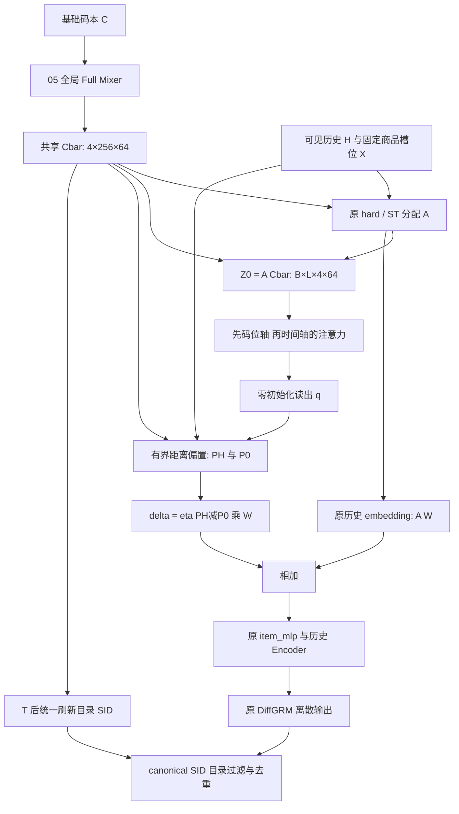

> 2026-10-26退役说明：本文属于旧的单目标历史侧交互研究，不能作为OneRec请求级列表生成的当前实现或执行方案。相关代码、模型和恢复包已按用户要求删除；历史结果保留。当前方案见 docs/research/onerec_listwise/PLAN_20261026.md。

# 首选设计：共享码本上的 session 条件路由

> 2026-10-24更新：本文保留的是旧概率路由草案，不是当前执行配方。阶段08改用直接64→256残差、独立双轴MHA和三臂对照，见[当前实现说明](../../../experiments/08_session_codeword/README.md)。不要把本文旧参数、原型计时或CPU通过项当作阶段08实现的结果。

日期：2026-10-23。状态：**设计与合成 CPU 原型通过；尚未接入生产模型，尚无推荐效果结果。**

## 1. 本轮究竟要改变什么

保留05的全局码本、离散SID、交替联合训练和DiffGRM输出。新增模块读取当前可见历史，先在**真实64维码字**上做交互，再对历史进入推荐器时的码位表示作小幅修正。

首选是一轮双轴交互：先在同一历史商品的4个码位之间交互，再沿历史时间交互。备选是将全部历史码位展平做一次完整注意力。loop暂作为第二步消融，而非首版必备。

“session”暂指原Beauty下一商品任务的一段可见历史前缀，不重新按时间间隔切会话，不改变数据划分。输出目标仍是同一目录版本的 `SID(i)`，不是 `SID(i|H)`。

这准确说是**session条件的历史码字路由**，不是为每个session重新训练全局码本，也不是已经完成的上下文相关商品量化器。它是对05的保守扩展；若学长要求连目标商品SID都随历史变化，需要另行设计动态目录，不能把下面方案说成已解决那个问题。

## 2. 当前接口与新增位置

05有两类不同向量：

| 记号 | 形状 | 作用 |
|---|---|---|
| `X_i` | `[4,64]` | 固定OPQ商品槽位，来自已有文本/预处理资产 |
| `C, Cbar=Mixer(C)` | `[4,256,64]` | 物理量化码本、05全局Full Mixer的有效输出 |
| `W` | `[4,256,256]` | 独立的推荐器SID embedding/输出表，不是C |
| `A` | `[B,L,4,256]` | R/推理为hard one-hot；T为原DIGER的hard-forward/soft-backward分配 |

当前是 `A@W → concat → item_mlp → 历史Encoder → 原生4步离散输出`。已有历史Encoder已经跨商品建模；新假设不是“第一次给模型看历史”，而是**在4个码位被压成一个item之前，让05的量化几何也接收当前历史条件**。



图中W参与原读出和残差读出，但**不作为64维交互块的输入**。没有未知下一商品进入历史分支；T中原有target-ST监督路径仍按05处理。

## 3. 首选模块的具体计算

设 `B=batch, L≤50, M=4, K=256, d=64, E=256`，PAD另行mask。

1. 取共享有效码本和历史分配，构造 `Z0=A@Cbar`，形状 `[B,L,M,d]`。加入历史位置向量和book身份向量；不对码字整数编号施加相邻关系。
2. 先把 `[B,L,M,d]` 重排成 `[B*L,M,d]`，做码位轴Pre-LN残差注意力；再重排成 `[B*M,L,d]`，做时间轴Pre-LN残差注意力。恢复形状后做一次Pre-LN FFN（hidden=128）。
3. 首版两个轴**共享同一个MHA和LayerNorm参数**，以便和full参照保持参数数目一致。正式的no-context参照也执行相同两次MHA，但时间轴仅能看同位置自身；它与首选只改变跨商品可见性。这是本项目的受控简化，不是Axial论文原配置复现，也不保证共享优于两套参数。
4. `q=Linear_zero(LN(Z1))`，形状 `[B,L,M,64]`。零初始化的只有最后读出矩阵；`eta=0.1, gamma=1`固定非零，避免双重零初始化堵住梯度。
5. 从固定槽位和当前码本计算确定性基准logits：

\[
a_{blmk}=-\|X_{H_{bl},m}-\bar C_{mk}\|^2/0.1,
\quad b_{blmk}=\gamma\tanh\left(q_{blm}^{\top}\mathrm{normalize}(\bar C_{mk})/\sqrt{64}\right).
\]

\[
P_0=\mathrm{softmax}(a),\quad P_H=\mathrm{softmax}(a+b),\quad
\Delta E_{blm}=\eta\sum_k(P_{H,blmk}-P_{0,blmk})W_{mk},
\quad E_{hist}=A W+\Delta E.
\]

`PH`和`P0`是概率，差值是**有符号、和为零的残差权重**，不是新的hard SID，也不保证 `A+eta(PH-P0)` 非负。不得把它称为新的离散编码概率。只让它生成历史embedding修正，目标标签和目录仍沿用canonical SID。

同一头在R/T/推理使用相同确定性基准a，不给新分支额外抽Gumbel。T原有A仍保留05既定的history/target独立Gumbel与ST。

新增距离a、C归一化、q与C点积、softmax、概率相减及W残差读出显式使用FP32；MHA/FFN可随R采用BF16，T采用FP32。原型另保留FP64供连续数值梯度检查。CPU BF16检查确认概率/残差为FP32且反向有限，但未覆盖真实CUDA/OCN。相加应在FP32完成，进入原线性层时再遵守统一autocast，不能先把很小的PH−P0舍入为BF16零。

初始q严格为零，因此 `PH=P0, delta=0`，前向与旧模型相同。第一批主要训练输出读出头，核心F的零梯度是预期；读出非零后梯度才进入F。不能以“第一次F核心梯度为0”判为失效，也不能以“非零梯度”判为推荐有效。

`b∈[-1,1]`限制偏移，但若实际a已很尖锐，路由变化仍可能很小。真实数据接入时必须记录a的尺度、熵、`||delta||/||AW||`和梯度；CPU合成张量没有替我们确定这个超参的合理性。不同OPQ子空间也不天然坐标对齐，book标签与可学习投影是否足够，是需要通过对照检验的假设。

## 4. 可见性、padding与loop

时间轴和full参照统一使用 `time(key)≤time(query)` 的因果可见性；同一商品4码位互相可见。最终预测下一商品时，最后一个有效位置已可访问全部合法前缀。选因果方式便于保持前缀语义；原Encoder是否双向不改变“输入只有目标前历史”的要求。

每一步屏蔽PAD的key和输出；对没有任何可见key的PAD query单独开放dummy key并丢弃其输出，避免全屏蔽softmax的NaN及反向问题。不同batch样本不混在同一次注意力序列中。

loop候选为 `Z^(r+1)=F_theta(Z^r,mask)`；重复使用同一参数，不能每轮重新输入Z0。首选r=1；待单轮有信号后比较r=2。原型不实现ACT、自适应停止或逐轮增加位置编码，不称完整Universal Transformer复现。loop不改变原生4步SID生成，通常增加历史编码计算。

## 5. 联合训练的参数与梯度归属

| 阶段 | 更新参数 | 冻结参数 | 对输入梯度与状态的要求 |
|---|---|---|---|
| R推荐器 | 原推荐器、W、新F及读出头 | C、05全局Mixer | Cbar用冻结cache；hard目录；训练新F |
| T Tokenizer | C、05全局Mixer | 原推荐器、W、新F | F参数冻结但计算图保留，梯度经新残差和旧ST路径回C；使用live Cbar |
| 验证/推理 | 无 | 全部 | R相同hard目录与确定性路由；eval模式；不更新全局buffer |

这是交替联合优化，不是固定编码训练。与05不同的是**新增session模块归R**，而原全局Mixer仍归T。理由是它主要处理请求内状态，且R有3640次更新，T只有60次；把新模块也全归T会成为另一种优化配方，需要单独比较，不能混写为当前设计。

T继续用原配方：推荐反馈1、重构1、balance0.01、anchor0.01，两侧SIA=0；不增加新的辅助目标。真实T中的target-ST、损失拆分和Gumbel不能被合成原型的简化hard-label CE替代。

每个T阶段后继续按共享Cbar刷新全目录SID及正反映射。“固定目标SID”仅表示**同一目录版本不随H变化**，并非35轮永不变。checkpoint必须同时保存C/Mixer、W、F、hard_codes、目录身份、优化器/调度/RNG与r等超参。阶段切换或恢复后要使冻结cache失效。

## 6. 推理到商品的闭环

1. 读取该checkpoint配套的全局SID目录，历史商品查canonical hard SID。
2. 用05共享码本、固定商品槽位和可见历史计算一次路由；经过原历史Encoder得到encoder_hidden。**不得每个beam候选重复计算F。**
3. 原confidence解码生成4位SID，目标输出W及训练标签协议不改。
4. 走当前代码实际的完整SID目录过滤、去重和不足候选处理。当前confidence路径没有启用trie前缀约束，不能写成“trie天然保证合法”。
5. 碰撞仍然存在：一个SID可能对应多个item。主指标保留SID-level并报告碰撞，不能把SID命中直接解释成唯一item命中。

**当前生产接口仍有一处必须改的历史依赖：**`prepare_joint_batch:611-615`无条件要求`target_item_id`，`forward(return_loss=False)`也会调用它。这不表示历史Encoder读取了目标，但意味着现有joint封装还不是可直接无标签服务的API。集成时拆成history-only准备和监督label准备；generate仅给H即可运行，evaluation单独构造labels。验收必须移除或置换target后检查encoder_hidden与生成结果不变。本次未改生产函数，也未声称真实无target服务已通过。

由此无需针对每个H重新编码全目录，也无需事先知道目标商品。代价是增加历史端计算，**没有解决少步生成或原生beam时延问题**。如果只提高质量但显著拖慢推理，仍需按质量—成本权衡决定是否继续。

## 7. 拟接入的实际文件（本轮未修改）

| 位置 | 后续最小改动 |
|---|---|
| 新 `external/DiffGRM/genrec/models/DIFF_GRM/session_codeword_routing.py` | 落地F、三种连接模式、r、mask与诊断；不读取target |
| `joint_cross_pse.py` | 统一返回history的live/frozen Cbar与FP32确定性距离logits；T避免错误detach，R/eval避免重复全局Mixer |
| `model.py:602`、`:949`附近 | 在R/T/eval取得原 `A@W` 后调用同一残差接口，再送item_mlp；保留原target-ST路径 |
| `model.py:522-566` | F挂在非alignment前缀下，纳入R优化器和phase切换；T冻结参数但保留autograd |
| `model.py:602-668`及generate入口 | 拆分history-only准备与target监督准备，去掉生成对target_item_id的无条件要求；标签置换不影响历史和预测 |
| 新独立runner与配置 | 复用05long协议但增加新前缀初态、冻结、保存恢复审计；共有模型权重/RNG不得被F构造扰动 |
| 评估与checkpoint | encoder_hidden只构造一次；配套SID目录；beam/唯一候选覆盖与碰撞报告 |

原代码证据、行号与版本见 [CODE_AUDIT.md](evidence/CODE_AUDIT.md)。根HEAD为`037876c`，DiffGRM HEAD为`1c87925`；绝不直接覆盖其他任务未提交的改动。

## 8. 本次CPU验证的实际范围

使用已有 `.runtime/continuous_env/Scripts/python.exe`，Python3.12.14、Torch2.6.0+cpu、1线程。没有新建/升级环境，没有加载大模型权重，没有构建优化器或step，没有申请GPU。

执行：

```powershell
& '.\.runtime\continuous_env\Scripts\python.exe' -B 'docs/research/session_wise_codebook/prototypes/verify_cpu.py'
& '.\.runtime\continuous_env\Scripts\python.exe' -B 'docs/research/session_wise_codebook/prototypes/benchmark_cpu.py'
```

[9/9检查收据](evidence/CPU_VERIFICATION.json)覆盖：真实05自定义ST；四种模式/两种轮数/三阶段的零初始化恒等；固定anchor商品时其他历史引起变化且item-only/no-context不变；padding/全PAD的前向、输入及参数反向有限；因果与跨样本隔离；R/T冻结与新分支单独回C的梯度；loop状态传递/参数共享；canonical目录碰撞及保存恢复；连续路由数值梯度检查。

诊断激活读出后，固定同一末尾商品，仅改变前面一件商品，其embedding最大差full约0.000259、axial约0.000599，item-only为0。T残差单独回C的梯度范数约0.000691。这些只是“路径确实存在”，**不是效应量或推荐提升**。

目录验证使用80件随机商品、79个唯一合成SID，保留1/2号商品碰撞，以小目录穷举输出50个唯一SID；不是生产beam，不证明真实@50已经可用。原型toy推荐头、T的确定性history-ST/hard CE也不是完整DiffGRM、target-ST、Gumbel、辅助损失或runner验收。

第一次检查发现数值零和阈值过紧（FP32约2.2e-8）及argsort参数写法不兼容，已修正；另主动修复leading PAD query的全mask风险。初次7/9收据保留为 [INITIAL_DIAGNOSTIC](evidence/CPU_VERIFICATION_INITIAL_DIAGNOSTIC.json)，没有把失败改写成首次通过。

## 9. 资源测量与局限

在`B4,L50,M4,K256,d64,E256`下，每种router均41,152个新增参数；两轮共享loop不增加参数。单独router CPU前向中位数如下（缓存C/分配/logits，warmup3、测15次）：

| 结构 | 毫秒/4条历史 |
|---|---:|
| item-only，1次MHA，CPU参考 | 4.778 |
| no-context，2次MHA，正式B1 | 6.613 |
| full，1轮 | 8.320 |
| axial，1轮 | 6.952 |
| full，2轮 | 14.257 |
| axial，2轮 | 10.805 |

原hard分配乘W的小张量读出约0.9–1ms，仅为读出参考，不是无router完整模型基线。原型 `bypass=True`仍计算router，**没有用它作计时基线**。全部原始样本与四分位见 [CPU_BENCHMARK.json](evidence/CPU_BENCHMARK.json)。

单轮每头注意力配对full为40,000、axial为10,800；后者有两次MHA投影，算上FFN的核心近似MAC分别11.67M与11.21M/样本。3.70倍配对差异不等于端到端加速。路由还包含K维点积、softmax与W读出；FP32单个 `[B,L,M,K]` 在B4约0.78MiB，训练会保留多个中间量和梯度。密集注意力score理论B4/4头full约2.44MiB、axial合计约0.66MiB，不是融合SDPA实测峰值显存。

因此选axial是**语义轴清楚、合成验证通过且本机增量计时较低**的工程取舍；真实H100吞吐、显存、完整延迟、是否多轮更稳及推荐收益均未验证。不能凭这次CPU结果承诺加速或涨点。
