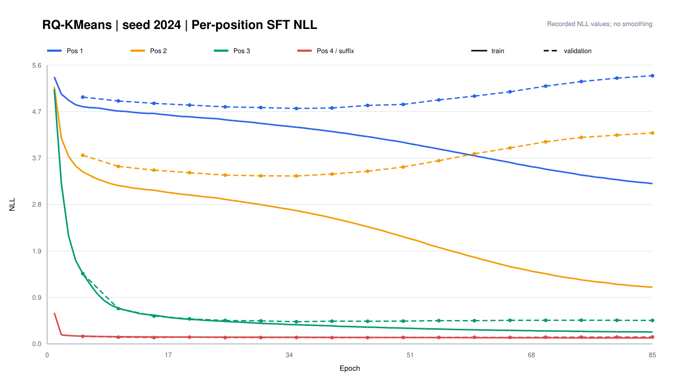
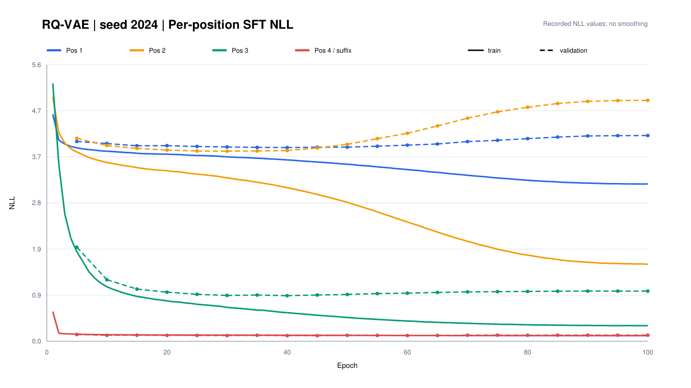
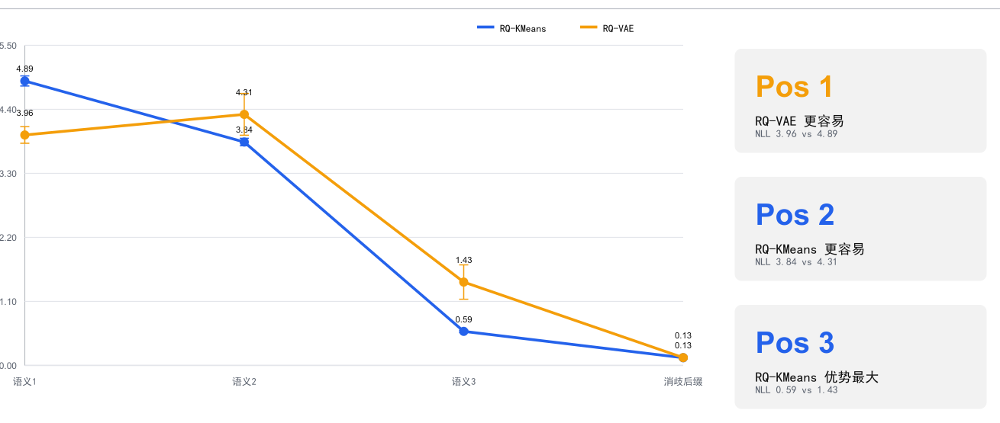
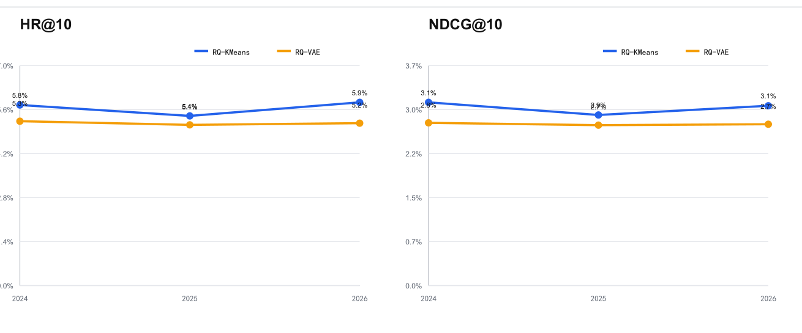
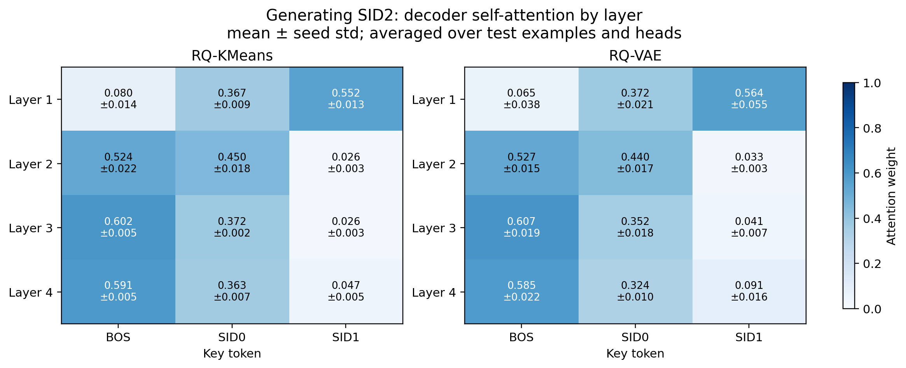

# 01｜AR 基线：RQ-KMeans 与 RQ-VAE（3×256）

本目录按“研究结论 + 原始证据 + 复现绑定”整理。旧说明保存在 [previous_README.md](reproducibility/previous_README.md)，原图、报告、运行目录和压缩包均保留。版本背景见 [HISTORY.md](HISTORY.md)。

## 1. 这一阶段想回答什么

固定 AR 推荐框架，比较 RQ-KMeans 与 RQ-VAE 生成的 SID，观察：

1. 不同语义位置是否有稳定的生成难度差异？
2. Tokenizer 的重构、邻域保持和碰撞情况，是否与推荐效果一致？

**当前结果：三个 seed 中，RQ-KMeans 的四项推荐指标均高于 RQ-VAE；RQ-VAE 的重构更好，但没有转化成推荐收益。逐位置难度分布也不同，不能只凭重构误差或某一位 Loss 判断 Tokenizer 优劣。**

这是 SFT 阶段的历史基线，不包含 RL。后续已完成 [02：AR 内部补充对照](../02_ar_capacity_ablation/README.md) 和 [03：DiffGRM Tokenizer 对照](../03_diffgrm_tokenizer_comparison/README.md)，不再把它们列作“待开始”。

## 2. 哪些实验、哪些设置保持一致

两种 Tokenizer 各跑 seed 2024、2025、2026，共 **6 次正式运行**。精确 run_id、checkpoint 与证据对应关系见 [runs.csv](runs.csv)；每个 seed 的结果见 [results.csv](results.csv)。

| 项目 | 设置 |
|---|---|
| 数据 | Amazon Reviews 2014 Beauty；22,363 个真实用户、12,101 个真实 item、198,502 次交互 |
| 划分 | Leave-one-out；训练用 sliding windows；train / val / test 为 105,668 / 22,363 / 22,363 |
| 共享输入 | 固定 sentence-t5-xl 物品向量，768 维 |
| SID | 3 位语义码，各 256 个码字；额外 1 位 collision suffix，大小 256 |
| Tokenizer 预处理 | RQ-KMeans：PCA32、whiten、归一化后残差量化；RQ-VAE：从共享原始向量学习 32 维 latent |
| Tokenizer 拟合 | catalog split；10% 物品用于验证；各运行绑定对应 seed |
| AR | 2 层 Encoder、4 层 Decoder、8 heads、hidden 256、FFN 1024；随机初始化下游模型 |
| 训练 | FP16；batch 64 × 梯度累积 8 = 有效 batch 512；LR 0.003；warmup ratio 0.05 |
| 其余训练项 | 最多 100 epochs；label smoothing 0.1；梯度裁剪 1.0 |
| 验证 / 选模 | 第 5 轮起每 5 轮验证，patience 6；存档配置指定验证 NDCG@10 选模 |
| 推荐评估 | beam 64、Top-10；严格 item-level；单目标下 HR = Recall |

“相同设置”指共享原始表征及下游主要超参，**不是两种 Tokenizer 的预处理和训练算法完全一致**。用户/item 计数不含 padding；日志中包含 padding 的计数可能各多 1。

历史完整 resolved config 未保存，上表依据存档配置与证据重建；不能据此声称恢复了历史运行的全部状态。

## 3. SFT 逐位置 NLL

这里画的是正确 token 的 **NLL**，不是包含 label smoothing 的优化 `loss`。原始 CSV 两列都保留，不互相替代。实线为 train、虚线为 val；位置 1～3 对应 SID0～SID2，位置 4 是 suffix。

另外两组 seed 的原图：[RQK 2025](report_assets/position_nll_rq_kmeans_seed2025.png)、[RQK 2026](report_assets/position_nll_rq_kmeans_seed2026.png)、[RQV 2025](report_assets/position_nll_rqvae_seed2025.png)、[RQV 2026](report_assets/position_nll_rqvae_seed2026.png)。

三个 seed 的总体形态相近：训练 NLL 下降，验证前部位置在中后期出现回升；SID2 和 suffix 通常比前部位置容易。这个现象描述的是**给定真实前缀时的预测难度**，不能直接等同于位置携带的语义信息量，也不能直接推出自由生成时的错误传播机制。

## 4. 测试集逐位置结果

以下均为各自最佳 checkpoint 的 teacher-forcing 诊断，报告三个 seed 的均值 ± 样本标准差。normalized NLL = NLL / ln(256)。

| Tokenizer | 位置 | NLL | Normalized NLL | Token accuracy |
|---|---|---:|---:|---:|
| RQ-KMeans | SID0 | 4.888 ± 0.087 | 0.881 ± 0.016 | 7.99% ± 0.69% |
| RQ-KMeans | SID1 | 3.838 ± 0.064 | 0.692 ± 0.012 | 15.40% ± 0.55% |
| RQ-KMeans | SID2 | 0.586 ± 0.021 | 0.106 ± 0.004 | 85.03% ± 0.86% |
| RQ-KMeans | Suffix | 0.133 ± 0.003 | 0.024 ± 0.001 | 98.19% ± 0.10% |
| RQ-VAE | SID0 | 3.960 ± 0.143 | 0.714 ± 0.026 | 10.53% ± 0.11% |
| RQ-VAE | SID1 | 4.314 ± 0.359 | 0.778 ± 0.065 | 10.90% ± 0.08% |
| RQ-VAE | SID2 | 1.433 ± 0.295 | 0.258 ± 0.053 | 61.33% ± 7.65% |
| RQ-VAE | Suffix | 0.135 ± 0.022 | 0.024 ± 0.004 | 98.31% ± 0.73% |

RQ-VAE 的 SID0 比 RQ-KMeans 容易，但 SID1、SID2 更难；差异不是所有位置统一升降。

原始证据还保留 Prefix accuracy：它统计本次 teacher-forcing 各位置预测的前缀联合正确率，**不是 beam search 的 item-level HR**，不应将两者混用。

## 5. 最终推荐结果

| 指标 | RQ-KMeans | RQ-VAE |
|---|---:|---:|
| HR@5 | **0.03618 ± 0.00194** | 0.03261 ± 0.00017 |
| HR@10 | **0.05689 ± 0.00230** | 0.05199 ± 0.00058 |
| NDCG@5 | **0.02352 ± 0.00111** | 0.02121 ± 0.00004 |
| NDCG@10 | **0.03020 ± 0.00111** | 0.02742 ± 0.00020 |

两组 legal@10 均接近 1、duplicate@10 均为 0；完整精度见 [results.csv](results.csv)，聚合见 [summary.csv](summary.csv)。

结论只适用于当前数据集、Tokenizer 配置与 AR 模型。三个 seed 上方向一致是支持性证据，但这里没有显著性检验，也不推广为“RQ-KMeans 总是优于 RQ-VAE”。

## 6. 必要的 Tokenizer 与 Attention 分析

### Tokenizer

几何指标来自固定原始 embedding 与离线重构向量，三个 seed 的均值 ± 样本标准差如下。重构误差沿用源文件 `reconstruction_mse_sum` 的统计定义，不能与其他实现中逐维平均的 MSE 直接比较。

| 指标 | RQ-KMeans | RQ-VAE |
|---|---:|---:|
| Reconstruction cosine | 0.91167 ± 0.00002 | **0.92735 ± 0.00171** |
| Reconstruction error（mse_sum） | 0.17667 ± 0.00004 | **0.14529 ± 0.00342** |
| Neighbor Recall@10 | **0.23880 ± 0.00123** | 0.13577 ± 0.01666 |
| 完整三位语义 SID 碰撞物品率 | 3.75% ± 0.14% | 4.02% ± 1.48% |
| SID0 / SID1 / SID2 利用率（均值） | 100.0% / 100.0% / 100.0% | 32.8% / 47.4% / 94.4% |

碰撞物品率 = 属于重复三元组的物品数 / 12,101，不是 `1 - unique SID数 / item数`。上述碰撞不含 suffix；suffix 用于把相同语义 SID 的物品区分开。利用率 100% 只代表每个码字至少用过一次，不代表使用均匀。

RQ-VAE 重构更好、邻域保持较弱且部分码本未充分使用；这些与下游结果一起报告，**目前不能确定其中哪一个造成了推荐差异**。

### Attention

使用最佳模型，在全部 22,363 个测试样本上 teacher forcing；记录 causal mask 后、dropout 前的 self-attention，每个 seed 内先平均样本和 8 个 head，再汇总三个 seed。

两种方法都呈现：Layer 1 更关注 SID1；Layer 2～4 更多关注 BOS 和 SID0。它是 decoder 使用前缀的描述性观察，不是 Tokenizer 质量指标，也不能单凭 attention 权重判定因果贡献。逐 head 图、逐 seed 碰撞明细仍保存在 [原补充分析](supplement/README.md)，作为历史证据查看。

## 7. 材料与复现边界

| 入口 | 用途 |
|---|---|
| [HISTORY.md](HISTORY.md) | 研究顺序、旧口径修正、与后续阶段关系 |
| [runs.csv](runs.csv) | 六次运行身份及原证据路径 |
| [results.csv](results.csv) / [summary.csv](summary.csv) | 每 seed 结果 / 均值与样本标准差 |
| `evidence/` | 原始 metadata、报告、位置诊断及相关证据副本 |
| `report_assets/`、`supplement/`、`pdf/` | 原图、历史补充与历史 PDF；均保留 |
| [reproducibility/README.md](reproducibility/README.md) | 配方、代码快照、资产 SHA256、校验与重跑说明 |

本次核心重放路径是：**固定历史 SID 与数据映射，随机初始化并重训 AR decoder**。它不是重新训练 RQ-VAE / RQ-KMeans，也不是从最终 AR 权重继续训练。重新拟合 Tokenizer 应另建实验，不能悄悄替换历史 SID。

历史运行没有完整代码 commit 与 resolved config 记录；现在建立的是可核验的源码与资产绑定，不是补造历史 commit。GPU smoke、完整重训和重新评估是否通过，以复现说明中的实际验收状态为准；整理完目录本身不等于 GPU 复现已经成功。权重与数据仍依赖锁定的迁移压缩包，不应只保留报告目录。
