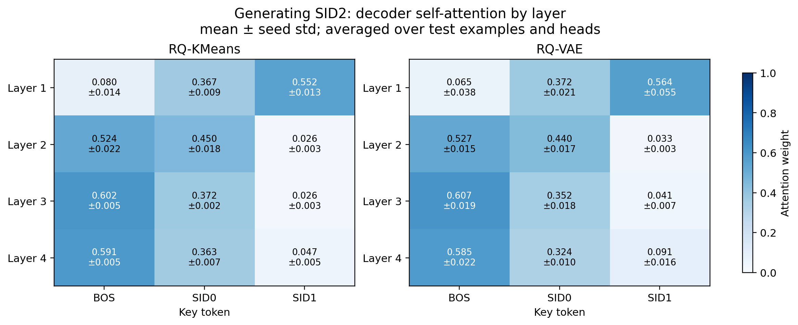
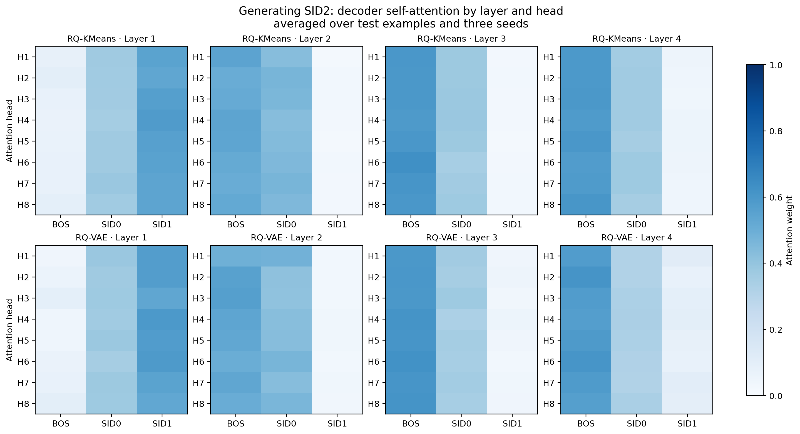

# AR 生成式推荐第一阶段补充结果

> **补充问题：**统计前三位 Semantic ID 的物品碰撞率，并观察 AR Decoder 在生成 `SID2` 时对 `BOS`、`SID0` 和 `SID1` 的 Self-Attention 分配。

## 1. 前三位 SID 的物品碰撞

这里的“前三位 SID”指完整的三元组 `(SID0, SID1, SID2)`。如果两个或更多物品具有相同的三元组，则这些物品均计入碰撞物品。

碰撞率定义为：

```text
碰撞物品率 = 属于重复三元组的物品数 / 物品总数
```

Beauty 数据集共包含 12,101 个物品。结果如下：

| Tokenizer | Seed | 唯一三元组数 | 碰撞物品数 | 碰撞物品率 | 碰撞组数 | 最大碰撞组 |
| --- | ---: | ---: | ---: | ---: | ---: | ---: |
| RQ-KMeans | 2024 | 11,864 | 443 | 3.66% | 206 | 5 |
| RQ-KMeans | 2025 | 11,865 | 446 | 3.69% | 210 | 4 |
| RQ-KMeans | 2026 | 11,845 | 473 | 3.91% | 217 | 9 |
| RQ-VAE | 2024 | 11,923 | 345 | 2.85% | 167 | 5 |
| RQ-VAE | 2025 | 11,879 | 427 | 3.53% | 205 | 4 |
| RQ-VAE | 2026 | 11,744 | 689 | 5.69% | 332 | 5 |


## 2. SID2 的 Decoder Self-Attention

### 2.1 统计方式

- 使用两种 Tokenizer 各自三个 seed 的最佳 AR checkpoint；
- 在测试集上进行 teacher forcing，每个 seed 包含 22,363 个样本；
- AR Decoder 包含4层、每层8个 attention head；
- 记录 causal mask 之后、attention dropout 之前的 Self-Attention softmax 权重；
- 预测 `SID2` 时，可见的 key token 为 `BOS`、`SID0`、`SID1`；
- 每个 seed 内先对测试样本和8个 head 求平均，再汇报三个 seed 的均值与标准差。

检查结果中，最大 attention 行和误差为 `1.23e-7`，对未来 token 的 attention 为 `0`。

### 2.2 分层结果

| Tokenizer | Decoder layer | BOS | SID0 | SID1 |
| --- | ---: | ---: | ---: | ---: |
| RQ-KMeans | 1 | 0.080 ± 0.014 | 0.367 ± 0.009 | 0.552 ± 0.013 |
| RQ-KMeans | 2 | 0.524 ± 0.022 | 0.450 ± 0.018 | 0.026 ± 0.003 |
| RQ-KMeans | 3 | 0.602 ± 0.005 | 0.372 ± 0.002 | 0.026 ± 0.003 |
| RQ-KMeans | 4 | 0.591 ± 0.005 | 0.363 ± 0.007 | 0.047 ± 0.005 |
| RQ-VAE | 1 | 0.065 ± 0.038 | 0.372 ± 0.021 | 0.564 ± 0.055 |
| RQ-VAE | 2 | 0.527 ± 0.015 | 0.440 ± 0.017 | 0.033 ± 0.003 |
| RQ-VAE | 3 | 0.607 ± 0.019 | 0.352 ± 0.018 | 0.041 ± 0.007 |
| RQ-VAE | 4 | 0.585 ± 0.022 | 0.324 ± 0.010 | 0.091 ± 0.016 |



从原始 attention 权重可以直接看到：

- 第1层主要关注最近的 `SID1`，RQ-KMeans 和 RQ-VAE 分别为 0.552 和 0.564；
- 第2至第4层主要关注 `BOS` 和 `SID0`，对 `SID1` 的平均权重明显下降；
- 两种 Tokenizer 的整体分层模式相似


## 3. 逐 Head 结果（附录）

下图保留每层8个 attention head 的平均结果，用于检查分层均值是否掩盖 head 之间的差异

