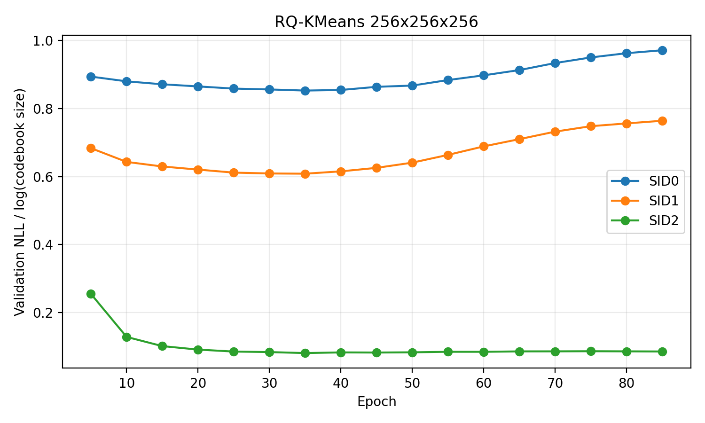
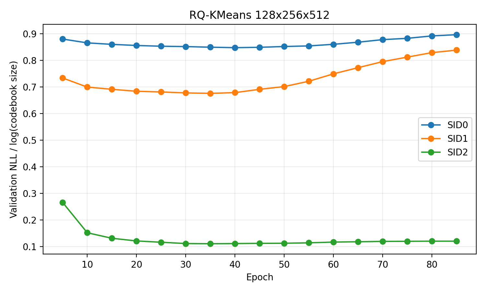
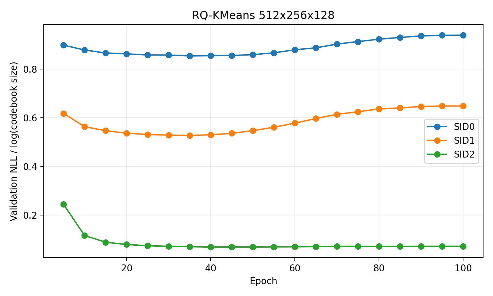
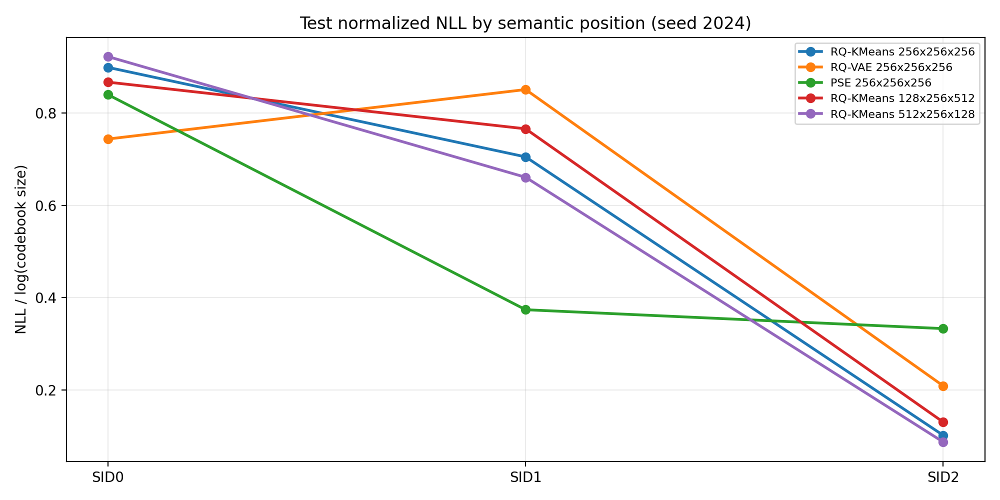
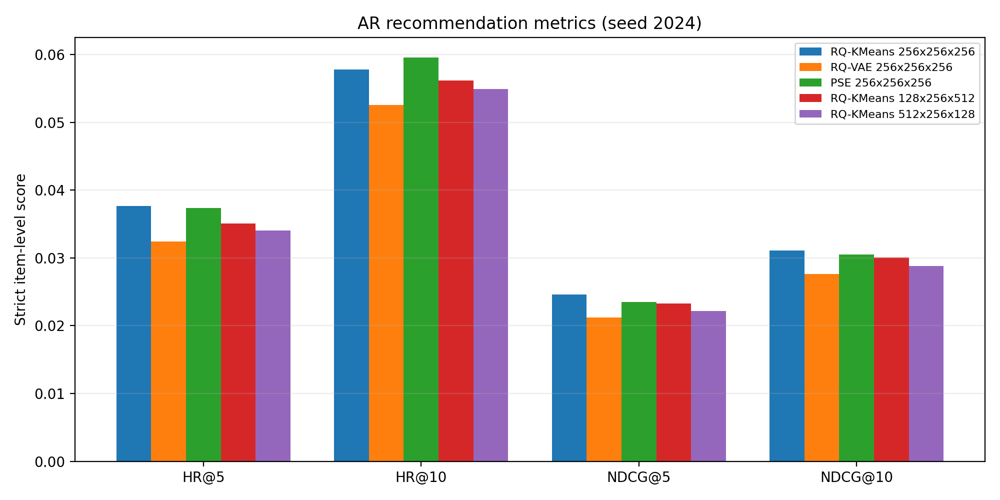
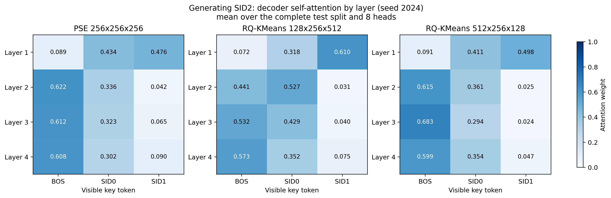

# 02｜AR 内部对照：补充 PSE 与码本容量分配

本阶段承接 [01：AR 3×256 基线](../01_ar_baseline_3x256/README.md)。旧说明保存在 [previous_README.md](reproducibility/previous_README.md)，原图、运行文件和压缩包均保留。版本对应见 [HISTORY.md](HISTORY.md)。

## 1. 这一阶段想回答什么

这里有两条问题，不混在一起解释：

1. 固定 3×256，PSE 与已有的 RQ-KMeans / RQ-VAE 在 AR 上有什么差异？
2. 固定 RQ-KMeans 和 24 bit 名义组合容量，改变各位置码本大小，能否改变逐位置预测难度并改善推荐？

**当前结果：容量分配确实改变了逐位置 NLL，但两个非均匀布局都未超过均匀 RQ-KMeans；PSE 的 HR@10 较高，而均匀 RQ-KMeans 的 NDCG@10 较高，没有单一方法全面领先。以上新增对照均只有 seed 2024。**

## 2. 哪几组实验、控制了哪些设置

| 方法 / 布局 | 研究角色 | 运行来源 |
|---|---|---|
| PSE 256×256×256 | 补充 Tokenizer 算法对照 | 本阶段新增，seed 2024 |
| RQ-KMeans 128×256×512 | 更多名义容量分给后部位置 | 本阶段新增，seed 2024 |
| RQ-KMeans 256×256×256 | 均匀容量基线 | **复用 01 的 seed 2024，不是新跑** |
| RQ-KMeans 512×256×128 | 更多名义容量分给前部位置 | 本阶段新增，seed 2024 |
| RQ-VAE 256×256×256 | 学习式 Tokenizer 基线 | **复用 01 的 seed 2024，不是新跑** |

| 项目 | 设置 |
|---|---|
| 数据 / 共享输入 | Beauty，12,101 个真实 item；固定 sentence-t5-xl 768 维原始向量 |
| 数据划分 | 与 01 相同；train / val / test = 105,668 / 22,363 / 22,363 |
| SID | 3 位语义码 + 1 位大小 256 的碰撞 suffix |
| 下游骨干 | 2 层 Encoder、4 层 Decoder、8 heads、hidden 256、FFN 1024；随机初始化 |
| 训练 | FP16；batch 64 × 累积 8；LR 0.003；warmup ratio 0.05；label smoothing 0.1 |
| 验证 / 选模 | 每 5 轮验证，最多 100 轮，patience 6；存档配置指定验证 NDCG@10 |
| 推荐评估 | beam 64；严格 item-level，输出 Top-10；单目标 HR = Recall |
| 主表 seed | 全部 2024；不将两条旧基线的三个 seed 均值混入本表 |

**比较边界：**

- 五组共享原始 embedding，但 PSE 使用 raw768 + OPQ/PQ；RQ-KMeans 使用 PCA32、whiten、归一化；RQ-VAE 使用学习到的 32 维 latent。不能称为所有预处理完全一致。
- 三种 RQ-KMeans 的组合空间均为 2²⁴，但码字总数并不相同：均匀布局为 768，非均匀布局为 896；含 suffix 与特殊 token 的词表分别为 1,027 和 1,155。因此嵌入/输出部分规模也会变化，这不是参数量完全一致的单变量实验。
- 历史完整 resolved config 未保存；选模协议依据归档配置与 trainer 行为核对。日志打印 weighted score 不代表按它选模，旧 README 的该表述已修正。

## 3. SFT 逐位置 NLL

图中是验证阶段的 **normalized NLL = NLL / ln(Kᵢ)**，不是 label-smoothed 优化 loss。SID0～SID2 分别对应原始 CSV 的 position 1～3；suffix 单列，不当作第 4 个语义位置。

[PSE 曲线](report_assets/val_position_curve_pse_256x256x256.png)与[RQ-VAE 曲线](report_assets/val_position_curve_rqvae_256x256x256.png)一并保留。图中不额外平滑，也不把不同词表大小的原始 NLL 直接当作同等难度。

主要观察是：容量前移后，SID0 更难、SID2 更容易；容量后移则相反。它说明**给定真实前缀时的位置预测难度可被布局改变**，不等于已经测出了各位置的语义信息量。

## 4. 测试集逐位置结果

以下使用各自验证集选中的最佳 checkpoint，均为 seed 2024 的 teacher-forcing 结果。

### NLL

| 方法 / 布局 | SID0 | SID1 | SID2 | Suffix |
|---|---:|---:|---:|---:|
| PSE 256×256×256 | 4.654 | 2.074 | 1.848 | 0.612 |
| RQ-KMeans 128×256×512 | 4.204 | 4.244 | 0.817 | 0.148 |
| RQ-KMeans 256×256×256 | 4.982 | 3.908 | 0.568 | 0.133 |
| RQ-KMeans 512×256×128 | 5.750 | 3.663 | 0.427 | 0.121 |
| RQ-VAE 256×256×256 | 4.122 | 4.716 | 1.161 | 0.121 |

### Normalized NLL

| 方法 / 布局 | SID0 | SID1 | SID2 | Suffix |
|---|---:|---:|---:|---:|
| PSE 256×256×256 | 0.839 | 0.374 | 0.333 | 0.110 |
| RQ-KMeans 128×256×512 | 0.866 | 0.765 | 0.131 | 0.027 |
| RQ-KMeans 256×256×256 | 0.898 | 0.705 | 0.102 | 0.024 |
| RQ-KMeans 512×256×128 | 0.922 | 0.661 | 0.088 | 0.022 |
| RQ-VAE 256×256×256 | 0.743 | 0.850 | 0.209 | 0.022 |

### Token accuracy

| 方法 / 布局 | SID0 | SID1 | SID2 | Suffix |
|---|---:|---:|---:|---:|
| PSE 256×256×256 | 9.43% | 41.25% | 48.95% | 81.85% |
| RQ-KMeans 128×256×512 | 10.57% | 11.85% | 78.18% | 97.52% |
| RQ-KMeans 256×256×256 | 7.25% | 15.89% | 85.71% | 98.09% |
| RQ-KMeans 512×256×128 | 5.28% | 19.80% | 90.08% | 98.67% |
| RQ-VAE 256×256×256 | 10.44% | 10.86% | 68.86% | 98.87% |

PSE 的 SID1、SID2 NLL 较低，但 suffix 更难；因此不能只挑前三位评价整个 item 是否容易生成。这些诊断与下节自由生成后的推荐指标也不是同一口径。

## 5. 最终推荐结果

表中是严格 item-level 测试结果，小数形式；详细结果见 [results.csv](results.csv)。五组无跨 seed 标准差，不能视为稳定排名。

| 方法 / 布局 | HR@5 | HR@10 | NDCG@5 | NDCG@10 |
|---|---:|---:|---:|---:|
| PSE 256×256×256 | 0.03734 | **0.05956** | 0.02347 | 0.03053 |
| RQ-KMeans 128×256×512 | 0.03510 | 0.05621 | 0.02327 | 0.03003 |
| RQ-KMeans 256×256×256 | **0.03765** | 0.05777 | **0.02463** | **0.03111** |
| RQ-KMeans 512×256×128 | 0.03403 | 0.05491 | 0.02216 | 0.02883 |
| RQ-VAE 256×256×256 | 0.03242 | 0.05259 | 0.02118 | 0.02763 |

五组 duplicate@10 均为 0，legal@10 均接近 1。PSE、两组 RQK 中的均匀与 128×256×512 为 1；512×256×128 为 0.999835，RQ-VAE 为 0.999763。

相对均匀 RQ-KMeans，128×256×512 的 HR@10 / NDCG@10 分别下降约 2.71% / 3.44%；512×256×128 分别下降约 4.95% / 7.31%。当前布局调整改变了逐位置难度，但没有带来对应推荐收益。

## 6. 必要的 Tokenizer 与 Attention 分析

### 前缀碰撞

碰撞物品率 = 与其他 item 共享该前缀的物品数 / 12,101。前 3 位是完整语义 SID，不含 suffix；它不是 `1 - unique SID数 / item数`。

| 方法 / 布局 | 前 1 位 | 前 2 位 | 前 3 位 | 最大完整语义 SID 碰撞组 |
|---|---:|---:|---:|---:|
| PSE 256×256×256 | 99.97% | 86.03% | 31.32% | 51 |
| RQ-KMeans 128×256×512 | 100.00% | 49.23% | 5.56% | 9 |
| RQ-KMeans 256×256×256 | 100.00% | 32.00% | 3.66% | 5 |
| RQ-KMeans 512×256×128 | 100.00% | 20.48% | 2.74% | 4 |
| RQ-VAE 256×256×256 | 100.00% | 66.16% | 2.85% | 5 |

PSE 的碰撞率与 suffix NLL 都较高，说明需要用 suffix 区分更多 item。512×256×128 碰撞最低，却没有最好的推荐结果；**低碰撞不能单独保证推荐提升**。

### 码本利用率与分布

| 方法 / 布局 | SID0 / SID1 / SID2 利用率 | SID0 / SID1 / SID2 归一化熵 |
|---|---|---|
| PSE 256×256×256 | 100% / 100% / 100% | 0.954 / 0.947 / 0.957 |
| RQ-KMeans 128×256×512 | 100% / 100% / 100% | 0.987 / 0.985 / 0.962 |
| RQ-KMeans 256×256×256 | 100% / 100% / 100% | 0.987 / 0.984 / 0.976 |
| RQ-KMeans 512×256×128 | 100% / 100% / 100% | 0.985 / 0.980 / 0.985 |
| RQ-VAE 256×256×256 | 37.1% / 64.1% / 95.7% | 0.808 / 0.904 / 0.984 |

利用率 100% 不代表均匀；以上是本次固定目录和 seed 的实际结果，不是这些算法必然具有的性质。

### Attention（辅助观察）

统计使用最佳模型、完整 test 集、teacher forcing、4 层 × 8 heads，记录 causal mask 后、dropout 前的权重。新增三组延续了“浅层较关注 SID1，后续层更多关注 BOS / SID0”的总体模式。

[两条旧基线的原 attention 图](report_assets/sid2_attention_by_layer_baselines.png)是 **3 seeds 均值 ± 标准差**；新增图只有 seed 2024，不能把两张图称为五组同 seed 的严格强度比较。原始逐 seed CSV 保留用于后续统一汇总。Attention 仅作描述，不能单独证明推荐差异由某一条信息依赖造成。

## 7. 材料与复现边界

- [runs.csv](runs.csv)：运行、证据和配置索引；标明新增实验与复用基线。
- [results.csv](results.csv) / [summary.csv](summary.csv)：逐 seed 指标与汇总；主文固定比较 seed 2024。
- `evidence/`：原始 metadata、位置指标、Tokenizer 和 attention 等证据副本。
- `report_assets/`：既有报告图，全部保留。
- [reproducibility/README.md](reproducibility/README.md)：代码、资产 SHA256、重放配方与验收步骤。

本次核心重放是**固定历史 SID / 数据映射，随机初始化并重训 AR decoder**；不是重新拟合 Tokenizer。尤其 PSE/RQK 的缓存缺失可能触发重建，运行前必须通过绑定文件校验。

历史代码 commit 和完整 resolved config 未记录，不能用当前源码快照补造。GPU smoke / 正式重训 / 独立评估仍以实际验收结果为准，整理目录不等于全部重跑成功。原迁移压缩包包含数据、Tokenizer 资产和最终权重，不能只保留这个报告目录。
