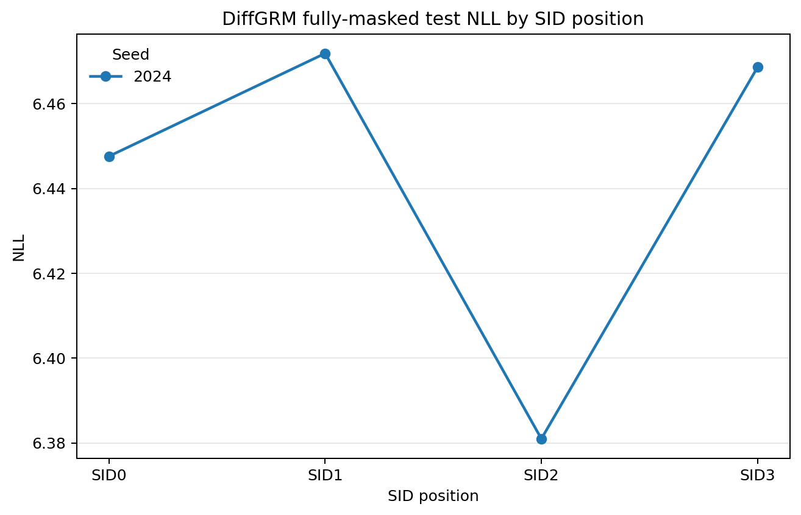
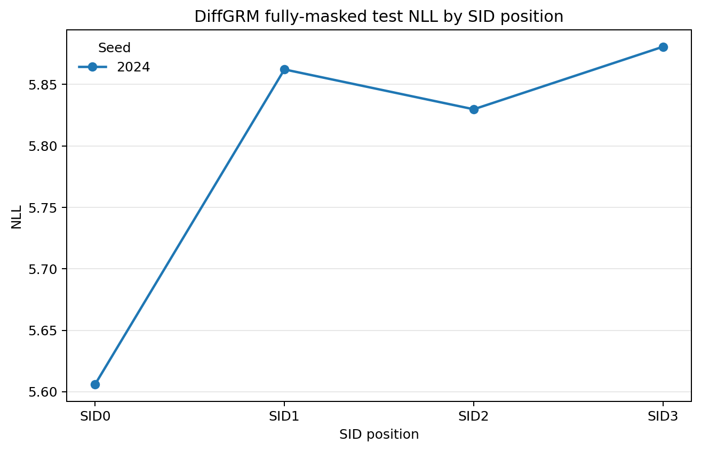
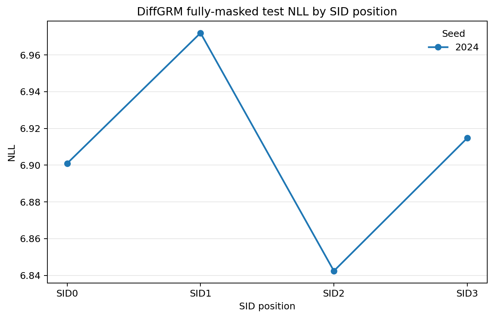
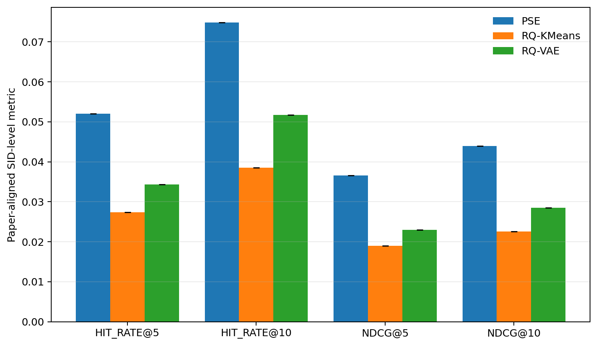
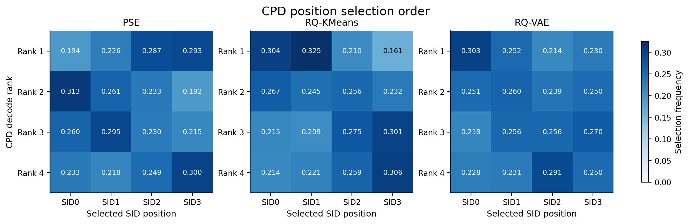
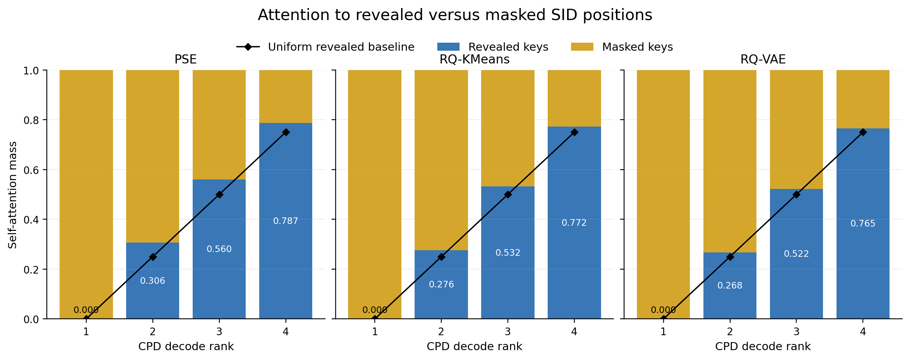
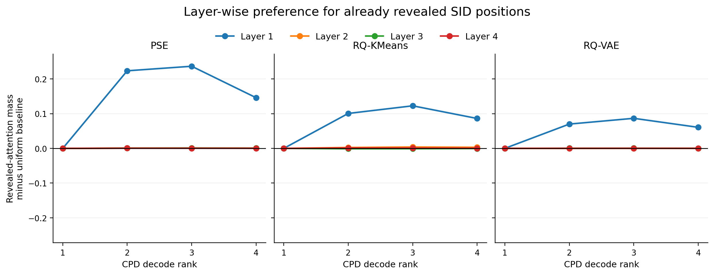

# 03｜DiffGRM 与三种 Tokenizer 的内部对照

本目录按“研究结论 + 原始证据 + 可校验复现”组织。整理日期：2026-10-07。原报告完整保存在 [previous_README.md](reproducibility/previous_README.md)，原始文件未删除或移动。

## 1. 研究问题与当前结论

**在相同 DiffGRM 设置下，只替换商品的 Semantic ID 编码方法，会怎样改变逐位置生成难度、解码顺序和推荐结果？**

比较 PSE、RQ-KMeans、RQ-VAE，先观察 Tokenizer 与扩散式 Decoder 是否存在适配差异，为后面的码本交互实验建立基线。

**当前观察：PSE 的 SID-level 推荐指标最高，但完整 SID 碰撞率也明显更高；逐位置 NLL、码本覆盖率和最终推荐指标没有简单的一一对应关系。** 这不是“PSE 在严格商品推荐上已经胜出”的结论，也不能据此证明某种 Attention 模式带来收益。

## 2. 实验身份与设置

| 方法 | 正式 run_id | Decoder seed | 最佳 epoch |
|---|---|---:|---:|
| PSE | diff_formal_pse_4x256_repo_repro_v6_bf16 | 2024 | 45 |
| RQ-KMeans | diff_formal_rqkmeans_4x256_v6_bf16 | 2024 | 55 |
| RQ-VAE | diff_formal_rqvae_4x256_v6_bf16 | 2024 | 55 |

PSE 绑定的是 **Aug-11-2026_14-09-45 的 v6 运行**，不是 Aug-11_10-58-33 的 v5。两个版本的最终测试数值相同，不代表训练记录、权重身份和耗时可以互换。详见 [runs.csv](runs.csv) 与 [版本演进](HISTORY.md)。

| 项目 | 三组共用设置 |
|---|---|
| 数据 | Amazon Reviews 2014 Beauty；12,101 个商品；测试集 22,363 个样本；leave-one-out |
| 物品表征 | Sentence-T5-base，PCA whiten 到 256 维，再归一化 |
| SID | 4 个语义位置，每位 256 个码字；不加 AR 阶段的碰撞后缀 |
| Decoder 训练起点 | 冻结本组历史 SID，随机初始化 DiffGRM；不是联合训练或 checkpoint continuation |
| 网络 | Encoder 1 层；Decoder 4 层、4 heads；hidden 256，FFN 1024 |
| 训练 | batch 64，梯度累积 16，有效基础 batch 1024；BF16，梯度裁剪 1.0 |
| 优化 | LR 0.01，weight decay 0；warmup 10,000 optimizer updates；最多 200 epochs；label smoothing 0.2 |
| 验证 / 早停 | epoch 20 起每 5 轮验证；warmup 结束后才累计早停 patience 5 |
| 选模 | 验证集 0.8 × NDCG@10 + 0.2 × HR@10 最大的 checkpoint |
| 解码 / 评估 | val beam 32，test beam 256，Top-5/10；SID-level；单目标下 HR = Recall |

本阶段采用作者仓库 Beauty 设置，而不是声称论文正文每项参数均完全一致：论文正文与仓库在最大 epochs、label smoothing 等处存在差异，已在 metadata 中记录。

| Tokenizer | 本组实现 |
|---|---|
| PSE | OPQ4,IVF1,PQ4x8；原始 OPQ/PQ 码本经过离线拟合，下游训练期间固定 |
| RQ-KMeans | 共享 PCA256 输入上的 4 阶残差 KMeans；每阶 256；Tokenizer seed 2024，20 次迭代 |
| RQ-VAE | 共享 PCA256 输入；4×256，latent dim 32；离线选中 step 3,000，再冻结 SID 训练 DiffGRM |

RQ-VAE 的离线训练上限为 60,000 steps，10,891 商品训练、1,210 商品验证。三组的下游配置一致，不代表 Tokenizer 的算法或训练过程一致；这些差异正是本阶段要比较的对象。

## 3. 逐位置训练结果

以下取各组**验证集最佳 epoch** 的 train OCN 诊断，列的是 NLL，不是含 label smoothing 的总训练 loss。每个位置只在被 mask 的 view 中计入，位置间 mask rate 不同。

| 方法 | SID0 NLL | SID1 NLL | SID2 NLL | SID3 NLL |
|---|---:|---:|---:|---:|
| PSE | 3.108 | 3.238 | 3.275 | 3.377 |
| RQ-KMeans | 3.682 | 3.664 | 3.622 | 3.603 |
| RQ-VAE | 3.365 | 3.692 | 3.739 | 3.789 |

PSE、RQ-VAE 在这组训练诊断中后部位置的 NLL 较高；RQ-KMeans 四个位置更接近。**这不是 AR teacher-forcing 条件下的逐位置 SFT loss，不能直接据此比较两类模型的信息容量结构。**

## 4. 测试集逐位置结果

最佳 checkpoint 在统一 fully-masked 条件下测试，即开始时四个目标 SID 都没有揭示。CSV 中 test 的 epoch 0 是独立测试标记，并非随机初始化模型。

| 方法 | 指标 | SID0 | SID1 | SID2 | SID3 |
|---|---|---:|---:|---:|---:|
| PSE | NLL | 6.448 | 6.472 | 6.381 | 6.469 |
| PSE | Accuracy | 0.53% | 0.53% | 0.76% | 0.54% |
| RQ-KMeans | NLL | 5.606 | 5.862 | 5.830 | 5.881 |
| RQ-KMeans | Accuracy | 1.35% | 1.04% | 1.27% | 1.20% |
| RQ-VAE | NLL | 6.901 | 6.972 | 6.842 | 6.915 |
| RQ-VAE | Accuracy | 0.71% | 0.46% | 0.53% | 0.45% |

| PSE | RQ-KMeans | RQ-VAE |
|---|---|---|
|  |  |  |

RQ-KMeans 的 fully-masked NLL 最低，但最终推荐指标最低。因此，**一次全 mask 预测的难度不能替代多步 CPD 搜索下的推荐表现**。训练 OCN 与测试 fully-masked 的上下文不同，两者相减也不是通常意义的泛化 gap。

## 5. 最终推荐结果

以下均为验证集选定 checkpoint 的测试指标，未按测试集挑最佳 epoch。完整精度见 [results.csv](results.csv)，按方法汇总见 [summary.csv](summary.csv)。

| 方法 | HR@5 | HR@10 | NDCG@5 | NDCG@10 | Duplicate@10 |
|---|---:|---:|---:|---:|---:|
| PSE | 0.05205 | 0.07490 | 0.03657 | 0.04392 | 0.00077 |
| RQ-KMeans | 0.02741 | 0.03855 | 0.01894 | 0.02255 | 0.00706 |
| RQ-VAE | 0.03430 | 0.05169 | 0.02295 | 0.02854 | 0.00720 |

三组 Legal@10 均为 1，只说明输出是合法 SID。PSE > RQ-VAE > RQ-KMeans 是本次 **单 seed、SID-level** 的指标排序。共享目标 SID 的不同商品在此协议下不能区分，因此下表的碰撞率差异是解释结果时必须保留的限制。

## 6. 必要的 Tokenizer 指标

碰撞率定义为：**属于重复 SID / 前缀分组的商品数 ÷ 全部商品数**，不是“1 − 唯一 SID 数 ÷ 商品数”。

| 方法 | Prefix-1 | Prefix-2 | Prefix-3 | 完整 SID | 唯一完整 SID |
|---|---:|---:|---:|---:|---:|
| PSE | 99.98% | 60.22% | 27.11% | 17.95% | 10,656 |
| RQ-KMeans | 99.85% | 71.23% | 8.04% | 1.78% | 11,989 |
| RQ-VAE | 100.00% | 40.62% | 6.44% | 2.10% | 11,967 |

| 方法 | 各位置至少使用一次的码字数（SID0 → SID3） | 各位置归一化熵（SID0 → SID3） |
|---|---|---|
| PSE | 256 / 256 / 256 / 256 | 0.966 / 0.959 / 0.959 / 0.961 |
| RQ-KMeans | 197 / 219 / 232 / 236 | 0.829 / 0.853 / 0.872 / 0.886 |
| RQ-VAE | 256 / 256 / 256 / 256 | 0.985 / 0.994 / 0.997 / 0.998 |

每位置的码本大小都是 256；表中数值是使用数量，不是四个位置相除。覆盖率 100% 只说明没有完全闲置的码字，不说明分布均衡，更不保证完整 SID 唯一。

PSE 原运行 metadata 未保存逐位置覆盖率字段；这部分由 04 阶段正式 Tokenizer summary 中**同一 PSE 底座的 base_pse 统计**补充，区别于本次下游运行实时记录。其他两组的逐位置统计在各自 metadata 中。AR 阶段的 RQ-VAE 与本阶段不是同一个 Tokenizer，不能把一阶段覆盖率套到另一阶段。

## 7. 解码顺序与 Attention：看行为，不作因果归因

### 7.1 先生成哪个位置

横轴是 SID 位置，纵轴是被选中的解码顺序，格子值为频率。它统计的是 **greedy CPD、容易确认的位置先揭示**；不要与训练 OCN 的“困难位置先加噪”顺序混用。

本次 PSE 的顺序较均衡；RQ-KMeans 偏向先生成 SID0/SID1；RQ-VAE 偏向先生成 SID0。它们是群体偏好，不是每条样本固定采用同一顺序。

### 7.2 对已经生成位置分配多少注意力

Attention 使用各组最佳 checkpoint、完整测试集 22,363 个样本，沿 beam 1 的 greedy CPD 轨迹，统计 softmax 后、dropout 前的 Decoder self-attention；不是正式 beam 256 的全部搜索轨迹。

| 方法 | Rank 2：已揭示质量 | Rank 3：已揭示质量 | Rank 4：已揭示质量 |
|---|---:|---:|---:|
| 均匀注意基线 | 0.250 | 0.500 | 0.750 |
| PSE | 0.306 | 0.560 | 0.787 |
| RQ-KMeans | 0.276 | 0.532 | 0.772 |
| RQ-VAE | 0.268 | 0.522 | 0.765 |

已经生成的位置越来越多，注意力总量自然会上升，所以必须与均匀基线比较。三组都高于基线，本次平均偏好以 PSE 最强。

额外偏好主要见于第一层；后层均值接近均匀，不代表后层、单个 head 或用户历史信息没有作用。**这些图支持“生成行为不同”的描述，不证明哪个位置对推荐有因果贡献，也不能证明 PSE 的指标较高由 Attention 导致。**

更密的 query-key 偏差图保留为 [附图](report_assets/position_attention_deviation.png)，正文不重复展开。

## 8. 目录、证据与复现边界

| 入口 | 用途 |
|---|---|
| [runs.csv](runs.csv) | 唯一 run_id、seed、metadata 与 checkpoint 身份 |
| [results.csv](results.csv)、[summary.csv](summary.csv) | 从保存证据核对、汇总的推荐结果 |
| evidence/ | 报告 CSV/JSON、metadata、诊断与相关配置等证据副本；实际收录以 manifest 为准 |
| report_assets/ | 保留的原报告图片，不把旧图片当作独立数据源 |
| [复现说明](reproducibility/README.md) | 固定源码、输入 hash、历史 SID、配置顺序与检查 / 重跑操作 |
| [HISTORY.md](HISTORY.md) | 从调度 pilot 到正式 v6 的版本演进 |
| [旧 README](reproducibility/previous_README.md) | 整理前完整原文，只作历史记录 |

复现主入口绑定**历史已冻结 SID，再随机初始化 Decoder**；重新训练 Tokenizer 是另一层复现任务，不能悄悄生成一套新 SID 替代历史输入。数据、Tokenizer 和权重保留在原迁移包 / 资产位置，不因报告整理而删除。

历史运行未记录完整 commit 与完整 resolved config；当前固定源码及重建配方不能冒称当时逐字节的执行状态。**本次整理不代表 GPU smoke、正式重训或独立 checkpoint 重评已通过**，具体状态以复现说明为准。

## 9. 本阶段如何衔接后续工作

本阶段建立了“Tokenizer 的空间结构与 Decoder 行为一起观察”的基线，但没有证明跨位置交互一定有益。因此 [04 阶段](../04_crosspse_offline/README.md) 开始直接干预 PSE：分别增加码本梯度微调、跨码本交互，先做单 item 的内部对照。跨 AR / DiffGRM 的绝对性能比较、多 seed 和严格 item-level 评估仍属未完成项，不写成已有结论。
