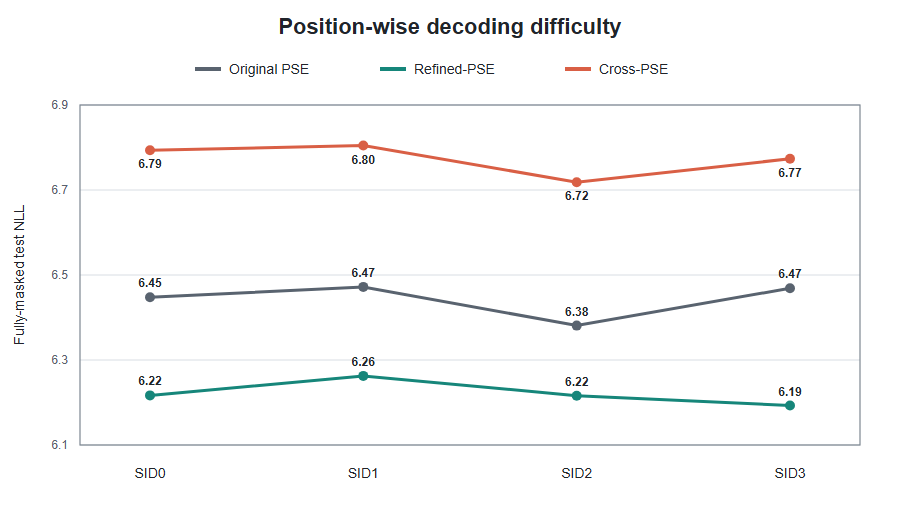
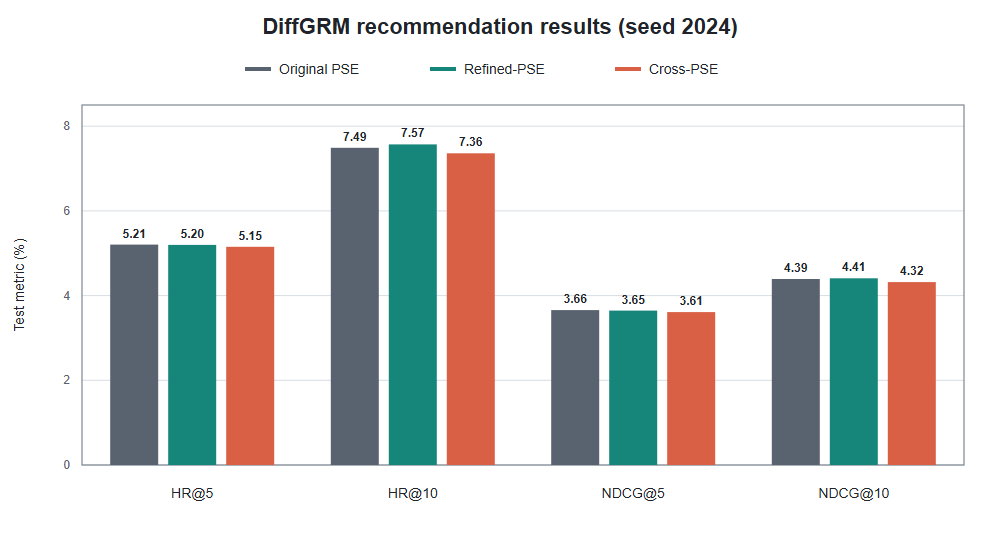
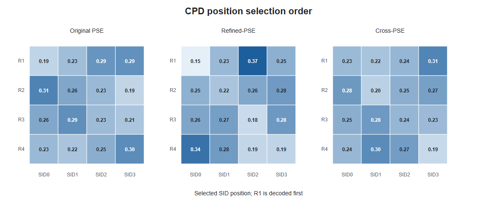
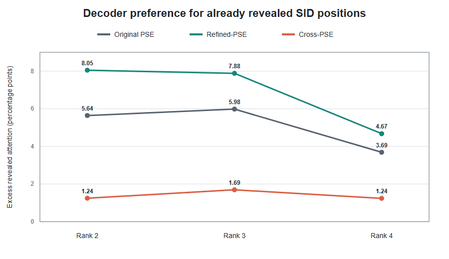

# 04｜离线 Refined-PSE / Cross-PSE：码本交互是否有用

本目录同时保留研究结论、原始证据与可校验复现材料。整理日期：2026-10-07。旧报告完整保存在 [previous_README.md](reproducibility/previous_README.md)，原文件未删除或移动。

## 1. 研究问题与当前结论

[03 阶段](../03_diffgrm_tokenizer_comparison/README.md) 观察到不同 Tokenizer 对 DiffGRM 的位置难度和解码行为有影响。本阶段进一步问：

**在 PSE 量化之前，让不同码本的码字交换信息，是否比单纯微调码本更有利于推荐？**

| 方法 | 是否额外梯度微调码本 | 是否增加跨码本交互 | 对照目的 |
|---|---|---|---|
| Original PSE | 否 | 否 | 复用 03 阶段的原始基线 |
| Refined-PSE v2-catalog | 是 | 否 | 区分“重新优化码本”带来的变化 |
| Cross-PSE v3-catalog | 是 | 是 | 检查交互模块是否提供额外收益 |

**原始 PSE 的码本本来就经过 OPQ/PQ 离线拟合。** 这里的“否”只指没有新增梯度微调，不能理解成原版码本没有训练。

**当前单 seed 结果：Refined 与原始 PSE 大体接近；Cross 未超过 Refined。码本和 SID 确有变化，但没有观察到这版离线交互带来推荐收益。** 这不是对“所有码本交互方法都无效”的否定，也没有验证出结果不佳的唯一原因。

## 2. 正式实验身份与设置

| 方法 | run_id | 最佳 Decoder epoch |
|---|---|---:|
| Original PSE | diff_formal_pse_4x256_repo_repro_v6_bf16 | 45 |
| Refined-PSE | diff_formal_refinedpse_4x256_v2_catalog_bf16 | 35 |
| Cross-PSE | diff_formal_crosspse_4x256_v3_catalog_bf16 | 65 |

Original PSE **复用 03 的 Aug-11-2026_14-09-45 正式 v6 运行**，不是本阶段重新跑了一组，也不是此前 v5。Refined / Cross 对应 Aug-28_14-15-28 / Aug-28_19-01-02。完整路径与身份见 [runs.csv](runs.csv)。

### 下游 DiffGRM 保持一致

| 项目 | 设置 |
|---|---|
| 数据 / 表征 | Amazon Reviews 2014 Beauty；12,101 商品；Sentence-T5-base + PCA256 归一化 |
| SID / seed | 4×256；Tokenizer 与 Decoder seed 均为 2024 |
| 网络 | Encoder 1 层；Decoder 4 层、4 heads；hidden 256，FFN 1024 |
| Decoder 起点 | 本组 SID 冻结后随机初始化 Decoder，从头训练；不是联合训练或继续微调预训练 Decoder |
| 优化 | batch 64、累积 16、有效基础 batch 1024；LR 0.01；warmup 10,000 updates；最多 200 epochs |
| 数值 / 选模 | BF16、clip 1.0、label smoothing 0.2；epoch 20 起每 5 轮验证；warmup 后累计 patience 5 |
| 评估 | 验证 weighted = 0.8 × NDCG@10 + 0.2 × HR@10；val beam 32，test beam 256；SID-level |

### 离线 Tokenizer 的成对设置

Refined / Cross 使用同一 PSE 底座、商品顺序和拟合集；底座码本、FAISS 索引、item keys、fit mask 均有 hash 记录。核心干预是 mixer 开关。

| 项目 | Refined / Cross 共用设置 |
|---|---|
| 基础码本 | 4 本 × 256 码字 × 64 维；允许梯度更新 |
| Mixer | Refined 关闭；Cross 为一层 4-head 全局 self-attention，1024 码字可互相注意 |
| 初始状态 | Attention 输出投影置零，残差系数固定为 1；初始量化结果保持原 PSE |
| 目标 | 重构 + 0.01 × 均衡损失 + 0.01 × 码本锚定损失 |
| 学习率 | 基础码本 1e-5；Cross mixer 1e-4；weight decay 1e-4 |
| 日程 | batch 2048，最多 3000 steps；warmup 比例 0.05；每 50 steps 检查，patience 10 |
| 选 Tokenizer 的口径 | 在原 PSE 的 12,061 商品拟合 catalog 上训练，并按该 catalog 的重构误差选择 checkpoint |
| 额外诊断 | 另外 40 件商品仅作诊断，不用于选择 checkpoint |

**这里不是独立验证集选模。** summary 为兼容旧字段保留了 validation 命名，但实际协议是 fit_catalog_reconstruction，selection 与 training catalog 相同。它与后续 Decoder 的推荐验证集是两回事。

## 3. 逐位置训练结果

下表取各组验证集最佳 Decoder epoch 的 train OCN masked-view **NLL**，不是包含 label smoothing 的总 loss。

| 方法 | 最佳 epoch | SID0 | SID1 | SID2 | SID3 |
|---|---:|---:|---:|---:|---:|
| Original PSE | 45 | 3.108 | 3.238 | 3.275 | 3.377 |
| Refined-PSE | 35 | 3.180 | 3.314 | 3.410 | 3.390 |
| Cross-PSE | 65 | 3.079 | 3.105 | 3.090 | 3.163 |

Cross 在这张表中的 NLL 更低，但各组取自不同最佳 epoch、各位置 mask rate 也不同。因此只能描述各组选中模型的训练状态，不能把它当作严格等训练量的优势，更不能由此推出推荐效果更好。

## 4. 测试集逐位置结果

以下使用最佳 checkpoint，在相同 fully-masked 上下文中测量各位置；CSV 中 test epoch 0 是测试标记。

| 方法 | 指标 | SID0 | SID1 | SID2 | SID3 |
|---|---|---:|---:|---:|---:|
| Original PSE | NLL | 6.448 | 6.472 | 6.381 | 6.469 |
| Original PSE | Accuracy | 0.53% | 0.53% | 0.76% | 0.54% |
| Refined-PSE | NLL | 6.217 | 6.262 | 6.216 | 6.193 |
| Refined-PSE | Accuracy | 0.55% | 0.82% | 0.69% | 0.57% |
| Cross-PSE | NLL | 6.794 | 6.805 | 6.718 | 6.773 |
| Cross-PSE | Accuracy | 0.48% | 0.55% | 0.65% | 0.65% |

Cross 的四个位置测试 NLL 均高于 Refined，但 Accuracy 并非逐位置全部更差。**NLL 描述概率分配，Accuracy 描述 top-1 命中，不能混用。** 训练 OCN 与测试 fully-masked 的上下文不同，不能直接把两张表的差解释为普通泛化 gap。

## 5. 最终推荐结果

以下均按验证集选模后进行正式测试。完整精度见 [results.csv](results.csv)，汇总见 [summary.csv](summary.csv)。

| 方法 | HR@5 | HR@10 | NDCG@5 | NDCG@10 | Duplicate@10 |
|---|---:|---:|---:|---:|---:|
| Original PSE | 0.05205 | 0.07490 | 0.03657 | 0.04392 | 0.00077 |
| Refined-PSE | 0.05196 | 0.07571 | 0.03646 | 0.04409 | 0.00085 |
| Cross-PSE | 0.05151 | 0.07360 | 0.03611 | 0.04320 | 0.00135 |

- Refined 相比 Original：HR@10 增加约 0.00080、NDCG@10 增加约 0.00017，但 @5 指标略低，整体接近。
- Cross 相比 Refined：HR@10 减少约 0.00210，NDCG@10 减少约 0.00090；本次未观察到额外收益。
- 三组 Legal@10 均为 1。它只说明生成 SID 合法，不代表没有商品碰撞或推荐一定正确。

只有一个 seed，没有均值稳定性、置信区间或显著性证据；不把这些小差异写成稳定优劣结论。

## 6. Tokenizer 是否真的改变了

| 指标 | Original PSE | Refined-PSE | Cross-PSE |
|---|---:|---:|---:|
| 最佳离线 step | — | 2900 | 2950 |
| 拟合 catalog 的选模重构改善量 | — | 0.000193 | 0.000218 |
| 相对底座码本变化 RMS | — | 1.72% | 1.80% |
| 商品完整 SID 改变率 | — | 5.06% | 5.74% |
| 完整 SID 碰撞率 | 17.949% | 17.965% | 17.965% |
| 唯一完整 SID | 10,656 | 10,650 | 10,652 |
| 各位置码本覆盖率 | 全为 100% | 全为 100% | 全为 100% |

| 方法 | Prefix-1 碰撞率 | Prefix-2 | Prefix-3 | 完整四位 |
|---|---:|---:|---:|---:|
| Original PSE | 99.983% | 60.218% | 27.105% | 17.949% |
| Refined-PSE | 99.983% | 60.119% | 27.254% | 17.965% |
| Cross-PSE | 99.983% | 60.177% | 27.328% | 17.965% |

碰撞率统计的是“处于重复分组中的商品比例”。Refined 与 Cross 的完整碰撞率相同，**不意味着 SID 映射相同**；二者唯一 SID 数、前缀结构和文件 hash 都有区别。

这些记录说明训练产生了可测变化，且边际覆盖率未塌缩；但不能据此排除所有实现问题。重构改善很小，也没有自动转化成推荐收益。

## 7. Attention 与解码顺序提供了什么线索

### 7.1 先区分两种 Attention

- **Tokenizer Mixer Attention**：1024 个码字之间的交互，用于形成新码本。
- **Decoder Self-Attention**：生成一个商品的四个 SID 时，目标位置之间的注意力。

两者不是同一张图、同一层网络，也不能相互替代。

Cross 的平均跨码本 Attention 质量约 74.96%，四码本均匀分配时为 75%；各 query-book 到 key-book 的平均权重约 23.1%～28.3%。**只能说按码本聚合后的均值接近均匀**，不能因此断言所有 head / 码字都没有结构或交互没有作用。

### 7.2 Decoder 对已生成位置的偏好

以下使用各组最佳 checkpoint、完整测试集 22,363 个样本、beam 1 greedy CPD，统计 softmax 后 dropout 前的 self-attention。正式推荐仍是 beam 256。

原始 PSE 第一轮较偏 SID2/SID3，Refined 较偏 SID2，Cross 相对偏 SID3；这是样本总体的选择频率，不是固定生成顺序。

| 方法 | Rank 2 超过均匀基线 | Rank 3 | Rank 4 |
|---|---:|---:|---:|
| Original PSE | +5.64 个百分点 | +5.98 | +3.69 |
| Refined-PSE | +8.05 个百分点 | +7.88 | +4.67 |
| Cross-PSE | +1.24 个百分点 | +1.69 | +1.24 |

均匀基线依次为 0.25、0.50、0.75，因为已生成位置从 1 个增加到 3 个。Cross 的平均额外偏好更小，说明本次统计下 Decoder 的注意力分配不同；**不能据此认定它更少使用有效信息，也不能证明这就是推荐下降的原因。**

## 8. 阶段结论与后续衔接

本阶段完成了离线成对实验：Refined / Cross 都改变了码本和 SID，未见明显覆盖率塌缩；但 Cross 没有取得更好的推荐结果。

一个值得继续检查的假设是：**Tokenizer 只由重构等离线目标训练，推荐误差无法直接反馈到码本，二者的目标可能不一致。** 这不是由本次结果单独证明的失败原因，但构成了 [05 联合训练阶段](../05_crosspse_joint/README.md) 的研究动机。

目前不直接扩展到列表生成，也不单靠调大交互强度继续试；先做联合 / 冻结、带交互 / 不带交互的内部对照，区分收益究竟来自哪里。05 的结果已在其独立目录汇总，本页不混入后续训练数值。

## 9. 材料组织与复现边界

| 入口 | 保存什么 |
|---|---|
| [runs.csv](runs.csv) | 两次本阶段正式运行，以及复用 PSE 基线的身份索引 |
| [results.csv](results.csv)、[summary.csv](summary.csv) | 原始精度的统一结果与汇总 |
| evidence/ | 原报告、metadata、Tokenizer 训练/几何统计、attention 等证据副本；以 manifest 为准 |
| report_assets/ | 保留的四张原报告图片 |
| [HISTORY.md](HISTORY.md) | Cross v1/v2、内部 split pilot、catalog 正式版本的演进 |
| [复现说明](reproducibility/README.md) | 固定代码、输入 hash、初始化、历史 SID 与重跑入口 |
| [previous_README.md](reproducibility/previous_README.md) | 整理前原文，不作为当前口径优先来源 |

原轻量材料曾位于 archive/deprecated_and_temp/tmp_browser_cache 下的 crosspse_report_20260829 包中；**目录名带 tmp 不意味着它是可丢弃缓存**。本次保存来源和校验信息，原包不动。

复现主流程绑定本组**历史冻结 SID，再随机初始化 Decoder**；离线 Tokenizer 重新训练另外保留配置、输入和底座绑定，不把新训练产物自动替换旧结果。保存的最终 Decoder checkpoint 用于结果追溯 / 后续重评，不是本阶段从头训练的初始化。

历史完整 commit 和 resolved config 未记录；当前固定代码与重建配置不能冒称原运行状态已完全恢复。**GPU smoke、正式重训和独立重评尚不能因本次整理而视为已验收。** 数据与权重仍需保留迁移包 / 原资产位置，具体操作见复现说明。
