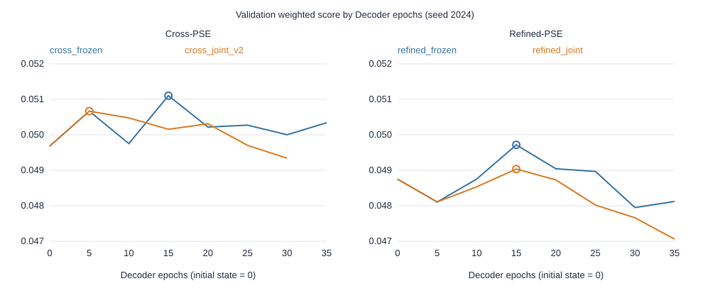

# 05｜PSE 码本与 DiffGRM 的联合训练

本目录同时保存**研究结论、原始证据副本和可校验的复现入口**，不只是汇报稿。整理日期：2026-10-07。旧说明完整保存在 [previous_README.md](reproducibility/previous_README.md)，原运行目录、配置、脚本和压缩包均未删除或移动。

## 1. 这一阶段想回答什么

上一阶段先离线训练 Refined-PSE / Cross-PSE，再固定 SID 训练 DiffGRM，未得到稳定提升。本阶段让推荐任务的梯度能够更新 Tokenizer，重点区分两件事：

1. **更新 Tokenizer 是否比只继续训练 Decoder 更有用？** 分别比较 Joint Cross 与 Frozen Cross、Joint Refined 与 Frozen Refined。
2. **跨码本交互是否有额外价值？** 在上述对照基础上观察 Cross 与 Refined 的表现，但不能忽略两者使用不同预训练初始化这一因素。

**当前结论：还没有得到“联合更新 Tokenizer、尤其跨码本交互，能够稳定提升推荐效果”的充分证据。不是训练没有跑通，而是效果归因尚不成立。**

## 2. 哪几组是主要实验

| 短名称 | 研究角色 | 训练中允许更新什么 | 复现配方 |
|---|---|---|---|
| cross_frozen | Cross 的 Decoder continuation 对照 | 只更新 Decoder；冻结 Tokenizer | [JSON](reproducibility/recipes/cross_frozen.json) |
| cross_joint_v2 | Cross 的直接梯度联合版本 | 交替更新 Decoder 和带 mixer 的码本 | [JSON](reproducibility/recipes/cross_joint_v2.json) |
| refined_frozen | Refined 的 Decoder continuation 对照 | 只更新 Decoder；冻结 Tokenizer | [JSON](reproducibility/recipes/refined_frozen.json) |
| refined_joint | 不带交互的联合版本 | 交替更新 Decoder 和基础码本；关闭 mixer | [JSON](reproducibility/recipes/refined_joint.json) |

另保留 SIA、DIGER v1 两版历史尝试，见 [版本演进](HISTORY.md)。它们不是“四组主对照”的额外重复 seed。完整 run_id、证据路径及初始化对应关系见 [runs.csv](runs.csv)。

### 共同设置与比较边界

| 项目 | 设置 |
|---|---|
| 数据 / 编码 | Amazon Reviews 2014 Beauty；4 位 SID，每位 256 个码字；seed 2024 |
| 初始化 | 预训练 Tokenizer + 对应的离线 DiffGRM checkpoint；不是从随机初始化重训 |
| 训练 batch | 64，梯度累积 16；基础有效 batch 为 1024 |
| Decoder 学习率 / warmup | 0.001 / 500 次 optimizer update |
| 精度 / 梯度裁剪 | BF16 / 1.0 |
| 联合节奏 | 先训练 5 个 Decoder epoch，再循环 1 个 Tokenizer phase + 3 个 Decoder epoch |
| 计划训练预算 | Joint 最多 45 个总 epoch，其中 35 个 Decoder epoch、10 个 Tokenizer phase；Frozen 最多 35 个 Decoder epoch |
| Tokenizer 更新预算 | 每 phase 96 个 batch，累积后 6 次 optimizer update；基础码本 LR 1e-5，Cross mixer LR 1e-4 |
| 验证 / 选模 | 每 5 个 Decoder epoch 验证；以验证集 0.8 × NDCG@10 + 0.2 × HR@10 选最佳模型 |
| 正式解码 / 评估 | val beam 32、test beam 256；SID-level，不是严格 item-level；单目标下 HR 与 Recall 相等 |

共同设置来自归档配置及 metadata；完整层叠顺序由每组配方指定。只跑了一个 seed，表中没有标准差或显著性结论。Cross 与 Refined 的初始 Tokenizer 和 Decoder 不同，因此它们之间不是“只改变 mixer 开关”的严格单变量比较。

## 3. 四组主要结果

以下为验证集选定 checkpoint 的测试结果；不是拿测试集选择最佳 epoch。原始精度见 [results.csv](results.csv)。

| 方法 | HR@5 | HR@10 | NDCG@5 | NDCG@10 | 最佳总 epoch | 最佳点已完成 Decoder epoch / Tokenizer phase |
|---|---:|---:|---:|---:|---:|---:|
| Frozen Cross-PSE | 0.05362 | 0.07423 | 0.03807 | 0.04467 | 15 | 15 / 0 |
| Joint Cross-PSE v2 | 0.05563 | 0.07732 | 0.03902 | 0.04599 | 5 | 5 / 0 |
| Frozen Refined-PSE | 0.05366 | 0.07566 | 0.03755 | 0.04465 | 15 | 15 / 0 |
| Joint Refined-PSE | 0.05259 | 0.07727 | 0.03643 | 0.04435 | 19 | 15 / 4 |

### 怎么理解

- **Cross：测试指标较高，但不能算作 Tokenizer 更新的收益。** Joint v2 的最佳点在第一次 Tokenizer phase（第 6 轮）之前。它和 Frozen Cross 在初始状态、第 5 个 Decoder epoch 的验证 weighted score 完全相同；随后 Frozen 的最佳验证分数为 0.051103，高于 Joint v2 的 0.050666。两组最终挑中的 checkpoint 不同，测试高低与验证高低也不一致。
- **Refined：有小幅混合信号，没有稳定优势。** 相比 Frozen，Joint 的 HR@10 增加 0.001610，但 NDCG@10 减少 0.000294，HR@5、NDCG@5 也降低。最佳验证 weighted score 为 0.049035，低于 Frozen 的 0.049717。不能仅挑 HR@10 上升这一项下结论。
- **不是码本明显塌缩。** 四组最佳模型的完整 SID 碰撞率均约 17.9655%，legal@10 均为 1。这里只说明这些统计未见明显恶化，不说明 SID 没变，更不等于 Tokenizer 改进有效。

### 训练量不能只看总 epoch

| 方法 | 实际总 epoch | 实际 Decoder epoch | 实际 Tokenizer phase |
|---|---:|---:|---:|
| Frozen Cross | 35 | 35 | 0 |
| Joint Cross v2 | 39 | 30 | 9 |
| Frozen Refined | 35 | 35 | 0 |
| Joint Refined | 45 | 35 | 10 |

计划 Decoder 预算相同，不代表早停后的实际训练量、或者最终选中 checkpoint 的训练量相同。下面统一用 **Decoder epoch** 作为横轴，而不是把 Joint 的总 epoch 与 Frozen 直接对齐。圆圈表示各自验证集最佳点。

图中是验证 weighted score，不是测试结果；折线只连接实际评估点，没有额外评估或插值实验。

## 4. 材料怎么放、能复现到什么程度

~~~text
05_crosspse_joint/
├── README.md                   # 主问题、四组结果、结论边界
├── HISTORY.md                  # SIA → DIGER v1 → v2 → 两组冻结对照
├── runs.csv                    # 六次运行身份、路径、初始化索引
├── results.csv                 # 从证据重算的统一结果表
├── figures/                    # 从证据重画的必要图片
├── evidence/
│   ├── configs/                # 当次迁移包中的配置副本，保持原字节
│   └── <短名称>/               # 原 summary、per_seed、各类 history、metadata
│       └── raw/                # 原始训练/验证/逐位置/顺序/联合诊断 CSV
└── reproducibility/
    ├── README.md               # 校验、恢复输入、smoke、正式重跑步骤
    ├── recipes/                # 六组独立配方；明确绑定初始化，不找“最新权重”
    ├── assets.lock.json        # 38 个数据、初始化、最终产物的路径与 SHA256
    ├── evidence_manifest.json  # 111 个证据副本的来源和 SHA256
    ├── code_versions.json      # 主仓库/模型仓库版本与历史缺口
    ├── code/                  # 两份模型仓库的固定版本源码 tar
    ├── environment/           # 迁移时的 conda / pip 环境记录
    ├── package_integrity.json  # 配方、锁文件和复现脚本的完整性校验
    └── previous_README.md      # 整理前的原说明，只作历史记录
~~~

**已经完成：** 六组结果交叉核对、原始证据复制及校验、代码快照锁定、初始化和最终产物绑定。初始化 SID、Tokenizer checkpoint、基础码本和 item keys 的文件 hash 还与历史 metadata 内的记录一致。

**仍有边界：** 历史训练未保存完整 resolved config 和代码 commit；目前锁定的是与 9 月 23 日迁移快照一致的现有源码。配置是根据归档 YAML 与锁定源码默认值重建的，不能宣称找回了每次训练时的完整状态。新入口已做本地 CPU 测试，但尚未在 GPU 上 smoke、正式重训或独立加载最终 checkpoint 重新评估。

权重和数据没有塞进 Git，也没有重复解压到本目录。它们仍保存在原迁移压缩包中；**只复制这个报告目录、不保留迁移包和两个配套脚本，无法完成训练复现。** 具体携带文件及命令见 [复现操作说明](reproducibility/README.md)。

## 5. 接下来怎么推进

1. 先将这次整理提交为独立 Git commit，保留研究代码和旧结果不变。
2. 在创智机器上校验固定输入，先跑一组短 smoke 验收新复现入口，不立即重跑全部六组。
3. 真正开展下一轮研究前，优先核查同一初始化、相同 Decoder 更新点、相同选模协议下的 Joint / Frozen 差异。DIGER v1 在更新 Tokenizer 后达到最佳点，是值得检查的线索，不是因果证明。
4. 若要隔离 mixer 的贡献，需要进一步收紧初始化和训练路径的对照；不要直接把当前 Cross 与 Refined 的结果差解释为 mixer 增益。先把对照设计说清楚，再决定调参或补 seed。

## 6. 新增 SID 一致性诊断

2026-10-11 已补充 [带噪声编码与确定性编码的统计及分析](diagnostics/sid_consistency_20261011/README.md)。当前噪声会大幅改变临时 SID，而最佳点的累计确定性 SID 变化仅为 Cross v1 的 43 个商品、Joint Refined 的 13 个商品；Cross v2 最佳点没有更新 Tokenizer。这提示下一步先验证前向采样与正式编码的对齐，不据此直接断言噪声导致性能下降。诊断独立保存，不修改本页历史推荐指标和原始证据。

## 7. 新增短对照入口

[一次更新—冻结—恢复短对照](pilots/noise_update/README.md) 从同一份 Cross v2 第 5 轮权重开始，比较 A 不更新、B 无噪声更新、C 原噪声配置完整施加，再分别训练相同 3 轮 Decoder。2026-10-12 发现旧内部打分可能泄漏训练模式，新入口增加每批模式恢复与实际加噪计数；固定快照统计不能证明旧训练每批都加了噪声。此处是新实验准备，不是新增正式推荐结果。

## 8. 新增推荐反馈机制对照入口

[推荐反馈短对照](pilots/feedback_update/README.md) 从相同的 Cross v2 第 5 轮、Tokenizer 尚未更新的权重开始，比较 `frozen` 不更新、`cross_recon` 仅按重构等目标更新、`cross_rec` 额外使用推荐反馈。三组保留同一 Cross Mixer，统一无 Gumbel 噪声；两个更新组使用 24 次 optimizer update，随后冻结 Tokenizer 并训练相同 3 轮 Decoder。第 6 / 24 次更新的 probe 只记录正式 SID，不刷新训练 mapping 或按验证分数择步。本实验直接检验推荐反馈，不是 Mixer 独立消融；新增代码及操作说明不代表已完成远端 smoke、提交同步或正式启动。旧结果和历史证据保持不变。

2026-10-13 更新：上述三组完整训练及固定 `decoder_3` 的逐样本验证重放已完成，原总体指标精确复现。反馈相对仅重构组净少 7 次 HR@10 SID 命中，尚无额外收益证据；目标变化子集的局部 +2 不能解释成主动重编码成功。结果、55 个命中得失案例与解释边界见 [配对诊断结果](pilots/feedback_update/paired_analysis/RESULTS.md)。本轮因 HDD 配额不足，经授权在独立 SSD 分析目录运行；不是 HDD 主仓库已同步的证明。

<!-- stage05-long-factorial-20261020 -->
<!-- stage05-long-delivery-verified -->

最终验收：[FINAL_DELIVERY_AUDIT.json](long_mixer_factorial/FINAL_DELIVERY_AUDIT.json)。
## 9. 共享起点、带噪声的长期四组（2026-10-20）

四组正式训练和各一次测试均已结束：每组35轮推荐器，两个Joint各60次Tokenizer更新；全部共享训练前Aug-28推荐器与重基E0，沿用5R＋10×(1T阶段＋3R)协议。两个Frozen全程函数相同，其35轮轨迹、真实权重及测试完全一致，是预期的负对照。

固定R35验证的Mixer增量为HR@10 `−0.0002235836`、NDCG@10 `+0.0001411057`、weighted `+0.0000681678`；不同指标方向不一致，不能宣称稳定额外收益。验证最佳点的一次测试另表报告，不能替代相同预算主比较。全部GPU已释放，实际35549 GPU秒；费用按已核对费率折算，实际结算未核实。

入口：[长期四组](long_mixer_factorial/README.md)、[结果报告](long_mixer_factorial/REPORT.md)、[逐项验收](long_mixer_factorial/ACCEPTANCE_MATRIX.md)、[资源释放](long_mixer_factorial/RESOURCE_RELEASE_FINAL.json)。

完整本地备份和恢复通过，最终完成状态见总验收。
