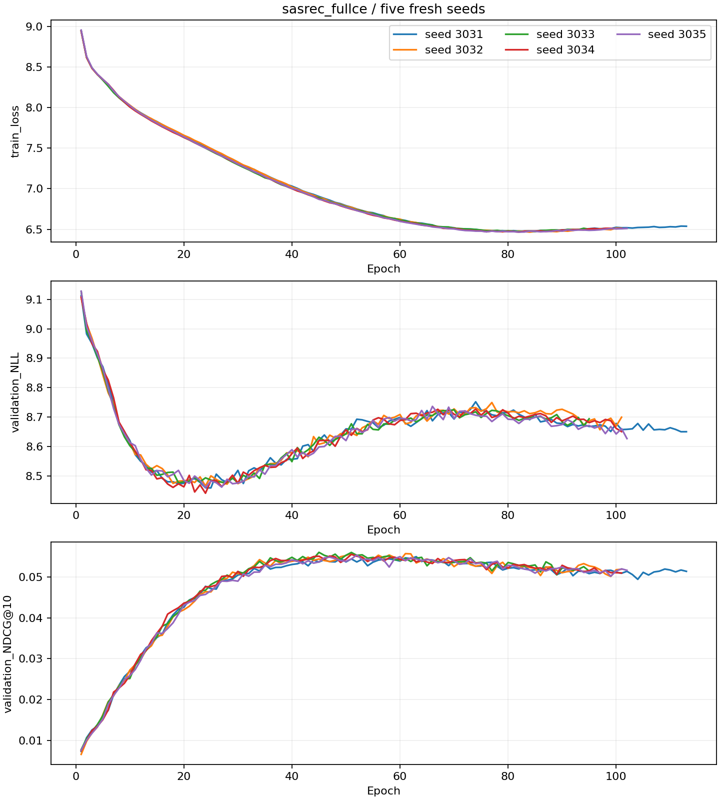
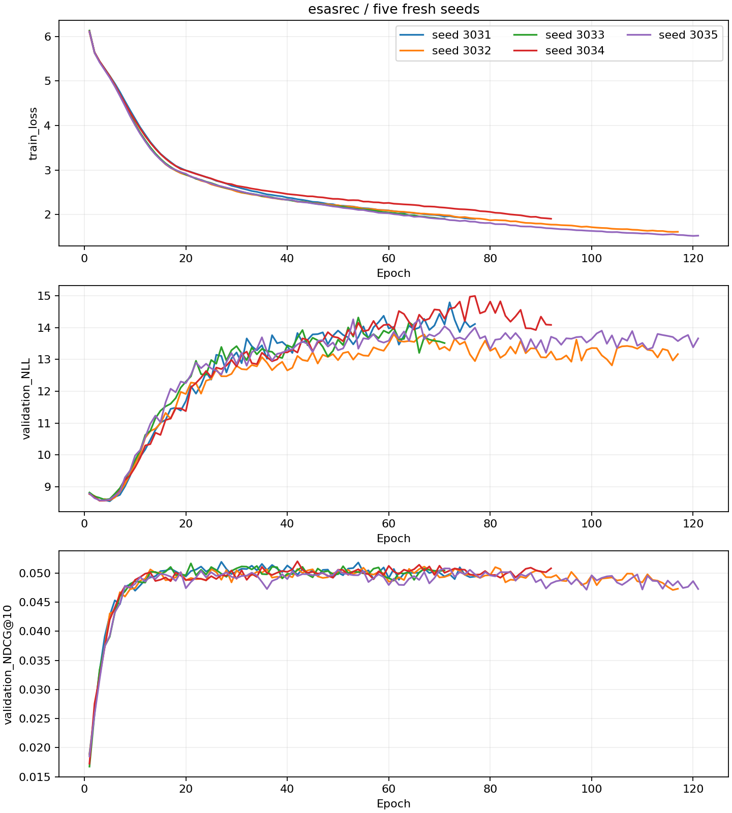

# 06阶段实验报告：连续商品向量推荐基线

更新：2026-10-16。下述指标均来自本轮冻结实现、固定预算内的真实运行；历史快照与故障尝试另列。

本轮按验证集预先封存的选择为 **SASRec＋FullCE，配置13**。五个新seed的测试HR@10为 **0.072280±0.001294**，NDCG@10为 **0.041515±0.000845**；六项测试均值均高于本轮eSASRec候选。它将作为后续连续空间研究的当前基线。

89项有效训练、13项最终测试逐样本重算、10份正式模型与商品向量导出及最终测速已通过相应审计。本Goal创建的GPU已释放。**完整本地备份已验收：9个分卷、1,300个文件、178份checkpoint状态均通过哈希与来源核对，412个可用文件已安全提取；代表模型CPU恢复亦通过。用户已明确接受实际GPU时长×平台费率的费用汇总，并保留“未核实独占结算”的限制，见[费用交付确认](execution_acceptance/final_delivery_20261016/FEE_ACCEPTANCE_20261016.json)。最终Goal状态以末次总核查及工具记录为准。**

## 1. 实验意图与结论边界

本阶段先回答：在当前Beauty数据和统一商品级评估口径下，充分训练、有限预算调参后的连续向量推荐器可以达到什么质量和推理开销？建立可复用的模型、输入/输出商品表和训练状态，才有条件评估后续“给定Decoder，学习适配的商品编码”是否带来额外价值。

当前模型把用户历史映射为一个查询向量，再与商品向量点积、从全库取Top-K。一次查询前向可以产生多个候选商品，当前没有逐商品或逐SID索引的串行解码；这也是标准序列检索模型的机制。它尚未实现Decoder适配编码器、自动搜索编码器结构、连续列表生成或任意Decoder的通用反演算法。

本阶段是 **item-level** 全库真实商品排名。历史03–05中主要记录的是 **SID-level** 生成排名，不能直接把数值排在同一榜单。05早期长期四组与最新共享起点Mixer短四组也分别属于历史实验族；本轮没有重跑它们，也没有把它们混入89项预算。

两套候选的结构、容量、训练损失和batch同时不同，比较的是各自预算内的完整基线，不是单因素消融。SASRec领先不能单独证明LiGR无效、sampled softmax有害，或连续表示优于SID。要回答这些因果问题仍需控制其他因素的新实验；本Goal不追加实验。

## 2. 数据身份、划分与训练设置

沿用Amazon Reviews 2014 Beauty：22,363个用户、12,101件商品、198,502条交互。保持原商品编号和交互顺序；PAD=0，真实商品ID为1–12,101。原始文件身份和已验收输入保持不变。

| 原始输入 | SHA256 |
|---|---|
| all_item_seqs.json | 43476d3f941f103d32ae58eb87da79c8894d76e3fb64da57f8e2d18c0c51d1b1 |
| id_mapping.json | 4d88fede709699e3415962419728b07dc8600140ebc000484dd371c81f66a0be |

序列为s，t为从0开始的交互位置。主协议full_train_prefix_v1训练目标位置为1≤t≤len(s)−3，历史取s[max(0,t−50):t]；legacy_prefix_v1取2≤t≤min(len(s)−3,50)，历史s[:t]。两者都只监督下一商品s[t]。完整协议每轮131,413个目标，旧协议105,668个，差25,745个。

验证历史为s[:-2][-50:]、目标s[-2]；测试历史为s[:-1][-50:]、目标s[-1]，两套协议的验证/测试逐字节相同，各22,363条。测试历史允许包含验证位置的真实交互。重复购买可以使同一商品出现在训练与留出位置，泄漏检查按用户与交互位置进行。这里沿用leave-one-out，不是全局时间切分或线上验证。

共同设置：最大历史50，左补PAD，因果及padding mask；输入/输出商品表共享，先取末位有效历史的query，再打分；PAD不参与训练分类空间或推荐。FFN倍率4，Adam betas=(0.9,0.98)，梯度裁剪1，label smoothing=0，常数学习率；最多300轮，每轮完整验证，patience=50。以验证NDCG@10选checkpoint，同分再看HR@10，不按测试集挑轮次。

评估为12,101件真实商品全库精确排名，**不屏蔽历史商品、不抽样负例**，同分按商品ID升序。报告HR/NDCG@5、10、20以及全库NLL；所有seed均为22,363条测试样本。

完整协议train SHA256：`894bed89c76a08907ef428c86e252a57076917c893b877b899cfd4f42ec3f78f`；validation：`4400827739f741e61f7dfc48f7e7221a1d0b2a278d6138adbf360e1c7729027f`；test：`9d406f76cea1017fc73f9a714e9f606dea9e45493107190329f64458915b1eb3`。协议定义见[数据配置](../../configs/06_continuous_baseline/data_protocols.json)与[数据验收](ACCEPTANCE.md)。

## 3. 模型来源与适配

eSASRec参考[论文2508.06450v1](https://arxiv.org/html/2508.06450v1)、[作者实现](https://github.com/blondered/transformer_benchmark)锁定commit `2b039927ceb4c7654131d7ac7c43ea124b49d240`，以及作者依赖的[RecTools 0.13.0](https://github.com/MTSWebServices/RecTools/tree/v0.13.0)，commit `6ffd25bf3ca8517c8bd1a7207d6b0e64c8e1912a`。这些链接用于记录来源；实际执行实现与差异见本地[SOURCES.md](SOURCES.md)、未改动的reference_upstream与字节哈希清单。

SASRec＋FullCE采用RecTools的PreLN注意力块、带bias的GELU FFN与块末dropout，**不是2018 TensorFlow SASRec的逐字复现**。eSASRec按作者方程使用pre-LN attention→sigmoid线性门控残差→pre-LN SwiGLU→门控残差；SwiGLU FFN无bias，隐层4d。

两者均使用inverse learned position，矩阵参数Xavier normal初始化，无额外输出归一化；embedding dropout施加在历史商品与位置之和，不施加在输出商品表。PAD行固定为零。网络与训练入口独立实现，不依赖运行RecTools/PyTorch Lightning，不改动历史两个引擎。

eSASRec对每个正监督目标独立均匀、有放回抽取256或1024件真实商品作为负例multiset，**不做logQ校正、不排除重复负例或偶然抽到正例**；损失是正例与该multiset上的softmax CE。SASRec使用全库CE。两者训练loss的分类空间不同，不能按loss绝对数值比较谁训练得更好；验证NLL统一按全库计算。

项目把序列展开为前缀，每行仅监督末位下一商品，不再重复监督所有历史位置；作者常见Shifted Sequence多位置监督与此不同。作者Beauty示例配置为256维/1层/1头/dropout0.2/256负例；本轮遵循预定32组搜索与300轮预算，不能称为论文报告设置的严格复现。

CUDA训练采用统一数值修复：注意力Q/K/V投影、SDPA及输出投影区域FP32 Math，外层FFN及商品打分仍为BF16。CPU保持原dtype。这是本项目适配，不能据此断言作者代码或某个库存在已确认bug。最终推理记录该策略，未采集逐kernel profile，不能扩大为所有实际推理kernel均为FP32 Math。

## 4. 固定预算与验证选模

搜索随机种子固定为20261015，完整清单在运行前生成。每模型32个不重复配置，含64维/1层/1头和256维/2层/4头锚点。空间为维度64/128/256/512，层1/2/4，头1/2/4，dropout0.1/0.2/0.3/0.5，LR 1e−4/3e−4/1e−3，weight decay 0/1e−5/1e−4，batch128/256；eSAS负例256/1024。

单节点最多8张H100，8个独立单卡worker动态领取满足依赖的任务，不做8卡DDP，不增第二节点，不为填满GPU额外增加配置。初始GPU0–3为SASRec、4–7为eSASRec，后续按空闲卡补位；每次实验记录PID、设备UUID、配置、seed、数据及源码身份。

| 阶段 | 有效训练数 | seed与选择规则 |
|---|---|---|
| 搜索 | 64 | 两模型各32组，seed2024；自己的32组全部完成后选Top-3 |
| Top-3复验 | 12 | 各Top-3新增2025/2026；与2024合计3seed均值锁配置 |
| 正式训练 | 10 | 每模型5个新seed：3031–3035 |
| 旧协议配对 | 3 | 锁定SASRec配置，legacy协议，3031–3033 |
| 合计 | 89 | smoke、诊断、失败尝试与测速另列 |

配置选择以三seed验证NDCG@10均值优先，平局依次看平均HR@10、较小参数量、固定配置编号。最终基线模型再按五个正式seed的验证均值选择，并在任何测试指标计算前封存；测试不反向改变配置、模型或seed。

| Top-3候选 | 三seed验证NDCG@10 | 三seed验证HR@10 | 结果 |
|---|---|---|---|
| sasrec_fullce_13 | 0.056183840 | 0.097393015 | 采用 |
| sasrec_fullce_16 | 0.054517784 | 0.092414554 |  |
| sasrec_fullce_01 | 0.054963303 | 0.092563610 |  |
| esasrec_16 | 0.048664382 | 0.085036295 |  |
| esasrec_19 | 0.052044780 | 0.085349312 | 采用 |
| esasrec_08 | 0.050685007 | 0.085394029 |  |

| 锁定配置 | SASRec＋FullCE | eSASRec |
|---|---|---|
| 配置编号 | sasrec_fullce_13 | esasrec_19 |
| 维度 / 层数 / 头数 | 256 / 1 / 1 | 512 / 1 / 4 |
| 参数量 | 3,900,672 | 10,945,536 |
| dropout | 0.3 | 0.3 |
| LR / weight decay | 0.0001 / 0 | 0.001 / 0 |
| batch | 256 | 128 |
| 损失 / 负例 | FullCE / 全库 | sampled softmax / 1024 |
| 五seed验证NDCG@10均值 | 0.055520364 | 0.051511271 |
| 五seed验证HR@10均值 | 0.095666950 | 0.086741493 |

独立[选模与阶段顺序审计](execution_acceptance/final_delivery_20261016/FINAL_SELECTION_AND_ORDER_AUDIT.json)从89条原始曲线重算验证选择，未导入原训练选模helper。服务器原始mtime证明最后训练完成→封存选择→最终测试→最终测速→GPU工作完成；队列完成时worker=0。该证据绑定冻结调用顺序与配置GPU0 UUID，但未采集连续进程追踪，不能独立证明期间不存在任何外部负载。

## 5. 最终测试结果

以下为5个新seed的均值±**样本标准差（ddof=1）**，不是最好seed成绩，也不是均值标准误。

| Test指标 | SASRec＋FullCE | eSASRec |
|---|---|---|
| HR@5 | 0.049439 ± 0.001248 | 0.046881 ± 0.000926 |
| HR@10 | 0.072280 ± 0.001294 | 0.064920 ± 0.001759 |
| HR@20 | 0.103179 ± 0.000622 | 0.088459 ± 0.001884 |
| NDCG@5 | 0.034171 ± 0.000893 | 0.033389 ± 0.000705 |
| NDCG@10 | 0.041515 ± 0.000845 | 0.039181 ± 0.000795 |
| NDCG@20 | 0.049302 ± 0.000714 | 0.045109 ± 0.000780 |

SASRec＋FullCE平均HR@10相对高11.34%，NDCG@10相对高5.96%。这是当前数据、实现和固定搜索预算内的结果，未做统计显著性检验，不声明全局最优或架构普遍优劣。

十个正式seed原始测试分数如下，表中保留9位小数；全部精度、checkpoint和预测哈希见[test_results.csv](execution_acceptance/final_delivery_20261016/test_results.csv)。NLL为该最佳验证NDCG checkpoint上的全库测试NLL。

| 模型 | seed | HR@5 | HR@10 | HR@20 | NDCG@5 | NDCG@10 | NDCG@20 | Test NLL |
|---|---|---|---|---|---|---|---|---|
| SASRec | 3031 | 0.049322542 | 0.072262219 | 0.102714305 | 0.033728547 | 0.041080965 | 0.048742337 | 9.048225 |
| SASRec | 3032 | 0.049054241 | 0.071054867 | 0.103429772 | 0.034348734 | 0.041442486 | 0.049565764 | 9.063398 |
| SASRec | 3033 | 0.048651791 | 0.071949202 | 0.103385056 | 0.033390535 | 0.040865367 | 0.048805724 | 9.076539 |
| SASRec | 3034 | 0.051603094 | 0.074453338 | 0.103966373 | 0.035643795 | 0.042980512 | 0.050438027 | 9.043833 |
| SASRec | 3035 | 0.048562357 | 0.071680901 | 0.102401288 | 0.033743949 | 0.041207522 | 0.048958054 | 9.055657 |
| eSASRec | 3031 | 0.045968788 | 0.065196977 | 0.089567589 | 0.032631512 | 0.038804702 | 0.044950077 | 13.261899 |
| eSASRec | 3032 | 0.046728972 | 0.063050575 | 0.087197603 | 0.033505180 | 0.038743533 | 0.044806705 | 13.776365 |
| eSASRec | 3033 | 0.048428207 | 0.067701113 | 0.091222108 | 0.034382639 | 0.040568415 | 0.046458438 | 12.640483 |
| eSASRec | 3034 | 0.046460672 | 0.064749810 | 0.087555337 | 0.032793170 | 0.038665307 | 0.044442862 | 13.624574 |
| eSASRec | 3035 | 0.046818405 | 0.063900192 | 0.086750436 | 0.033632495 | 0.039124703 | 0.044885981 | 14.100879 |

[服务器逐样本独立重算](execution_acceptance/final_delivery_20261016/CPU_DELIVERY_PASS.json)覆盖13个测试文件、每个22,363条，从保存的Top商品列表重新求排名与HR/NDCG，并重算NLL；[本地均值/标准差审计](execution_acceptance/final_delivery_20261016/LOCAL_FINAL_METRIC_AUDIT.json)再次从下载CSV重算，跨Python版本聚合最大差约2.17e−19。逐样本预测、truth和checkpoint均有SHA绑定。

## 6. 十三项正式/旧协议训练细节与曲线

“最佳轮”始终指验证NDCG@10最佳轮；该轮验证NLL未必最小。“训练loss”是在该轮整个训练epoch记录的平均损失，不是对best权重重新评估的loss。updates与耗时是整次运行（含早停等待）的累计值；运行时间含循环内验证与相关开销，不含平台排队/实例分配窗口，不可与GPU费用计时互换。

| 运行 | seed | 总轮 / 最佳轮 | 总updates | 最佳轮train loss | 最佳轮val全库NLL | 训练耗时s |
|---|---|---|---|---|---|---|
| SASRec full | 3031 | 113 / 63 | 58,082 | 6.581668 | 8.681158 | 284.90 |
| SASRec full | 3032 | 101 / 51 | 51,914 | 6.771795 | 8.645838 | 256.41 |
| SASRec full | 3033 | 95 / 45 | 48,830 | 6.889852 | 8.631252 | 236.11 |
| SASRec full | 3034 | 101 / 51 | 51,914 | 6.749282 | 8.637781 | 250.99 |
| SASRec full | 3035 | 102 / 52 | 52,428 | 6.731335 | 8.659799 | 261.86 |
| eSASRec full | 3031 | 77 / 27 | 79,079 | 2.730777 | 13.109166 | 594.43 |
| eSASRec full | 3032 | 117 / 67 | 120,159 | 2.021848 | 13.783744 | 908.93 |
| eSASRec full | 3033 | 71 / 21 | 72,917 | 2.857352 | 12.467573 | 548.71 |
| eSASRec full | 3034 | 92 / 42 | 94,484 | 2.439911 | 13.216235 | 725.39 |
| eSASRec full | 3035 | 121 / 71 | 124,267 | 1.900183 | 14.041812 | 930.72 |
| SASRec legacy | 3031 | 101 / 51 | 41,713 | 6.670929 | 8.807566 | 207.94 |
| SASRec legacy | 3032 | 109 / 59 | 45,017 | 6.443970 | 8.901890 | 222.72 |
| SASRec legacy | 3033 | 102 / 52 | 42,126 | 6.592843 | 8.822649 | 208.06 |

表格直接取自[FORMAL_TRAINING_DETAILS.csv](execution_acceptance/final_delivery_20261016/FORMAL_TRAINING_DETAILS.csv)，该文件带每条源曲线SHA。全89项训练的最佳轮、更新量和验证指标见[training_results.csv](execution_acceptance/final_delivery_20261016/training_results.csv)。

五seed曲线已检查标签、图例、坐标与边界，无明显裁切；PNG便于浏览，PDF便于导出。



[SASRec矢量PDF](execution_acceptance/final_delivery_20261016/curves/sasrec_fullce.pdf)



[eSASRec矢量PDF](execution_acceptance/final_delivery_20261016/curves/esasrec.pdf)

SASRec训练CE从约9降至6.5附近，验证NLL先降后升，验证NDCG最佳轮在45–63轮。eSASRec sampled训练loss持续下降，但全库验证NLL从早期低点明显上升，验证NDCG在21–71轮选出最佳点后总体趋平/回落。这说明训练目标拟合、全库概率质量和Top-K排序不能互相替代；不能仅凭这些曲线确定损失函数、容量或结构中哪项是原因。

89项中仅两项搜索触及300轮，均不在该模型Top-3：SASRec配置28最佳第294轮、308,100次更新；eSASRec配置29最佳第255轮、154,200次更新。两项均未走完从最佳轮开始的50轮patience，存在预算截断。没有自动加轮数或搜索；不能声称所有候选已完全收敛。十项正式训练均按早停结束。

## 7. legacy协议配对

使用同一锁定SASRec配置13与3031/3032/3033匹配seed，验证/测试、模型和超参数保持一致；仅训练前缀协议不同。每个seed完整协议减旧协议的六项测试差值均为正。

| seed | 协议/差值 | HR@5 | HR@10 | HR@20 | NDCG@5 | NDCG@10 | NDCG@20 |
|---|---|---|---|---|---|---|---|
| 3031 | full | 0.049322542 | 0.072262219 | 0.102714305 | 0.033728547 | 0.041080965 | 0.048742337 |
| 3031 | legacy | 0.046773689 | 0.068282431 | 0.096811698 | 0.031678872 | 0.038566135 | 0.045765505 |
| 3031 | full−legacy | 0.002548853 | 0.003979788 | 0.005902607 | 0.002049675 | 0.002514829 | 0.002976832 |
| 3032 | full | 0.049054241 | 0.071054867 | 0.103429772 | 0.034348734 | 0.041442486 | 0.049565764 |
| 3032 | legacy | 0.047399723 | 0.067969414 | 0.095738497 | 0.032772504 | 0.039367186 | 0.046350150 |
| 3032 | full−legacy | 0.001654519 | 0.003085454 | 0.007691276 | 0.001576229 | 0.002075300 | 0.003215614 |
| 3033 | full | 0.048651791 | 0.071949202 | 0.103385056 | 0.033390535 | 0.040865367 | 0.048805724 |
| 3033 | legacy | 0.046550105 | 0.066806779 | 0.095872647 | 0.032208238 | 0.038727619 | 0.046053059 |
| 3033 | full−legacy | 0.002101686 | 0.005142423 | 0.007512409 | 0.001182297 | 0.002137747 | 0.002752665 |

| 指标 | 三seed配对差值均值 ± 样本SD（full−legacy） |
|---|---|
| HR@5 | 0.002101686 ± 0.000447167 |
| HR@10 | 0.004069221 ± 0.001031397 |
| HR@20 | 0.007035431 ± 0.000985122 |
| NDCG@5 | 0.001602734 ± 0.000434296 |
| NDCG@10 | 0.002242626 ± 0.000237794 |
| NDCG@20 | 0.002981704 ± 0.000231513 |

两套协议的训练预算不是等更新或等样本暴露。以batch256计，完整协议每轮514次更新，旧协议413次；早停轮数也不同：

| seed | full / legacy总updates | full / legacy累计目标暴露 | full / legacy训练秒 |
|---|---|---|---|
| 3031 | 58,082 / 41,713 | 14,849,669 / 10,672,468 | 284.90 / 207.94 |
| 3032 | 51,914 / 45,017 | 13,272,713 / 11,517,812 | 256.41 / 222.72 |
| 3033 | 48,830 / 42,126 | 12,484,235 / 10,778,136 | 236.11 / 208.06 |

完整协议带来更多训练位置、更新和样本暴露，本次对照支持“当前完整前缀训练方案更有效”，不能把收益归为网络结构，也不能声称在相同训练成本下获得同等收益。后续若要拆解数据覆盖与训练量影响，需要另设等更新/等暴露对照；本轮未执行。

## 8. 最终锁定模型测速

最终测速固定seed3031，未用测试最好的seed替代。两模型均绑定最终配置、同一NVIDIA H100 80GB HBM3（最终节点qb-prod-gpu406，配置GPU0 UUID `GPU-5b538adf-8822-b42b-21d4-3f69ca3ddb57`），按队列训练与13项测试退出后的独立窗口顺序执行。共同BF16外层与记录的fp32_math注意力策略、12,101商品、精确Top20。每项预热50次、重复200次，12项共2,400条实测样本，正确CUDA同步。此表只用最终实测，不混初始smoke的小配置或旧节点测速。

查询前向：已驻GPU的历史tensor→query，CUDA event计时。商品检索：驻GPU query→全库点积与精确Top20，CUDA event计时。端到端：已准备的普通CPU tensor→H2D→query→全库Top20→D2H，CUDA同步wall clock计时；**不含JSON解析、CPU序列预处理、模型加载、网络请求**。

吞吐为每秒处理的历史查询数（queries/s），源字段虽名为throughput_items_per_second，并非每秒推荐的20件商品总数；它依据全部重复样本总时长计算，不是直接用p50倒数。显存为PyTorch峰值allocated/reserved，单位MiB（2^20字节），包含模型与该测量路径分配，不等于nvidia-smi整进程占用。

| 模型 | batch | 范围 | p50 ms | p95 ms | queries/s | 峰值allocated / reserved MiB |
|---|---|---|---|---|---|---|
| SASRec | 1 | query前向 | 0.865184 | 0.898072 | 1153.61 | 49.48 / 50.00 |
| SASRec | 1 | 全库Top20 | 0.284720 | 0.302853 | 3436.77 | 53.05 / 70.00 |
| SASRec | 1 | 端到端 | 1.251661 | 1.292126 | 797.17 | 54.10 / 70.00 |
| SASRec | 128 | query前向 | 0.979824 | 1.017022 | 130092.74 | 110.42 / 126.00 |
| SASRec | 128 | 全库Top20 | 0.310624 | 0.320536 | 410302.49 | 117.75 / 150.00 |
| SASRec | 128 | 端到端 | 1.422246 | 1.462509 | 89384.25 | 118.80 / 150.00 |
| eSASRec | 1 | query前向 | 0.894208 | 0.921763 | 1113.43 | 83.81 / 102.00 |
| eSASRec | 1 | 全库Top20 | 0.248560 | 0.256906 | 4006.71 | 86.06 / 102.00 |
| eSASRec | 1 | 端到端 | 1.236305 | 1.258137 | 808.53 | 94.16 / 102.00 |
| eSASRec | 128 | query前向 | 1.188304 | 1.204720 | 107671.46 | 237.64 / 282.00 |
| eSASRec | 128 | 全库Top20 | 0.305296 | 0.318382 | 414660.74 | 150.76 / 282.00 |
| eSASRec | 128 | 端到端 | 1.566600 | 1.584110 | 81140.53 | 237.69 / 282.00 |

SASRec在batch128的端到端p50为1.422ms，eSASRec为1.567ms；batch1则eSASRec略低（1.236ms对1.252ms），不能笼统写“SASRec所有场景更快”。SASRec参数量约为eSASRec的35.6%，两者容量不同，不能把全部差异解释为结构效率。

[最终原始样本重算审计](execution_acceptance/final_delivery_20261016/FINAL_BENCHMARK_AUDIT.json)核对全部2,400条样本的p50/p95/吞吐及seed/配置/checkpoint绑定；[顺序与设备证据](execution_acceptance/final_delivery_20261016/FINAL_SELECTION_AND_ORDER_AUDIT.json)补充队列退出、同步评估后顺序测速的源码/时间线依据。没有连续系统负载追踪或逐kernel剖析，不扩大这两类证据范围。

上述结果只覆盖当前12,101商品的单步query全库检索；未运行ANN、大商品库或多商品列表生成，也没有同口径SID端到端实测。因此可说明当前基线的实际开销，尚不能证明相对SID的线上延迟优势。

## 9. 故障、作废边界与恢复

原执行版本commit `4d7c4662c077ca3aaa9d78363e1ee09d8bb34432`、源码SHA `7bff9f19bfef7ef8ec4ee9b058a6ff6cf7baeea3f469c5dc3f87c1cf25031ccc`，在eSAS配置17的第28轮触发非有限梯度范数保护。原28项技术完成与7项中断保留为旧版证据，**不进入本报告89项有效训练或选模**；这不等于已证明28项每项都发生相同错误。没有改batch、LR、容量或预算来绕过失败，也未关闭检查。

独立1卡诊断重放固定checkpoint，原BF16默认注意力路径复现巨大错误梯度。修复经固定负例、关闭dropout的3批梯度比较（最大相对L2误差约0.00119、最小cosine约0.99999945）、第28轮514步重放和原配置35轮压力检查，通过后统一冻结新训练计算。新主作业再次执行增强GPU gate与35轮回归；原配置17在修复版完整完成53轮，最佳第3轮后按patience50早停。证据为有界校准与实际运行，不宣称证明所有可能配置长期稳定。详见[NUMERICAL_FAILURE.md](NUMERICAL_FAILURE.md)。

统一训练版本commit `bbaa45b515a15912a04665721e0a5c43d64dc9e9`、源码SHA `b240275a547d36537282f318099241abf9b0be9a197489b040f8b41b6ae6c907`。修复后第一次8卡作业因调度器把启动瞬间空command纳入身份比较，误判尚正常运行的进程，属于进程管理缺陷，不是再次梯度溢出，也不伪装为基础设施重试。

外部supervisor以独立commit `37ef4065546c3fb13397a4d9cdc0d3f29d1462df`与SHA `578fdcaed74a47ac470abc393af62fa29e9bc2bd676fbe97533e1a49ad98dd91`修复进程身份与清理。部署manifest SHA `229b9948c63571d65f08e75d1a16a40ec37bf6ec104d1a9c7fb7ddea5e55b0a6`。**冻结目录中的训练计算、数据、配置和选模均未改变。** 38项已完成完整状态核验后保留，8项中断任务从epoch边界状态恢复，其余任务按原清单完成；旧pipeline与新attempt均保留。不是重跑一切，也不计新增搜索机会。

最终有效89项的740个元数据文件、89条原始曲线通过[元数据审计](execution_acceptance/completed_metadata_precision_v2_batch20/AUDIT.json)；178份best/last完整状态CPU加载/张量检查，与本地89项元数据交叉核对无缺项，见[完整状态收据](execution_acceptance/checkpoint_payload_precision_v2/LOCAL_RECEIPT_AUDIT_22.json)。这些收据与完整文件本地备份核验是不同范围；后者现已另行通过全量分卷审计，见第11节。

## 10. 资源、GPU小时与费用范围

本Goal共创建5个GPU Job，按真实Scheduled→Pod删除的分配窗口核算；最多同时8张GPU，没有额外并行节点。最终Job `nancy-stage06-20261016-8h100-supervisor-v3`为SUCCEEDED，2026-10-16 15:14:19退出，15:14:40 Pod删除、剩余节点0。本Goal GPU已全部释放；既有CPU桥与非Goal单卡Notebook未停止。

| Job（均为2026-10-16） | GPU数 | Scheduled→Pod删除 | 分配GPU小时 | 平台运行GPU小时 |
|---|---|---|---|---|
| nancy-stage06-20261016-8h100-01 | 8 | 10:17:21→11:09:23 | 6.937778 | 6.840000 |
| nancy-stage06-grad-diag-20261016-01 | 1 | 11:17:36→11:19:05 | 0.024722 | 0.017500 |
| nancy-stage06-precision-diag-20261016-02 | 1 | 11:30:51→11:34:59 | 0.068889 | 0.057222 |
| nancy-stage06-20261016-8h100-precision-v2 | 8 | 11:43:00→13:02:43 | 10.628889 | 10.531111 |
| nancy-stage06-20261016-8h100-supervisor-v3 | 8 | 13:17:58→15:14:40 | 15.560000 | 15.488889 |

五作业合计分配 **33.220278 GPU小时**，平台报告运行 **32.934722 GPU小时**。实际规格费率为1点券/GPU小时，CPU/内存单价为0，因而两种口径按费率折算分别为33.220278点和32.934722点；**这都是计时×费率的计算值，不是已核实的逐Goal平台结算。** 两者不同来自计时范围，不互相覆盖。

正确数值版本v2与v3程序内业务窗口合计25.901753 GPU小时；最终89项成功训练worker累计20.569430 GPU小时，后者不含所有诊断、中断更新、启动、空闲或测速开销，不能代替总资源消耗。旧数值版本与两个诊断也在上表单列。

个人项目当日账单最近观察值48.27点券包含Goal之前创建的单卡Notebook；接口按用户项目/日期聚合，短时间窗口也不能稳定归属逐Job，不能通过减去假设的Notebook消耗反推Goal精确账单。**actual_goal_settlement_verified=false**。资源事件、费率与释放证据已通过[FINAL_RESOURCE_AUDIT.json](execution_acceptance/resource_accounting_20261016/FINAL_RESOURCE_AUDIT.json)；接口范围与未解决项见[BILLING_RESEARCH_20261016.md](execution_acceptance/resource_accounting_20261016/BILLING_RESEARCH_20261016.md)。

## 11. 产物复用与费用结算边界

本地轻量报告/收据目录：

`C:/Users/nancy/Documents/experiment1/experiments/06_continuous_baseline/execution_acceptance/final_delivery_20261016/`

服务器冻结执行根目录：

`/inspire/hdd/global_user/<inspire-account>/nancy/experiment1_stage06/goal_20261016_precision_v2/`

其有效pipeline为`code/outputs/stage06_continuous/pipeline_20261016_precision_v2_supervisor_v3/`，下文以`PIPE/`代指该路径；`CAMPAIGN/`为`PIPE/campaign/`。锁定prepared/cache输入在相邻`goal_20261016/inputs/`，不重新生成。

| 产物 | 权威位置/本地入口 | 已核查范围 |
|---|---|---|
| 数据与候选映射 | 服务器 goal_20261016/inputs/{prepared,cache}/；本地 verified/inputs/{prepared,cache}/ | 原始身份、协议、划分、缓存校验；本地逐文件SHA核对 |
| 冻结配置与任务清单 | CAMPAIGN/queue.json、FROZEN_SELECTION.json；本地 final_delivery/FROZEN_SELECTION.json | 89项状态与阶段依赖、验证选模 |
| 全部训练曲线与指标 | CAMPAIGN/runs/<task>/attempt_<n>/；本地 training_results.csv | 89曲线、740元数据文件；完整数据在分卷中 |
| 全部best/last状态 | CAMPAIGN/runs/<task>/attempt_<n>/{best,last}.pt及receipt；本地backup_parts/ | 178份CPU payload核对；全量本地分卷及178状态SHA与独立ledger交叉核对通过，其他seed状态保留在已验证分卷内 |
| 代表模型可恢复目录 | 本地 outputs/stage06_continuous/final_delivery_20261016/recoverable_primary/ | SASRec配置13/seed3031/attempt0：已校验所需两分卷，重建事务别名并通过真实CPU状态恢复；不是89目录全部恢复 |
| 13项测试与逐样本结果 | CAMPAIGN/evaluations/<task>/{result.json,predictions.jsonl}；本地 verified/campaign/evaluations/及test_results.csv | 每项22,363条独立重算；13份原始预测已安全提取、重新校验SHA |
| 10份可移植模型与商品向量 | CAMPAIGN/exports/<formal_task>/；本地 verified/campaign/exports/ | 逐张量、全部商品表、8条验证query及全库logits一致；10份导出已本地提取并重新核对文件SHA |
| 最终测速原始样本 | CAMPAIGN/final_benchmarks/<model>/；本地 benchmarks/<model>/result.json | 12项2400条样本重算与绑定 |
| 曲线PNG/PDF | 本地 final_delivery/curves/ | 五seed train loss、全库验证NLL、NDCG@10，已目视检查 |
| 完整分卷备份 | 服务器 delivery/final_backup_v1/；本地 outputs/stage06_continuous/final_delivery_20261016/backup_parts/ | 9分卷/1,300文件/178状态全量本地验收PASS；共14,409,004,551字节未压缩内容 |
| 本地可用产物 | C:/Users/nancy/Documents/experiment1/outputs/stage06_continuous/final_delivery_20261016/verified/ | 412个文件：10份导出、13份预测、冻结源码/输入/证据及SASRec配置13/seed3031的best/last；其余状态仍在已验证分卷内 |
| 独立审计 | 本地 final_delivery/ 与 checkpoint_payload_precision_v2/ | 指标、选模顺序、完整状态、测速、导出分别审计 |

本地复用入口为[LOCAL_ARTIFACT_INDEX.json](execution_acceptance/final_delivery_20261016/LOCAL_ARTIFACT_INDEX.json)：列出10份正式导出、13份逐样本评估、178份状态在分卷中的成员名与SHA，以及首选SASRec配置13/seed3031、可恢复目录、冻结源码和prepared/cache的本地路径。原始export/evaluation索引中的远端路径字段保留用于溯源，不改写为本地路径；实际本地加载按此索引定位。

每份正式导出含：`recommender.pt`（model_config、完整model权重、training_binding与原checkpoint哈希）、`input_item_embeddings_with_pad.npy`（形状12,102×d，第0行为PAD）、`output_item_embeddings.npy`（12,101×d，无PAD；第r行对应商品ID r+1）与`result.json`。共享表已经逐元素核对，输入与输出表不是两套独立学习空间。后续输入编码与输出检索必须沿用相应商品ID映射与维度。

默认复用SASRec配置13的seed3031，选择该seed用于测速/代表产物在测试前已固定。其他四seed也保留，不按最好测试seed替换代表。导出可在CPU严格重载：从冻结源码导入`ContinuousRecommender`与`ModelConfig`，按`model_config`实例化，strict加载`model`后eval；或用`trainer.restore_model(best.pt, 'cpu')`加载带receipt的完整checkpoint。输出向量以`np.load(..., allow_pickle=False)`读取。冻结PyTorch为2.6.0，服务器NumPy2.2.6/Python3.10.20，本地CPU环境Python3.12.14/PyTorch2.6.0+cpu；CPU重载与GPU实测精度范围分别记录。

[十份正式导出审计](execution_acceptance/final_delivery_20261016/FINAL_EXPORT_AUDIT.json)覆盖全部权重、全部输入/输出商品向量，并对每模型8条验证历史检查query与全库logits一致；没有额外测试推理，也不代表新环境的GPU速度验证。

完整last状态含模型、optimizer、scheduler、Python/NumPy/CPU/CUDA随机状态、轮次、更新数、早停状态、曲线与binding，支持训练器的epoch边界恢复；在epoch中途被中断会重做该未完成epoch。当前89项均已有COMPLETE，训练入口会拒绝对完成运行直接`--resume`，本阶段没有续训需求。

**代表模型的目录恢复已实际验收。** 分卷保存best/last及CURRENT.json，未直接保存`checkpoint_epochs/`内原事务别名；[恢复脚本](execution_acceptance/restore_backup_transaction.py)先对所需的`evidence-01.tar.gz`、`checkpoints-03.tar.gz`逐包检查大小与SHA，再对所需全部10个成员文件逐一检查大小与SHA，在新的`outputs/stage06_continuous/final_delivery_20261016/recoverable_primary/`目录按CURRENT重建best/last的两个不可变目标及receipt。原归档与冻结源码均未修改。

脚本实际调用冻结原`repair_committed`，严格重载模型、Adam及scheduler，并实际恢复、核对Python/NumPy/CPU随机状态；得到第113轮、58,082次更新、最佳第63轮。CUDA RNG仅保留并核对字节态SHA，未在GPU执行。COMPLETE标志保留，未训练、未启动续训。见[LOCAL_RECOVERY_TRANSACTION_AUDIT.json](execution_acceptance/final_delivery_20261016/LOCAL_RECOVERY_TRANSACTION_AUDIT.json)。这证明代表run的CPU恢复消费者可读取重建目录，**不是已全量恢复89个目录，也不是CUDA继续训练等价性的验证**。

可在项目根目录使用以下PowerShell命令再次复核；示例选择新的`recoverable_primary_recheck`输出及新收据，二者若已存在须改用另一个新名称，脚本拒绝覆盖。`--task-id`与`--attempt`可指定其他已归档run，但必须先具备该run所需的全部完整分卷；本次仅代表run已执行通过。

```powershell
& 'C:/Users/nancy/Documents/experiment1/.runtime/continuous_env/Scripts/python.exe' -B 'C:/Users/nancy/Documents/experiment1/experiments/06_continuous_baseline/execution_acceptance/restore_backup_transaction.py' --archives 'C:/Users/nancy/Documents/experiment1/outputs/stage06_continuous/final_delivery_20261016/backup_parts' --manifest 'C:/Users/nancy/Documents/experiment1/outputs/stage06_continuous/final_delivery_20261016/backup_parts/FINAL_BACKUP_MANIFEST.json' --task-id formal__sasrec_fullce_13__seed3031 --attempt 0 --output 'C:/Users/nancy/Documents/experiment1/outputs/stage06_continuous/final_delivery_20261016/recoverable_primary_recheck' --report 'C:/Users/nancy/Documents/experiment1/experiments/06_continuous_baseline/execution_acceptance/final_delivery_20261016/LOCAL_RECOVERY_TRANSACTION_RECHECK.json'
```

未来若另有授权恢复一个未完成run，先按上述方式重建和核对其完整事务目录，再由原训练器核验config/data/source/precision绑定及恢复条件；当前89项均为完成状态，不删除COMPLETE来续训。

完整本地备份已由[verify_final_backup.py](execution_acceptance/verify_final_backup.py)实际验收：[FINAL_BACKUP_LOCAL_AUDIT.json](execution_acceptance/final_delivery_20261016/FINAL_BACKUP_LOCAL_AUDIT.json)为PASS。全部9个压缩分卷、1,300个普通成员文件均按SHA及字节数检查，178状态与独立CPU payload ledger及89项任务清单交叉核对；总未压缩内容14,409,004,551字节。全部验证后，412个可用文件安全提取到`C:/Users/nancy/Documents/experiment1/outputs/stage06_continuous/final_delivery_20261016/verified/`，10份导出和13份逐样本预测再次校验来源哈希。代表seed3031的best/last及元数据已提取，其他seed优化器状态仍在已验证分卷内，未全部展开；独立的`recoverable_primary/`目录通过前述事务恢复验收。完整备份PASS与代表恢复PASS各自覆盖不同范围，不据此声称89个目录均实际续训过。

**费用交付方式已经用户确认接受。** 用户针对“分配口径约33.22点、平台运行口径约32.93点，均为实际GPU时长×平台费率，尚无单独归属本Goal的结算明细”的明确问题，直接回复“接受，以此完成Goal”。[FEE_ACCEPTANCE_20261016.json](execution_acceptance/final_delivery_20261016/FEE_ACCEPTANCE_20261016.json)记录该确认及对应资源审计哈希。因此，以两种实测计时口径乘实际费率、同时注明未核实结算的汇总作为本轮费用交付，不再把费用范围视为实验或交付阻塞。

该接受不改变证据本身：`actual_goal_settlement_verified`仍为false，33.220278点与32.934722点仍是不同计时口径的计算值，个人项目48.27点券仍不能当作Goal实际结算。这里保留的是结算证据限制，不是尚未执行的研究任务。[最终总核查](execution_acceptance/final_delivery_20261016/FINAL_DELIVERY_STATUS.json)已通过，92个本轮交付文件已明确提交为`aec2307`，其[提交范围验收](execution_acceptance/final_delivery_20261016/FINAL_GIT_DELIVERY_AUDIT.json)核对了逐文件清单和受保护改动。随后仅同步完成状态说明，未推送；Goal工具状态以当前任务为准，不把用户接受重新标成平台结算已核实。

## 12. 对后续研究的作用

本轮已建立一个明确的数据/商品级评估起点：在当前规模下，连续query与商品表的全库Top20检索可以用约1.2–1.6ms的测量范围完成，SASRec＋FullCE取得本轮更好的质量与较小容量。后续应保留该基线、完整前缀协议和相同排名口径；研究“让商品编码适配给定Decoder”时，需证明收益来自适配机制，而非更多样本、更多更新、更大容量或不同评估。

给定Decoder学习编码不等于自动发明网络结构。可以先固定一个明确Decoder及其参数/接口，用相同编码器族比较固定表示与受Decoder目标监督的表示；是否冻结Decoder、如何避免编码坍塌、是否仍保持商品可区分性和检索效率，都属于下一阶段待验证问题。本轮未执行这些方法，不能将其写成已有创新结果。大商品库下ANN与SID的效率权衡、连续生成的多解性、列表层面的多样性/去重、跨Decoder通用性也仍未解决。

本报告给出的是可检查的连续检索基线与边界，为下一阶段挑选单一可检验问题提供参照；不凭当前结果宣称SID被替代或通用Encoder方案已得到验证。
