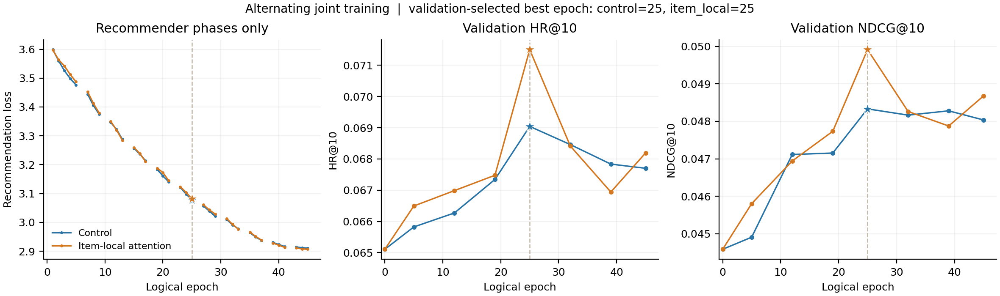

# Stage07交替联合训练结果与验收记录

A组control和B组item_local均完成45个逻辑轮、验证选模及唯一正式测试。B测试NDCG@10相对A增加**0.424972%**，HR@10增加**0.279018%**，未达到预设的“NDCG@10至少提高3%，且HR@10不降”初筛门槛。正式成对审计、资源释放核验、335件归档文件校验及14份本地权重/训练状态回读均已通过，曲线已生成并检查。

本轮按用户后续确认的“两组交替联合训练、累计28 GPU小时”执行，取代最初固定SID、单组和8 GPU小时方案；此前失败、中止及短测的资源消耗均计入累计预算。

研究问题是：**码本已接受推荐反馈后，在历史商品的码位间加入局部注意力，能否进一步改善推荐？**两组使用同一05 refined_joint暖启动、seed2024、数据及交替配方，共同基础权重、初始RNG和SID已核对一致，仅局部注意力开关不同；全局Mixer均关闭。

模块位于历史SID embedding之后、item_mlp压缩之前：输入/输出均为`[B,L,4,256]`，只在同一商品4个码位间做1层4头残差注意力，新增263,680参数，dropout=0、输出投影零初始化。先训练5轮推荐器，再循环1个Tokenizer阶段＋3轮推荐器，最多45轮。推荐器阶段冻结码本；Tokenizer阶段冻结推荐器及local参数，但保留梯度路径，经DIGER-ST将推荐损失传向基础码本，与其他损失共同更新码本。文本特征和OPQ固定。

验证和测试均为SID级。选模取`0.8×NDCG@10＋0.2×HR@10`首个最大值，含epoch0；每完成5轮推荐器验证一次，patience=5。验证beam32，测试beam256；测试前重载最佳权重及对应SID，每组只测一次。

两组完整训练均包含35轮推荐器/3640次更新、10个Tokenizer阶段/60次更新，均按45轮上限结束；最佳验证均在逻辑轮25。下表指标和绝对差采用0–1数值，相对变化为`100×(B/A−1)`。结果取自原始CSV和正式产物，已核对选中权重、对应SID及一次测试绑定，并通过本地备份回读。

| 指标 | A最佳验证 | B最佳验证 | A最终测试 | B最终测试 | 测试差B−A | 测试相对变化 |
| --- | ---: | ---: | ---: | ---: | ---: | ---: |
| HR@5 | 0.06394491 | 0.06577829 | 0.05446496 | 0.05598533 | +0.00152037 | +2.791461% |
| HR@10 | 0.06904262 | 0.07150203 | 0.08013236 | 0.08035595 | +0.00022358 | +0.279018% |
| NDCG@5 | 0.04663222 | 0.04802169 | 0.03809947 | 0.03868087 | +0.00058140 | +1.526006% |
| NDCG@10 | 0.04833184 | 0.04991417 | 0.04636612 | 0.04656316 | +0.00019704 | +0.424972% |
| legal@10 | 0.99991057 | 0.99986585 | 1.00000000 | 1.00000000 | 0 | 0% |
| duplicate@10 | 0.35535036 | 0.36054197 | 0.00208827 | 0.00181550 | −0.00027277 | −13.062099% |
| 加权分数 | 0.05247400 | 0.05423175 | 0.05311937 | 0.05332172 | +0.00020235 | +0.380937% |

A、B最佳SID的碰撞统计均为：12101件商品、10651个唯一SID，2171件商品处于721个非单例组内，最大组40件，碰撞率17.9407%；已从实际备份的最佳权重逐项计数，见[最佳SID统计](BEST_SID_STATISTICS_20261020_final_r3.json)。两组SID哈希不同，相同的碰撞数量不代表商品编码相同。SID碰撞不同于解码duplicate@10，后者降低也不能替代推荐主指标。另一个指标`duplicate_ratio`衡量跨用户batch重复，A/B分别为0.16881855/0.17097639，不能与单用户列表的duplicate@10混用；两组`legal_ratio`均为1。

B最佳验证相对A同轮的NDCG@10高3.27%、HR@10高3.56%，但没有转化为同幅度的测试收益。本次单seed观察是测试指标小幅增加、主要初筛未通过；既不能据此认定局部注意力确定有效，也不能认定它彻底无效。

03采用固定PSE及新初始化推荐器，本轮使用Refined-PSE暖启动和交替优化，训练修复与配方亦不同。以下只作历史背景，不能将差异归因于local；主要对照仍是本轮A。

| 指标 | 03历史原版 | 本轮B减03 | 相对变化 |
| --- | ---: | ---: | ---: |
| HR@5 | 0.05205026 | +0.00393507 | +7.560137% |
| HR@10 | 0.07490051 | +0.00545544 | +7.283582% |
| NDCG@5 | 0.03656713 | +0.00211374 | +5.780435% |
| NDCG@10 | 0.04391883 | +0.00264433 | +6.020956% |

最值得后续验证的一个假设是：**局部模块收益可能对解码搜索协议敏感。**验证使用beam32，测试使用beam256，但数据划分也不同，现有结果不能区分搜索宽度、泛化差异或单seed波动。最小后续检查是在同一验证集上，固定本轮两组最佳权重及各自SID，比较beam32/256下的组间差值；不再训练，也不再次用测试集选方案。这是假设，不是已确认原因，本轮未追加这项实验。

所有GPU已释放。累计8个作业分配26741秒，即**7.428056 GPU小时**，包含旧失败、中止、短测和两组正式训练，低于用户批准的28小时上限。这是实际分配时长，不是平台结算金额。

成对审计的精度边界：原CPU FP32/FP64最近邻检查在四份最佳/末轮权重中分别有1/4/3/4个码位差异。仅将点积操作数按TF32格式舍入的独立CPU复演，在同一舍入模式下精确匹配全部193616个码位；r3据此通过，原差异和失败收据保留。这不等于追溯了历史CUDA精度开关。没有修改训练权重、SID或测试结果，详见[精度说明](postprocess_tools_r3/README.md)。

下图从归档中的真实CSV生成，星号为验证选中的第25轮；左图只画推荐器阶段，断点对应Tokenizer阶段，不把两种损失混画。测试点不参与曲线选模。

备份位于`outputs/stage07_item_local_joint/delivery_20261020_final_r3/`：`package/`保存两个原始分卷及清单，`verified/`保存335件校验后的源码、配置、日志、权重和证据。两组最佳权重分别在`verified/runs/stage07_item_local_joint_{control,item_local}_seed2024_20261020_r1/training_state/best_model.bin`；[归档清单](../../../outputs/stage07_item_local_joint/delivery_20261020_final_r3/package/PACKAGE.json)和[字节校验](../../../outputs/stage07_item_local_joint/delivery_20261020_final_r3/verified/BYTE_VERIFICATION.json)可直接追溯。

13件输入在远端逐件核对并保存身份，原始数据/cache字节未随包打入；本地完成的是归档字节校验与实际CPU权重/状态读取，未执行完整异地训练恢复。远端原件保留在`/inspire/hdd/global_user/<inspire-account>/nancy/experiment1_stage07/goal_20261020_item_local_joint_r2/`，训练源码保持冻结，未将另一任务的本地修改同步过去。

验收证据：[真实成对审计](JOINT_PAIR_AUDIT_20261020_r3.json)、[累计资源及释放](ALLOCATION_FINAL_R2.json)、[实际14份权重回读](LOCAL_CHECKPOINT_READBACK_20261020_final_r3.json)、[曲线输入与选模](curves_20261020_final_r3/CURVE_INPUTS_AND_SELECTION.json)、[总验收索引](FINAL_ACCEPTANCE_20261020_r3.json)。

证据：[正式完成观察](progress_snapshots/item_local_formal_completed_20261020.json)、[结果算术复核](RESULTS_COMPARISON_R2.json)、[共同起点](FORMAL_PAIR_INITIALIZATION_MATCH_R2.json)、[A结果核对](control_final_r2_20261020/CONTROL_RESULT_REVIEW.json)、[A原始评估CSV](control_final_r2_20261020/control_evaluation_metrics_20261020T103144Z.csv)、[B第25轮原始CSV](progress_snapshots/item_local_validation_through25_20261020_1934.csv)、[历史边界](HISTORICAL_BACKGROUND.json)、[联合训练范围修正](SCOPE_OVERRIDE_20261020.json)。
