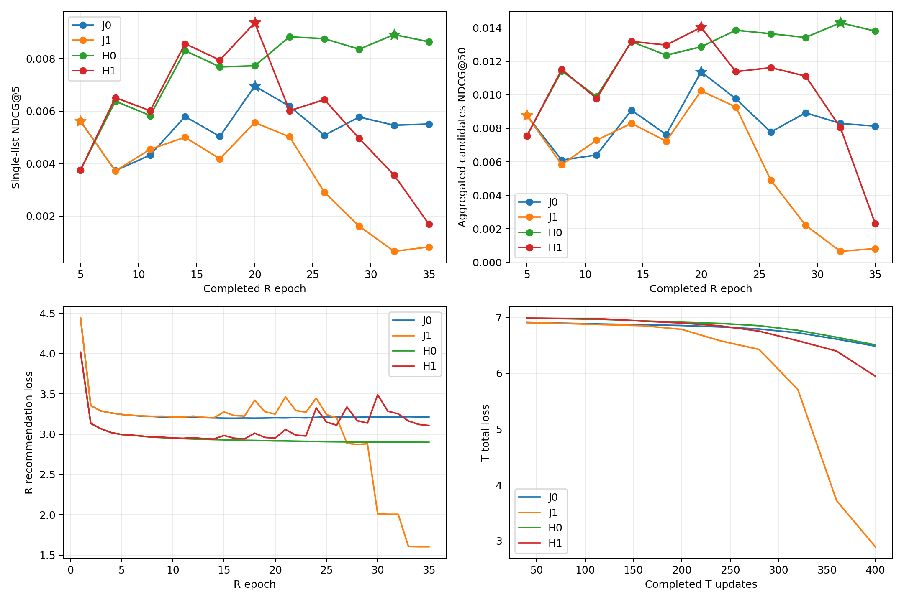

# 09｜KuaiRec五商品列表生成与码本交互：最终报告

2026-10-28。四组训练、统一测试、逐样本复算、用户配对区间及本地恢复均已验收。所有GPU已释放；本轮未追加调参或新seed。

**本轮没有证明码本交互提高测试推荐质量。H1验证best有小幅优势，但测试NDCG@5比H0低7.71%；同时发现H1/J1后期码字使用塌缩。下一步值得做的是一个控制后期编码更新的小诊断，而不是直接认定交互有效或扩大模型。**

## 1. 这轮想验证什么

核心问题是：**从单商品预测扩展到五商品列表生成后，全局码本交互能否提高推荐质量？** 两种列表结构各做一对开关对照，优先看同架构中加入 Full Mixer 的差值。J 与 H 的比较用于了解结构差异，不能把两者的差距直接归因于 Mixer。

这轮保留 DiffGRM 的 PSE、OCN/CPD 思路和项目已有的交替联合训练。OneRec 提供按请求组织多商品输出的参考，但本轮不是 OneRec 复现，也不是前期的商品内注意力实验。依据见[实施方案](../../docs/research/onerec_listwise/MODEL_EXPERIMENT_PLAN_20261027.md)和[逐项来源](../../docs/research/onerec_listwise/IMPLEMENTATION_REFERENCES.md)。

## 2. 数据与任务

使用 KuaiRec 2.0 big_matrix 和静态商品文本，目录共 **10,728 件商品**。按30分钟间隔划人工会话，从段首每五条切块，保留五件互异、均有正播放、跨度不超过600秒且已有至少五条历史的块。输入为目标发生前最近5–50件已播放商品，标签为接下来的五件；主版本不要求五件总播放达到60秒。

| 划分 | 五件列表样本数 |
|---|---:|
| 训练 | 709,443 |
| 验证 | 71,657 |
| 测试 | 53,194 |

划分采用全局时间切点，跨切点的整个人工会话不贡献目标。验证、测试按当时已发生的历史滚动构造，当前及未来目标不进入输入。保留冷目标，也不排除历史看过的商品。

**这些是人工构造的消费续接列表，不是真实曝光请求中的推荐列表。** 正播放也不等于强偏好；全目录静态文本可离线使用是本轮假设，文本并非已证实的历史时点快照。因此结论首先适用于这一代理任务。具体规则、切点和验收见[数据报告](../../docs/research/onerec_listwise/kuairec_preparation/REPORT.md)、[数据清单](../../docs/research/onerec_listwise/kuairec_preparation/MANIFEST.JSON)。

## 3. 模型与公平对照

商品文本经冻结 BGE-M3 得到1024维内容向量，再经 PCA/OPQ 和残差 PSE 编为四个码。四套码本各有256个64维中心；推荐器内部 SID embedding 宽度为256维，二者不是同一套向量。四组共用内容资产、初始码本 E0 和初始 SID0。

| 组别 | 列表生成方式 | Full Mixer |
|---|---|---|
| J0 / J1 | 五件商品的20个码位共同去噪，四套码本及输出表跨商品共享 | 关 / 开 |
| H0 / H1 | 外层依次生成五件商品，每件内部仍用四码 DiffGRM；训练用真实前缀，推理只用已生成前缀 | 关 / 开 |

骨干为1层 Encoder、4层 Decoder，hidden256、4头、FFN1024，dropout0.1。J/H 都采用置信度驱动的逐码搜索，最多20个逻辑填码阶段，不能称为一步生成。

Full Mixer 是对全局码本做 full attention，4头、残差系数固定1、输出投影零初始化，使分叉时有效码本仍为 E0；没有加入07的商品内注意力或已退役的08模块。**四组全部交替联合训练，包括关闭 Mixer 的 J0/H0；关闭交互不等于冻结码本。**

同架构先完成一次固定 PSE、关闭 Mixer 的5R推荐器暖身，再复制模型、码本/SID、优化器、调度器和 RNG 给两个分支。成对起点验收已通过；J 与 H 分别暖身，不要求跨架构权重相同。模型来源和实现见[实现说明](../../docs/research/onerec_listwise/IMPLEMENTATION.md)，实际源码/数据/资产绑定见[FORMAL_BRANCH_BINDING.json](formal_execution_20261027/FORMAL_BRANCH_BINDING.json)。

共同初始资产有9,513个唯一 SID，1,505件商品处于碰撞桶，占14.03%。工程一致性验收已通过，但碰撞仍限制商品区分能力；不能据此宣称表示质量足够好。见[PSE清单](assets_preparation_20261027/PSE_MANIFEST.json)和[资产审计](assets_preparation_20261027/PSE_ASSET_AUDIT.json)。

## 4. 已锁定的训练设置

每个分支在共享5R后执行10轮「40次 T 更新＋3个 R epoch」，计划累计 **35R / 400T**。R更新推荐器、固定Tokenizer；T固定推荐器，以推荐损失及重构/均衡/锚定项更新码本和启用的Mixer，随后刷新SID。优化器状态跨阶段保留。

- 正式微批256，梯度累积4次，有效batch1024；每R epoch为693次更新，每模型计划24,255次R更新。
- 推荐器峰值学习率1e-3，前500次R更新warmup，随后按全程24,255次R更新做cosine衰减；码本1e-5、Mixer1e-4，T优化器没有学习率调度器。推荐/重构/balance/anchor权重分别为1/1/0.01/0.01。两组配对使用相同设置。T的Gumbel噪声由1衰减到0.2，是采样噪声调度，不是T学习率衰减。
- 训练使用 BF16；推荐解码实际使用 FP32并关闭TF32。推理batch32。
- 正式分支在同一个 Job 内使用2张 H100、4个独立进程：GPU0为J0/H0，GPU1为J1/H1；每模型只见一张卡，不使用DDP。

共享暖身只计算一次，已经验收的实际训练工作量为130R、90,090次R更新、1,600次T更新，不是重复计算暖身的140R；35R和5R暖身均未被证明是最优预算或收敛保证。

正式批量设置以[R2配置](preparation_20261027/runtime_efficiency_r2.json)为准；[base.json](../../configs/09_kuairec_listwise/base.json)保留的是初始微批16、推理batch4，不能拿它们描述实际运行。源码冻结为`1c423662d9a25a926328ee6466c30c0f2857b4f6`，其引擎版本和文件hash由上述绑定记录。

## 5. 怎么评价、怎么选模型

**主指标是最高分单份五件列表的真实商品级 NDCG@5**，同时报告 HR@5、Recall@5。五个目标按相关商品集合评价，不要求预测顺序逐项复现未来消费顺序；训练仍保留时间顺序。HR为是否至少命中一件，Recall为命中数/5，NDCG按预测名次折扣，理想排序包含五件相关商品。

验证和正式测试统一全局 beam32。目录约束检查已填码位，SID碰撞按重构误差、原始商品ID顺序消歧；不能将整个碰撞桶算作命中。列表内去重、缺项补PAD，不过滤已看历史。

另外将最多32份完整五件候选列表按分数排序，再按「列表名次→列表内位置」展开、首次出现去重，统计聚合 HR/Recall/NDCG@10、@20、@50，并报告候选覆盖和缺项。**聚合@50评价的是多列表候选池，不是模型一次生成一份50件列表的质量。**

完整验证安排为R5、R8、R11……R35，按单列表 NDCG@5 选择best，平局取较早轮次。每臂有11个验证点，但共享R5后实际共42次完整验证。四组best全部冻结后才做一次统一测试，测试结果不参与选模。固定R35结果另行保留。

最终解释以实际选中checkpoint的R/T计数为准：J1 best已确认停留在共享R5，0次T更新，不能把其测试表现解释为后续交替联合训练或Mixer学习带来的收益。报告同时展示best和固定R35结果。

beam32/256敏感性检查只使用事先按sample_id哈希选定的同一[1,024条验证清单](preparation_20261027/validation_hash1024.json)，沿用各组已冻结best，不重选模型、不改候选聚合规则。两种beam都最多取32份有效完整列表聚合；beam256扩大搜索路径数，不扩大聚合列表上限。

正式分析按J0→J1、H0→H1配对，在同一场景下做10,000次用户聚类bootstrap：抽用户时保留其全部样本，主结果为样本平均，另报用户等权平均及冷/已见目标组均值。冷目标组指至少一件目标未在实际训练样本中出现。本轮仅训练seed2024，用户置信区间不能证明跨seed稳定。准确复算命令见[最终分析清单](formal_execution_20261027/FINAL_ANALYSIS_COMMANDS.md)。

## 6. 最终测试结果

四组按完整验证集预先选出的best，在同一53,194条测试样本、4,153名用户上评估。下表来自独立逐样本复算。

| 模型 | best R/T | 单列表NDCG@5 | HR@5 | Recall@5 | 聚合NDCG@50 | 候选覆盖@50 |
|---|---|---|---|---|---|---|
| J0 | 20 / 200 | 0.005795 | 0.028424 | 0.005745 | 0.009883 | 36.80% |
| J1 | 5 / 0 | 0.004605 | 0.023499 | 0.004722 | 0.007640 | 32.63% |
| H0 | 32 / 360 | 0.008607 | 0.039309 | 0.008110 | 0.014058 | 39.69% |
| H1 | 20 / 200 | 0.007944 | 0.037297 | 0.007617 | 0.013097 | 43.35% |

所有模型单份五件列表的完整输出率为100%，重复率和非法率为0。候选覆盖@K是每条样本实际不同候选数（最多K）除以K后取平均，不是全目录覆盖率。聚合@50的平均有效候选少于50，缺项按既定PAD规则处理。

| 模型 | K | 聚合HR@K | Recall@K | NDCG@K | 候选覆盖@K |
|---|---|---|---|---|---|
| J0 | 10 | 0.049554 | 0.010114 | 0.008181 | 99.11% |
| J0 | 20 | 0.065421 | 0.013449 | 0.009634 | 82.83% |
| J0 | 50 | 0.068542 | 0.014129 | 0.009883 | 36.80% |
| J1 | 10 | 0.038162 | 0.007779 | 0.006268 | 98.01% |
| J1 | 20 | 0.051209 | 0.010497 | 0.007452 | 74.88% |
| J1 | 50 | 0.053446 | 0.011020 | 0.007640 | 32.63% |
| H0 | 10 | 0.064613 | 0.013460 | 0.011532 | 99.87% |
| H0 | 20 | 0.085950 | 0.018183 | 0.013565 | 87.82% |
| H0 | 50 | 0.091928 | 0.019532 | 0.014058 | 39.69% |
| H1 | 10 | 0.063541 | 0.013144 | 0.010974 | 99.90% |
| H1 | 20 | 0.081363 | 0.017115 | 0.012705 | 89.71% |
| H1 | 50 | 0.086100 | 0.018201 | 0.013097 | 43.35% |

### 配对差值与证据边界

在同一用户内保留全部样本，按用户有放回抽样10,000次。下表区间对应样本平均差值，均为未校正的逐指标95%区间。

| 比较 | 指标 | 绝对差值 | 相对差值 | 95%用户聚类区间 |
|---|---|---|---|---|
| J1−J0 | list/ndcg@5 | -0.001190 | -20.53% | [-0.001587, -0.000801] |
| J1−J0 | aggregate/ndcg@50 | -0.002242 | -22.69% | [-0.002688, -0.001807] |
| H1−H0 | list/ndcg@5 | -0.000663 | -7.71% | [-0.001103, -0.000237] |
| H1−H0 | aggregate/ndcg@50 | -0.000961 | -6.84% | [-0.001437, -0.000503] |

H组两项区间都在零以下，在这两个固定模型和本次测试用户分布下，下降不只是点估计的微小波动。但这是单个训练seed，不能用用户抽样代替多seed复验。J1的best来自共同暖身、T=0；J1测试低于J0，说明这次带Mixer的训练轨迹没有选出优于暖身的状态，不能把该best视为已学会交互的模型。

### 用户平均与冷目标分组

冷目标组指五件目标中至少有一件未出现在实际训练样本中；这不是只对冷商品计算指标。所有目标均已核对原始split和train_seen。

| 模型 | 用户等权NDCG@5 | 含冷目标7,639条 | 全已见目标45,555条 |
|---|---|---|---|
| J0 | 0.004601 | 0.003997 | 0.006096 |
| J1 | 0.004045 | 0.003089 | 0.004859 |
| H0 | 0.006303 | 0.004352 | 0.009321 |
| H1 | 0.006034 | 0.004523 | 0.008517 |

H1在含冷目标组的点估计略高，全部已见目标组较低；这只是探索性分组结果，不构成冷启动收益结论。各指标、用户平均差值与区间详见[完整机器可读结果](SUMMARY.json)。

## 7. 验证轨迹与编码退化

| 模型 | best轮次 | best验证NDCG@5 | 固定R35验证NDCG@5 | best / R35聚合NDCG@50 |
|---|---|---|---|---|
| J0 | 20 | 0.006955 | 0.005508 | 0.011375 / 0.008131 |
| J1 | 5 | 0.005607 | 0.000818 | 0.008771 / 0.000818 |
| H0 | 32 | 0.008920 | 0.008645 | 0.014309 / 0.013809 |
| H1 | 20 | 0.009372 | 0.001685 | 0.014033 / 0.002297 |

H1在R8、11、14、17、20超过同期H0，R20以后明显退化。这些点来自同一训练轨迹，不能当作五次独立实验。H1与H0各自best的验证差为+5.07%，不能用同轮R20的+21.27%替代。J1损失下降却指标恶化，也说明只看SID预测损失可能掩盖表示区分能力的损失。

| 状态 | 不同SID数 | 碰撞商品比例 | 四槽使用码字数 | Mixer修正/基础码本整体范数 |
|---|---|---|---|---|
| H0 best R32 | 9513 | 14.02% | 256/256/256/256 | 0.000 |
| H0 last R35 | 9513 | 14.01% | 256/256/256/256 | 0.000 |
| H1 best R20 | 9600 | 12.91% | 181/137/190/218 | 0.824 |
| H1 last R35 | 2551 | 91.41% | 8/17/15/13 | 4.230 |
| J1 best R5 | 9513 | 14.03% | 256/256/256/256 | 0.000 |
| J1 last R35 | 1 | 100.00% | 1/1/1/1 | 4.763 |

碰撞商品比例是位于多个商品共享的SID桶中的商品占比，不是这些商品全部无法推荐。CPU FP32和独立FP64距离重算都与checkpoint SID一致，排除了这些端点的缓存未刷新。端点只能确认晚期退化，不能定位第一次塌缩的T更新，也不能单凭它判定学习率就是根因。

## 8. 固定验证子集的beam敏感性

所有模型沿用冻结best，在事先固定的1,024条验证样本上比较beam32/256；均最多聚合32份列表，不重新选模。

| 模型 | beam | 单列表NDCG@5 | 聚合NDCG@50 | 候选覆盖@50 | 推理秒 |
|---|---|---|---|---|---|
| J0 | 32 | 0.007322 | 0.012849 | 38.23% | 52.07 |
| J0 | 256 | 0.007638 | 0.017018 | 36.98% | 293.20 |
| J1 | 32 | 0.004949 | 0.007735 | 31.56% | 49.65 |
| J1 | 256 | 0.003765 | 0.008550 | 35.20% | 287.31 |
| H0 | 32 | 0.008769 | 0.014703 | 39.12% | 39.09 |
| H0 | 256 | 0.007051 | 0.013100 | 25.35% | 205.37 |
| H1 | 32 | 0.010838 | 0.014574 | 40.55% | 35.89 |
| H1 | 256 | 0.009053 | 0.013735 | 24.45% | 193.04 |

H1相对H0的子集NDCG@5点估计在两种beam下都为正，但两个用户配对区间都跨零；不能据此推翻完整测试下降。beam256使H0/H1自身的单列表NDCG@5都下降，也没有稳定提高聚合指标。扩大搜索更充分地优化模型分数，不保证分数排序更符合真实商品相关性。子集较小且没有做同模型跨beam的配对区间，不作显著性结论。

## 9. 下一步最值得验证的问题

**从H1 R20保留已学到的交互表示，停止或减弱后续编码更新，能否避免塌缩并保持推荐质量？**

建议同一个完整R20状态分叉到R26：A保持原设置，B只把Mixer学习率1e-4降为3e-5，C固定基础码本、Mixer和SID，只继续推荐器。若只做一支干预，先C。原A轨迹只有在恢复一致性通过后才可复用。3e-5是待验证的诊断值，不是论文给出的最优值。

保留优化器状态、R的35轮调度和数据阶段编号；A/B继续原400T噪声时钟，C明确停止T。R26完整验证NDCG@5为预先固定主判据，R23看轨迹；逐T边界记录有效码字/SID数、碰撞率、编码变化和残差范数。不要同时改学习率、损失、噪声和交互结构。

这首先验证能否止跌；超过旧H1峰值、跨seed稳定超过H0是另外两步。H1测试best仍低于H0，后续参数只能按验证选择，不能把当前测试变成调参依据；正式新结论需要公平给H0调参机会及额外seed。方案与ETEGRec、BLOGER、DACT、DIGER的可借鉴部分和区别见[训练设置调研](../../docs/research/onerec_listwise/H1_TRAINING_STABILITY_REVIEW_20261028.md)。本轮没有执行上述新增分支。

## 10. 资源、恢复和验收

累计13个Job分配148,316 GPU秒，即 **41.198889 GPU小时**，低于75小时授权上限。含内容编码、短验收、共享GPU测速、暖身、训练、评估及失败H1 r1的522秒；所有GPU原生释放事件均已核实。按已核实1点/GPU小时估算 **41.20点，未核实结算**。

正式四分支在2张H100上运行4个独立进程，GPU0=J0/H0，GPU1=J1/H1，无DDP；共享暖身2个单卡Job，最终四组评估各一个单卡Job。H1首次评估因NodeNotReady失败，r2仅改任务和产物路径，模型、参数和数据不变，失败证据及0字节输出保留。

| 模型 | 完整测试推理秒 | 完整测试分钟 |
|---|---|---|
| J0 | 2564.24 | 42.74 |
| J1 | 2440.31 | 40.67 |
| H0 | 1843.89 | 30.73 |
| H1 | 1862.88 | 31.05 |

上述是实际批量离线评估耗时，不是单请求线上延迟，不包含整个Job分配时间。

- 远端来源：`/inspire/hdd/global_user/<inspire-account>/nancy/experiment1_stage09/goal_20261027_r1`。
- 本地归档：`C:/Users/nancy/Documents/experiment1/outputs/stage09_delivery/goal_20261027_r1`。
- 独立恢复：`C:/Users/nancy/Documents/experiment1/outputs/stage09_restore/goal_20261027_r1`。
- 两份暖身、四组initial/best/last、42份验证、12份最终评估、运行日志、共同资产和三份源码bundle均有SHA绑定；模型checkpoint包含优化器、调度、RNG及SID。代表J1/H1严格CPU恢复与无目标前向通过。
- 12份最终预测和8个best/R35角色完整验证已独立复算；6份用户配对bootstrap已完成。已有本地数据只核对SHA，没有重新迁移。

验收入口：[资产与恢复复核](formal_execution_20261027/FINAL_LOCAL_ASSET_VERIFICATION_20261028.json)、[四best冻结](formal_execution_20261027/FOUR_BEST_FREEZE_20261028.json)、[GPU释放与费用](formal_execution_20261027/ALL_GPU_RELEASE_ACCOUNTING_20261028.json)、[交接说明](HANDOFF.md)。
