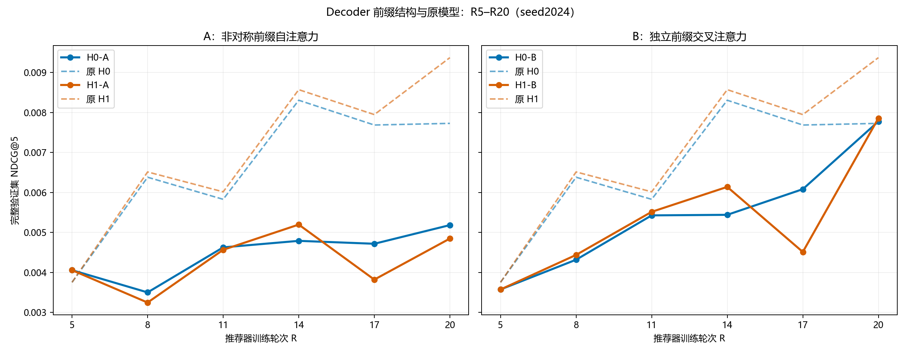

# Decoder 前缀四组实验结果

四组均为 seed2024，microbatch256、有效 batch1024，训练到 R20/T200。A 使用非对称前缀自注意力；B 使用独立前缀交叉注意力。H0 不加 Mixer，H1 加 Mixer。真实历史固定编码，已生成商品作为 Decoder 前缀。

H0/H1 在各自 A 或 B 内共享一致的 R5 暖身状态；A、B 和原模型的结构、初始化及暖身起点不同。因此与原模型比较的是整体方案，不能把差值归因于单个模块。

## 最佳点和最终点

best 仅按六个完整验证节点的 NDCG@5 选择，未按测试集选模型。

|组别|best轮次|best验证|best测试|R20验证|R20测试|
|---|---:|---:|---:|---:|---:|
|H0-A|R20|0.005184|0.005627|0.005184|0.005627|
|H1-A|R14|0.005197|0.005370|0.004847|0.003557|
|H0-B|R20|0.007777|0.007382|0.007777|0.007382|
|H1-B|R20|0.007857|0.005828|0.007857|0.005828|

## 与原模型同预算比较

原模型也只在 R5–R20 的验证节点中选择 best，不使用 R20 之后的结果。

|原模型|best轮次|best验证|best测试|R20验证|R20测试|
|---|---:|---:|---:|---:|---:|
|原 H0|R14|0.008307|0.008923|0.007728|0.007756|
|原 H1|R20|0.009372|0.007944|0.009372|0.007944|

四个新版本的验证所选 best 测试均低于各自原模型。新版本中 H0-B 最好，但其 best 测试比原 H0 best 低约 17.3%；固定 R20 下比原 H0 低约 4.8%。H1-B best 测试比原 H1 低约 26.6%。当前单 seed 结果不支持新前缀结构已经超过原模型；是否存在训练速度、超参数适配或多 seed 方面的机会，需要另行设计实验，不能由本次结果直接确定。

来源：BASELINES_R20.json、BASELINES_R20_EXTRA.json 与 BASELINE_R5_VALIDATION.json；排除 EXTRA 中非原 H0/H1 的分支。

## 逐轮验证 NDCG@5

|R/T|H0-A|H1-A|H0-B|H1-B|原H0|原H1|
|---|---:|---:|---:|---:|---:|---:|
|R5/T0|0.004057|0.004057|0.003574|0.003574|0.003753|0.003753|
|R8/T40|0.003501|0.003247|0.004318|0.004438|0.006381|0.006513|
|R11/T80|0.004627|0.004566|0.005427|0.005516|0.005829|0.006016|
|R14/T120|0.004790|0.005197|0.005441|0.006139|0.008307|0.008571|
|R17/T160|0.004717|0.003821|0.006083|0.004512|0.007687|0.007948|
|R20/T200|0.005184|0.004847|0.007777|0.007857|0.007728|0.009372|

## 观察与边界

- B 的验证表现优于 A；B 两组在 R20 均取得最佳验证结果。
- A 中 H1 的 best 测试低于 H0，且 H1 的 R20 测试进一步下降。
- B 中 H1 验证比 H0 高约 1.02%，但测试低约 21.05%；尚不支持 Mixer 在新前缀结构下有稳定收益。
- 只有一个 seed，不能据此确定结构优劣或把波动归因于某个具体机制。

## 运行与验收说明

原作业在 12 小时时限后停止；训练更新已经完成，恢复作业仅补完评估。B 的 best 与 R20 checkpoint SHA256 完全一致，完整 best 测试覆盖 53,194 条，因此固定 R20 复用该结果，重复第二次测试主动停止，平台终态不能写成 SUCCEEDED。依据见 B_REUSE_VERIFIED.json。

24 个验证 checkpoint 的 SHA、可读取性和更新计数核验通过；R5 组内共同状态核验通过。最终资源释放和总验收仍待完成。

## 训练曲线

新组使用实线、原模型使用虚线；同色对应相同 H0/H1。横轴仅为已完成的完整验证节点，连线不代表中间每轮都有评估。
