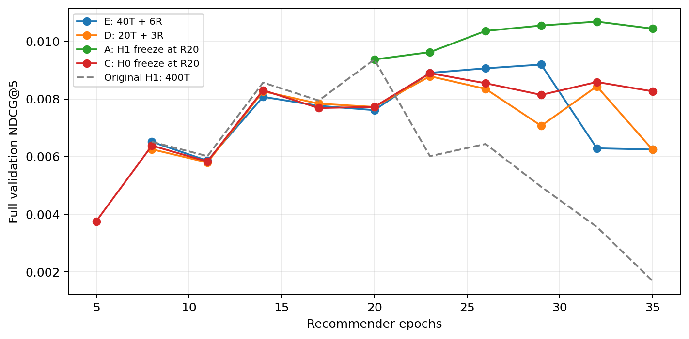
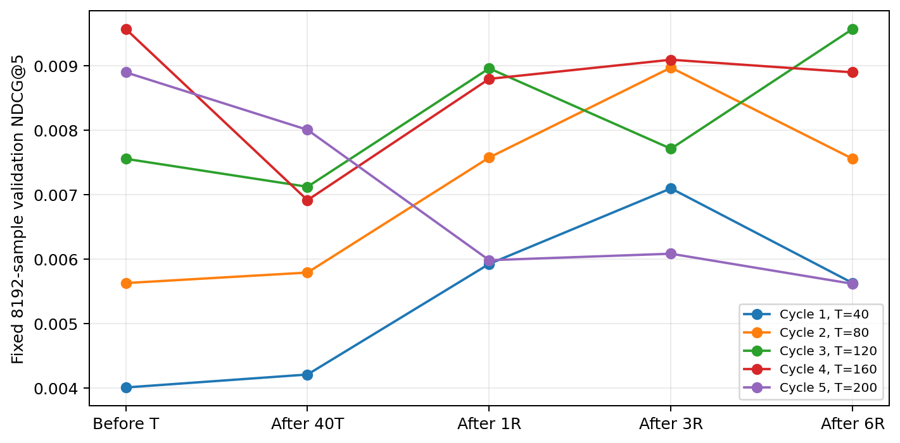
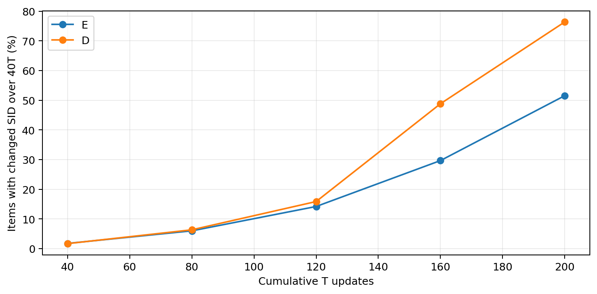

# E：40T＋6R 实验结果与验收

## 1. 实验改变与对照

从原H1完整R5/T0状态出发，E执行5次“40T＋6R”，最终R35/T200。D是10次“20T＋3R”，总R/T相同；A在原H1的R20/T200冻结Tokenizer，推荐器继续到R35。E只改变交替安排，沿用D单卡实现、全局batch1024（256×4）、seed2024、原样本/阶段种子映射、双优化器、35R学习率时钟及400T噪声时钟。

最初八卡尝试没有进入正式训练；本报告E结果来自唯一单H100正式分支。因此不再将“八卡与单卡执行后端不同”作为本次E对D的混杂因素。但40T块大小和6R间隔同时改变，仍不能把差异唯一归因于推荐器适应时间。

| 组别 | 共享5R后的安排 | 终点 | 对照用途 |
| --- | --- | --- | --- |
| 原H1 | 10×(40T＋3R) | R35/T400 | 原始持续联合训练 |
| A | 5×(40T＋3R)，随后冻结T继续15R | R35/T200 | 前期完成T、后期保留编码 |
| D | 10×(20T＋3R) | R35/T200 | 较小T块分散更新 |
| E | 5×(40T＋6R) | R35/T200 | 40T块与更长连续R窗口 |
| C | H0无Mixer，R20/T200后冻结T | R35/T200 | 与A同冻结点的交互对照 |

## 2. 固定R35/T200：主比较

| 模型 | R | T | 测试NDCG@5 | HR@5 | Recall@5 |
| --- | --- | --- | --- | --- | --- |
| E | 35 | 200 | 0.004845 | 0.021939 | 0.004429 |
| D | 35 | 200 | 0.005528 | 0.025360 | 0.005132 |
| A | 35 | 200 | 0.008956 | 0.041715 | 0.008539 |

E相对D的固定终点NDCG@5变化为-12.35%，绝对差-0.000683，用户聚类配对bootstrap 95%区间[-0.001081, -0.000262]。

E相对A的固定终点NDCG@5变化为-45.90%，绝对差-0.004111，用户聚类配对bootstrap 95%区间[-0.004537, -0.003671]。

## 3. 按共同验证网格选择的best（次要结果）

只从R20/23/26/29/32/35按验证NDCG@5选模，平局取较早；测试不参与选模。固定R35与best共两次测试，未因结果较差追加模型。

| 模型 | best R | T | best测试NDCG@5 |
| --- | --- | --- | --- |
| E | 29 | 160 | 0.008621 |
| D | 23 | 120 | 0.008074 |
| A | 32 | 200 | 0.009431 |

best比较同时存在R/T进度差异，只反映各自共同网格选模后的表现，不能替代固定R35/T200主比较。

图中各轮次的T预算不始终相同；E与D在R11/17/23/29/35的累计T相同，分别为40/80/120/160/200。

| 相同R | 相同累计T | D完整验证NDCG@5 | E完整验证NDCG@5 | E−D |
| --- | --- | --- | --- | --- |
| 11 | 40 | 0.005799 | 0.005858 | +0.000059 |
| 17 | 80 | 0.007839 | 0.007764 | -0.000075 |
| 23 | 120 | 0.008791 | 0.008909 | +0.000118 |
| 29 | 160 | 0.007070 | 0.009198 | +0.002128 |
| 35 | 200 | 0.006243 | 0.006246 | +0.000002 |

相同更新总量并不意味着相同优化路径：T发生时推荐器的参数已经不同，R发生时商品SID也不同；A最后一次T之后有15R保持编码不变，E为6R，D为3R。因此“R总量更多”不等于“对最终同一套SID的有效适应更多”。这是调度事实，不是已经验证的唯一掉分原因。

| 历史状态（测试） | R/T | NDCG@5 | 比较边界 |
| --- | --- | --- | --- |
| 原H1 best | 20/200 | 0.007944 | 同T，不同R；原全验证网格选模 |
| H1 Freeze R26 | 26/200 | 0.009157 | 与A同一冻结路线的较早节点 |
| 旧H0 best | 32/360 | 0.008607 | 无Mixer、R/T不同 |
| C固定终点 | 35/200 | 0.008256 | 无Mixer，R20冻结 |

## 4. 40T之后，1R、3R和6R如何变化

以下使用固定8192条诊断样本；3R/6R从对应完整验证预测中提取，没有重复解码。完整验证曲线与此子集曲线不能混用。

| 周期 | 累计T | T前 | 40T后 | 1R后 | 3R后 | 6R后 | 6R减3R |
| --- | --- | --- | --- | --- | --- | --- | --- |
| 1 | 40 | 0.004004 | 0.004205 | 0.005924 | 0.007098 | 0.005626 | -0.001471 |
| 2 | 80 | 0.005626 | 0.005790 | 0.007578 | 0.008975 | 0.007558 | -0.001418 |
| 3 | 120 | 0.007558 | 0.007123 | 0.008963 | 0.007714 | 0.009576 | +0.001862 |
| 4 | 160 | 0.009576 | 0.006915 | 0.008800 | 0.009097 | 0.008901 | -0.000196 |
| 5 | 200 | 0.008901 | 0.008008 | 0.005982 | 0.006083 | 0.005615 | -0.000468 |

五个周期中，3R到6R的诊断NDCG@5有1次上升、4次没有上升。这是保存状态的描述性结果，不代表多给3R总能恢复，也不能独立证明Tokenizer退化或过拟合。

第3R至第6R之间没有T更新，SID保持不变，因此这些区段的下降不能直接归因于期间SID再次刷新。最后周期从40T后到首R后继续下降，6R结束仍未恢复到T前；推荐器继续优化也不保证推荐指标单调恢复。

## 5. SID变化：按相同累计40T端点比较

| 累计T | E变化商品% | D变化商品% | E碰撞商品% | E四槽使用数 | E Mixer相对幅度 |
| --- | --- | --- | --- | --- | --- |
| 40 | 1.73 | 1.66 | 13.99 | 256/256/256/256 | 0.026324 |
| 80 | 5.98 | 6.32 | 13.98 | 256/256/256/256 | 0.068238 |
| 120 | 14.18 | 15.85 | 13.92 | 256/256/256/256 | 0.137286 |
| 160 | 29.65 | 48.81 | 13.64 | 246/240/255/255 | 0.273170 |
| 200 | 51.53 | 76.38 | 12.90 | 188/140/210/235 | 0.685793 |

D的数值由两个实际端点快照直接比较，未相加两个20T变化率。SID变化率高不等同于编码质量下降；还需结合碰撞、码字使用、码本位移与推荐指标。完整槽位分布、位移和训练损失/梯度/学习率保留于PROCESS.json与training.jsonl。

## 6. 时间泛化（固定R35验证集）

沿用原时间切点1598745441188500微秒及训练频次五类；早期38644、后期33013样本。A/D原统计与数组直接复用，只处理E新预测。此为固定数据切片，不是在线新数据学习。

| 模型 | 早期NDCG@5 | 后期NDCG@5 | 后期减早期 |
| --- | --- | --- | --- |
| A：冻结 | 0.012458 | 0.008090 | -0.004368 |
| D：20T＋3R | 0.007601 | 0.004653 | -0.002948 |
| E：40T＋6R | 0.007904 | 0.004304 | -0.003601 |

E−A差值的后期减早期变化为+0.000768，95%区间[+0.000026, +0.001516]。频次占比变化和类内效率变化的描述性分解见TEMPORAL.json；不能从分解直接断言唯一原因。

E−D差值的后期减早期变化为-0.000653，95%区间[-0.001346, +0.000067]。频次占比变化和类内效率变化的描述性分解见TEMPORAL.json；不能从分解直接断言唯一原因。

E相对A在前后两段均更低，后段绝对负差缩小不能解释为获得更好的时间泛化。E相对D的点估计前段略高、后段更低，但上述联合时间差值区间跨零，尚不能认定相对时间衰减稳定存在。

## 7. 评价口径、局限与验收

所有新完整预测经过独立CPU复算，核验样本、标签、用户、冷启动分组及指标。保持FP32、TF32关闭、beam32、batch32、原映射/碰撞消歧/去重/PAD定义。2000次用户聚类配对bootstrap，seed2024、样本均值口径；单训练seed和多项比较仍限制结论，用户bootstrap不等于跨seed稳定性。

已核验全部R/T样本顺序、R24255/T200计数及原双时钟；20个只读任务完成且状态指纹一致；36个边界完整状态核验，关键状态从独立解压代码真实CPU恢复。CPU恢复未应用CUDA RNG，也未新增GPU下一步恢复测试；复用D既有实现依据，原CUDA RNG字节保留。

全部E GPU已释放；包含九次旧尝试总消耗10.8972GPU小时，上限24小时。完整科学备份包、逐文件SHA与独立解压均有记录。最终CPU释放、报告远端同步和heartbeat关闭以FINAL_DELIVERY_CLOSURE.json为准，不以本报告生成代替资源收尾。
