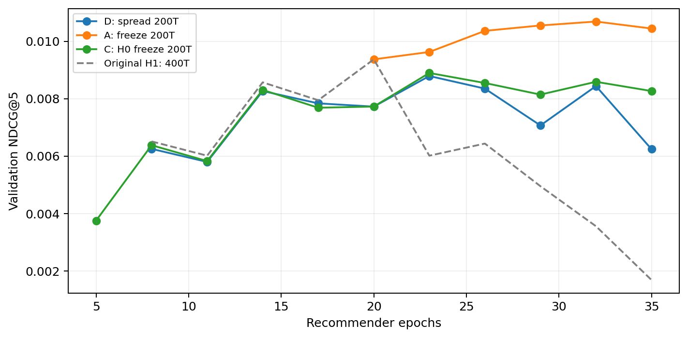
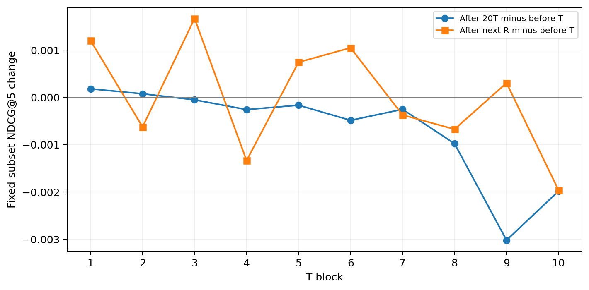
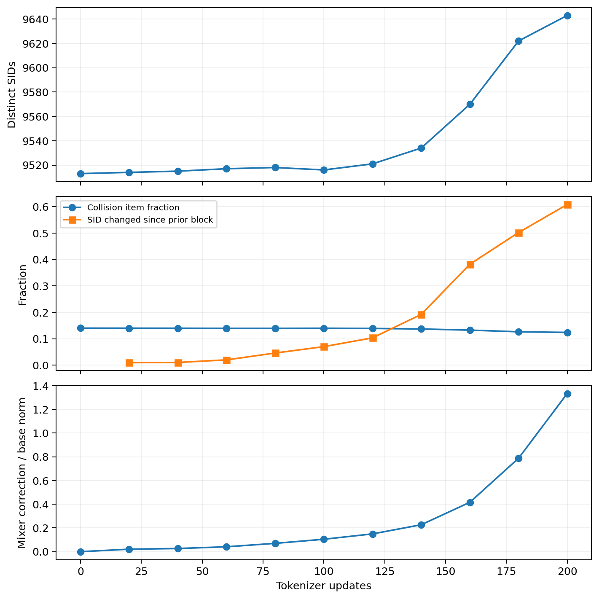
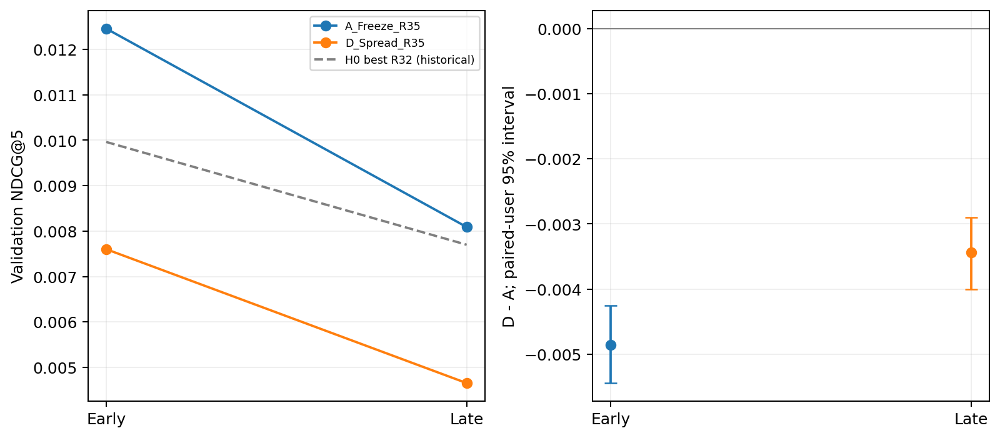

# H1低T预算分散更新实验报告

本次固定终点的D低于冻结对照A，用户重采样区间位于0以下。

本次新增唯一D分支；负结果也按原协议交付，没有据测试结果追加训练。下述区间只反映固定模型在用户样本上的不确定性，不包含训练seed、选模和事后设计的不确定性。

## 实验回答的问题

A与D均到R35/T200。A在前期完成200T后冻结，D把相同有序T样本分成10个20T块，分散到35R。R样本顺序、原35R学习率日程、400T噪声退火时钟、模型、损失和解码规则保持原绑定。后期T仍使用同一训练集，其接收梯度时推荐器已经处于更后期的状态。

因此本次主要考察相同更新预算下的时间安排。它没有实施MEDA式随机重置，也不能单凭本实验认定存在one-epoch overfitting。与原H1/T400的曲线比较同时涉及T总量与安排变化，应作辅助观察。

## 执行中断与恢复

正式作业曾中断，后续从R24第400步的完整checkpoint继续，没有从头重训，也没有把短测更新并入正式轨迹。恢复后将训练与阶段checkpoint上的只读验证放到同一张H100并行执行；模型、损失和解码源码仍使用原冻结版本，科学更新序列和预算口径保持原协议。

最终独立运维审计核对了11个恢复后只读任务：指定checkpoint、完整状态指纹和完成记录绑定一致，验证前后状态相同；首30次真实续跑也保留了原日志前缀及CUDA重放比对证据。运维包SHA为b9f829d07aded961e8508c129fb5af318e71c9bb78a2fc0c5d5ab626ac8b8b09，详情见[独立运维审计](../ASYNC_DELIVERY_AUDIT.json)。这些证据用于核对执行正确性，不代表模型效果提升。

## 固定R35主测试

| 指标 | A：冻结200T | D：分散200T | D−A | 用户聚类95%区间 |
|---|---:|---:|---:|---|
| list/ndcg@5 | 0.00895634 | 0.00552839 | -0.00342796 | [-0.00388395, -0.00297584] |
| list/hr@5 | 0.04171523 | 0.02536000 | -0.01635523 | [-0.01826039, -0.01439521] |
| list/recall@5 | 0.00853856 | 0.00513216 | -0.00340640 | [-0.00380979, -0.00300336] |

HR@5表示五件列表至少命中一个目标；Recall@5按五件目标计算。聚合@10/20/50来自32份候选列表按分数和位置去重汇总，不表示单次生成一份50件列表。完整聚合指标、候选覆盖与区间见独立分析JSON和METRICS.csv。

## 共同网格best补充

D从R20/23/26/29/32/35按验证NDCG@5选出R23/T120；A已锁best为R32/T200。补充测试NDCG@5差值为-0.00135636，区间[-0.001854786115176182, -0.0008936153203737087]。补充best的R/T预算可能不同，等预算结论依据固定R35。测试只执行固定R35和已锁best，重合时复用。

## Tokenizer扰动与推荐器恢复

固定8192条诊断集共31个状态：20份新子集推理、10份新完整验证的子集提取、1份旧R5提取复用。每个T块记录更新前、20T后、随后第一个R后及周期末；T后相对更新前的NDCG变化范围为[-0.00302182, +0.00017981]，随后第一个R后相对更新前范围为[-0.00196181, +0.00166802]。

曲线描述短期扰动和恢复，不能直接把一次下降等同于编码器退化。SID变化还要结合碰撞、码字使用、有效码本位移和Mixer幅度判断。R阶段Tokenizer状态相同已逐checkpoint核验，因此T前码本可复用上一T后的认证快照；这没有增加模型推理。

## 时间泛化

| 验证时段 | A NDCG@5 | D NDCG@5 | D−A及95%区间 |
|---|---:|---:|---|
| 前段：38644条 | 0.01245804 | 0.00760130 | -0.00485674 [-0.00544362, -0.00425047] |
| 后段：33013条 | 0.00808979 | 0.00465331 | -0.00343648 [-0.00400269, -0.00290071] |

后段相对前段的D−A优势变化为+0.00142026，联合用户抽样95%区间为[0.0006638322139960363, 0.002244564970839013]。切点保持1598745441188500微秒，按首目标时间划分；冷暖、head/mid/tail均沿用训练期定义。

旧H0 best R32/T360单列为历史参照，其R/T预算不同。目标组成与组内表现分解只作描述，不能由组内项推断唯一原因；本次完整分组、推荐集中度及分解闭合证据见TEMPORAL.json。静态训练与时间切片结果也不能证明模型适应了线上新到达数据。

## 证据与交付状态

独立指标、逐更新batch与时钟、选模、31个过程状态、SID快照及时间分解的审计已通过，来源SHA保存在各JSON。归档下载、独立解压、真实CPU冷恢复、GPU释放和临时CPU关闭必须另有最终验收收据；本报告生成不代表Goal完成。

本次仅一个seed，且调度设计受到此前H1结果启发。用户bootstrap不覆盖跨seed稳定性或这种事后选择。结果支持到哪一步，应以固定终点、区间和过程证据共同判断。
