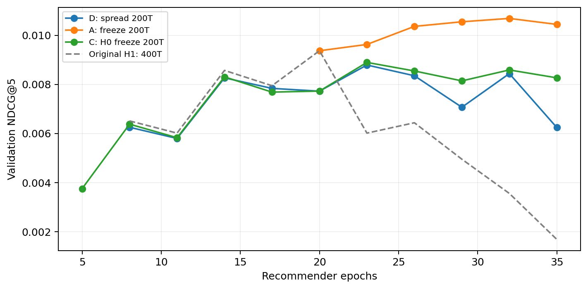
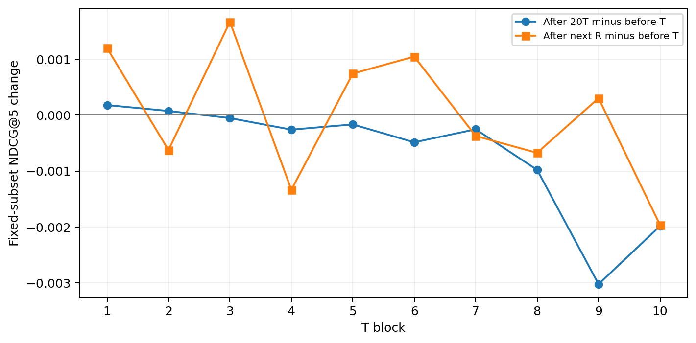
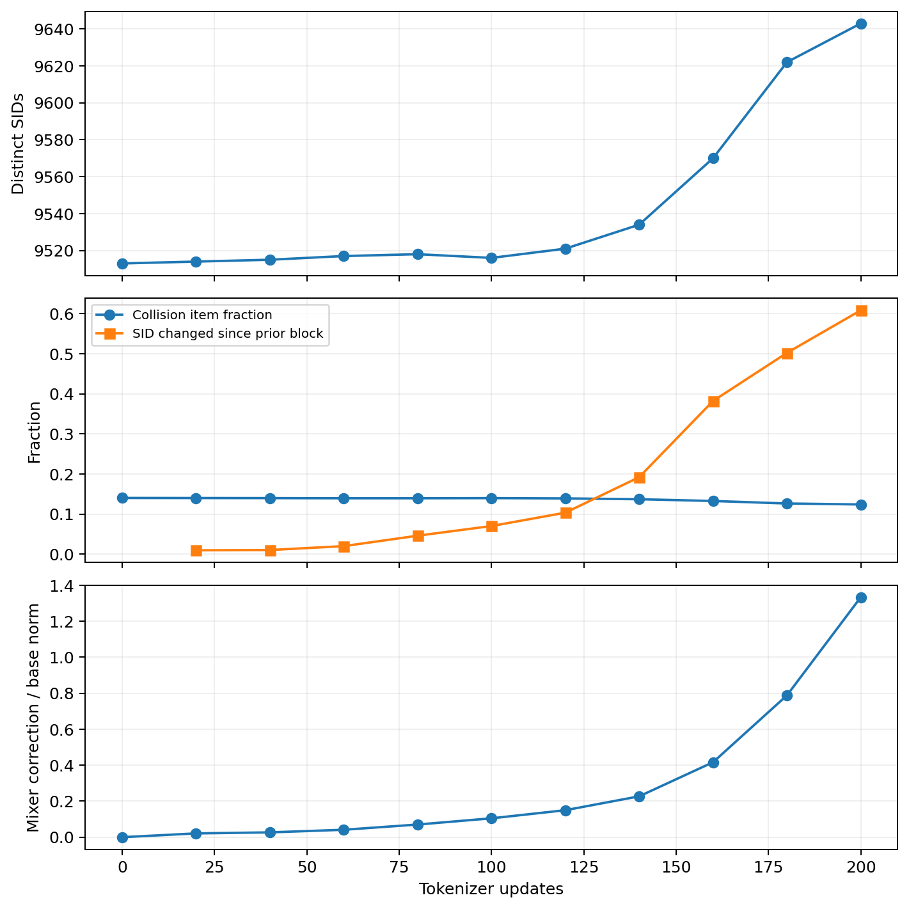
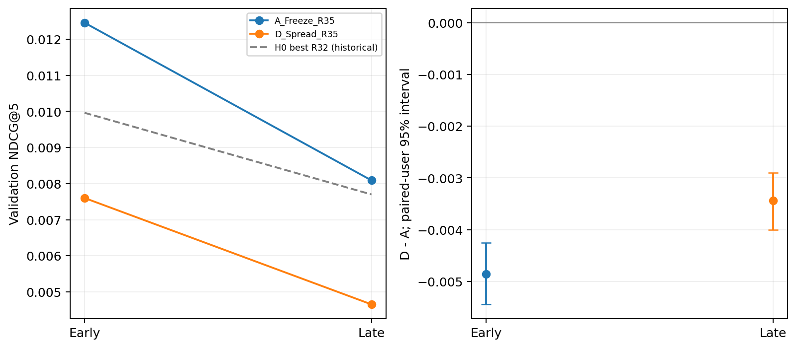

# H1低T预算分散更新实验报告

本次固定终点的D低于冻结对照A，用户重采样区间位于0以下。

本次新增唯一D分支；负结果也按原协议交付，没有据测试结果追加训练。下述区间只反映固定模型在用户样本上的不确定性，不包含训练seed、选模和事后设计的不确定性。

## 实验回答的问题

A与D均到R35/T200。A在前期完成200T后冻结，D把相同有序T样本分成10个20T块，分散到35R。R样本顺序、原35R学习率日程、400T噪声退火时钟、模型、损失和解码规则保持原绑定。后期T仍使用同一训练集，其接收梯度时推荐器已经处于更后期的状态。

因此本次主要考察相同更新预算下的时间安排。它没有实施MEDA式随机重置，也不能单凭本实验认定存在one-epoch overfitting。与原H1/T400的曲线比较同时涉及T总量与安排变化，应作辅助观察。

## 执行中断与恢复

正式作业曾中断，后续从R24第400步的完整checkpoint继续，没有从头重训，也没有把短测更新并入正式轨迹。恢复后将训练与阶段checkpoint上的只读验证放到同一张H100并行执行；模型、损失和解码源码仍使用原冻结版本，科学更新序列和预算口径保持原协议。

最终独立运维审计核对了11个恢复后只读任务：指定checkpoint、完整状态指纹和完成记录绑定一致，验证前后状态相同；首30次真实续跑也保留了原日志前缀及CUDA重放比对证据。运维包SHA为b9f829d07aded961e8508c129fb5af318e71c9bb78a2fc0c5d5ab626ac8b8b09，详情见[独立运维审计](../ASYNC_DELIVERY_AUDIT.json)。这些证据用于核对执行正确性，不代表模型效果提升。

## 固定R35主测试

| 指标 | A：冻结200T | D：分散200T | D−A | 用户聚类95%区间 |
|---|---:|---:|---:|---|
| list/ndcg@5 | 0.00895634 | 0.00552839 | -0.00342796 | [-0.00388395, -0.00297584] |
| list/hr@5 | 0.04171523 | 0.02536000 | -0.01635523 | [-0.01826039, -0.01439521] |
| list/recall@5 | 0.00853856 | 0.00513216 | -0.00340640 | [-0.00380979, -0.00300336] |

主指标的相对差为-38.27%。区间来自既定2000次用户聚类配对bootstrap，估计量仍为样本均值；它不包含跨seed训练不确定性。

HR@5表示五件列表至少命中一个目标；Recall@5按五件目标计算。聚合@10/20/50来自最多32份候选列表按分数和位置去重汇总，不表示单次生成一份50件列表。

| 聚合指标 | A R35 | D R35 | D−A | 用户聚类95%区间 |
|---|---:|---:|---:|---|
| aggregate/ndcg@10 | 0.01198872 | 0.00781059 | -0.00417813 | [-0.00466347, -0.00369330] |
| aggregate/hr@10 | 0.06769560 | 0.04553145 | -0.02216415 | [-0.02452246, -0.01979833] |
| aggregate/recall@10 | 0.01407678 | 0.00930932 | -0.00476745 | [-0.00526926, -0.00427312] |
| aggregate/ndcg@20 | 0.01420923 | 0.00986758 | -0.00434165 | [-0.00484786, -0.00384255] |
| aggregate/hr@20 | 0.09110050 | 0.06765801 | -0.02344249 | [-0.02618043, -0.02075977] |
| aggregate/recall@20 | 0.01921645 | 0.01408430 | -0.00513216 | [-0.00571079, -0.00455333] |
| aggregate/ndcg@50 | 0.01481701 | 0.01040941 | -0.00440760 | [-0.00493679, -0.00389798] |
| aggregate/hr@50 | 0.09845095 | 0.07455728 | -0.02389367 | [-0.02676476, -0.02102825] |
| aggregate/recall@50 | 0.02088957 | 0.01557694 | -0.00531263 | [-0.00593223, -0.00470951] |

| 候选指标（描述性均值） | A R35 | D R35 |
|---|---:|---:|
| aggregate/coverage@10 | 0.996590 | 0.999921 |
| aggregate/coverage@20 | 0.893684 | 0.957701 |
| aggregate/coverage@50 | 0.411625 | 0.482624 |
| aggregate/candidate_count | 20.581269 | 24.131199 |
| aggregate/lists_used | 26.643606 | 30.016938 |

这里的coverage@K是去重候选对K个位置的平均填充比例，不是整个商品目录的覆盖率；candidate_count是最多50位中的不同有效商品数，lists_used是实际用于聚合的完整候选列表数。覆盖表仅作描述，不对其差值附加显著性结论。

## 共同网格best补充

D从R20/23/26/29/32/35按验证NDCG@5选出R23/T120；A已锁best为R32/T200。补充测试NDCG@5差值为-0.00135636，区间[-0.001854786115176182, -0.0008936153203737087]。补充best的R/T预算可能不同，等预算结论依据固定R35。测试只执行固定R35和已锁best，重合时复用。

| 测试指标 | A best R32/T200 | D best R23/T120 | D−A | 用户聚类95%区间 |
|---|---:|---:|---:|---|
| list/ndcg@5 | 0.00943079 | 0.00807444 | -0.00135636 | [-0.00185479, -0.00089362] |
| list/hr@5 | 0.04398992 | 0.03725984 | -0.00673008 | [-0.00882156, -0.00484158] |
| list/recall@5 | 0.00900477 | 0.00762116 | -0.00138361 | [-0.00180914, -0.00097972] |

## Tokenizer扰动与推荐器恢复

固定8192条诊断集共31个状态：20份新子集推理、10份新完整验证的子集提取、1份旧R5提取复用。每个T块记录更新前、20T后、随后第一个R后及周期末；T后相对更新前的NDCG变化范围为[-0.00302182, +0.00017981]，随后第一个R后相对更新前范围为[-0.00196181, +0.00166802]。

曲线描述短期扰动和恢复，不能直接把一次下降等同于编码器退化。SID变化还要结合碰撞、码字使用、有效码本位移和Mixer幅度判断。R阶段Tokenizer状态相同已逐checkpoint核验，因此T前码本可复用上一T后的认证快照；这没有增加模型推理。

| T累计更新 | 该20T块SID改变商品比例 | 碰撞商品比例 | Mixer修正/基础码本范数 |
|---|---:|---:|---:|
| 140 | 19.22% | 13.71% | 0.2271 |
| 160 | 38.23% | 13.27% | 0.4166 |
| 180 | 50.22% | 12.65% | 0.7880 |
| 200 | 60.84% | 12.41% | 1.3337 |

| T块 | T前NDCG@5 | 20T后 | 随后首R后 | 随后三R后 |
|---|---:|---:|---:|---:|
| 9 | 0.00717131 | 0.00414948 | 0.00747479 | 0.00830210 |
| 10 | 0.00830210 | 0.00631891 | 0.00634030 | 0.00583652 |

上表效果来自同一8192条固定诊断集，与完整验证和测试的样本集合不同。第9块之后首个R已恢复到T前水平以上；第10块之后三R结束仍低于T前。不同块的表现不能概括为每次T更新都必然有害。

全目录不同SID数从9513增至9643，碰撞商品比例从14.03%降至12.41%。与此同时，最后20T改变了60.84%商品的SID，最终Mixer修正全局范数约为当时基础码本范数的1.33倍。碰撞减少与推荐性能下降在本次运行中同时出现，不能把码的分散程度直接当作推荐效果。

| 最终码槽 | 已使用码字/总数 | 有效码字数 exp(entropy) | 归一化熵 |
|---|---:|---:|---:|
| 0 | 142/256 | 107.29 | 0.8432 |
| 1 | 109/256 | 82.54 | 0.7959 |
| 2 | 146/256 | 111.84 | 0.8507 |
| 3 | 159/256 | 117.69 | 0.8598 |

已验证的日程事实：T的基础码本/Mixer学习率仍为1e-5/1e-4；R33、R34、R35首步学习率依次为1.878e-05、8.376e-06、2.098e-06，沿用原35R余弦衰减。

解释性猜想：后期SID大幅移动，而R的学习率已经较低，可能使推荐器来不及适应新的编码。过程曲线与这一解释相符，但本实验没有单独操纵学习率、SID移动或收敛速度，不能据此证明该机制，也不能据此确认Tokenizer已经发生过拟合。

## 时间泛化

| 验证时段 | A NDCG@5 | D NDCG@5 | D−A及95%区间 |
|---|---:|---:|---|
| 前段：38644条 | 0.01245804 | 0.00760130 | -0.00485674 [-0.00544362, -0.00425047] |
| 后段：33013条 | 0.00808979 | 0.00465331 | -0.00343648 [-0.00400269, -0.00290071] |

后段减前段的D−A差值变化为+0.00142026，联合用户抽样95%区间为[0.0006638322139960363, 0.002244564970839013]。这表示绝对负差缩小；D在两个时段都低于A，两个区间均低于0。点估计的相对差前段为-38.98%、后段为-42.48%，因此不能将绝对负差缩小解读为D获得了更好的时间泛化。

切点保持1598745441188500微秒，按首目标时间划分；冷暖、head/mid/tail均沿用训练期定义。该切片来自验证集，属于过程诊断，不能替代主测试结论。

旧H0 best R32/T360单列为历史参照，其R/T预算不同。目标组成与组内表现分解只作描述，不能由组内项推断唯一原因；完整分组、推荐集中度及分解闭合证据见[时间分析](../final_temporal/TEMPORAL.json)。静态训练与时间切片结果也不能证明模型适应了线上新到达数据。

## 证据与交付状态

独立指标、逐更新batch与时钟、选模、31个过程状态、SID快照及时间分解的审计已通过，来源SHA保存在各JSON。归档下载、独立解压、真实CPU冷恢复、GPU释放和临时CPU关闭必须另有最终验收收据；本报告生成不代表Goal完成。

本次仅一个seed，且调度设计受到此前H1结果启发。用户bootstrap不覆盖跨seed稳定性或这种事后选择。结果支持到哪一步，应以固定终点、区间和过程证据共同判断。
