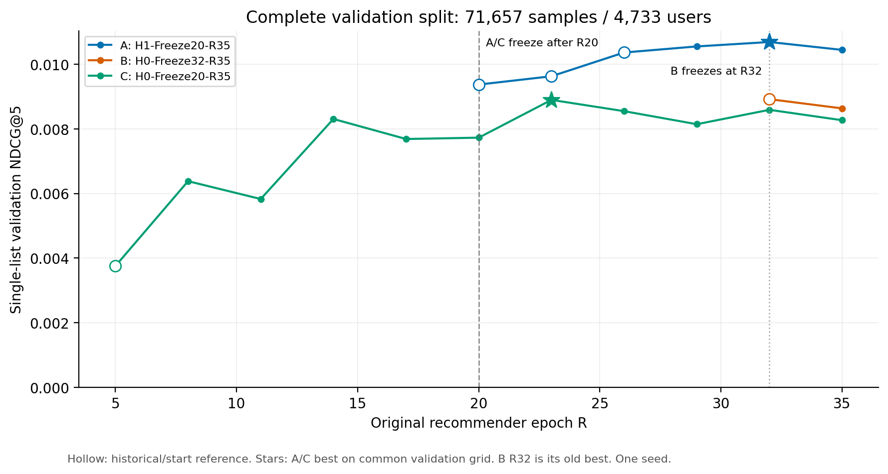
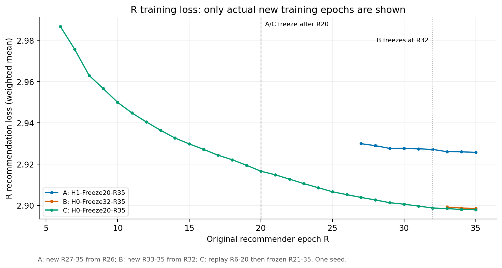
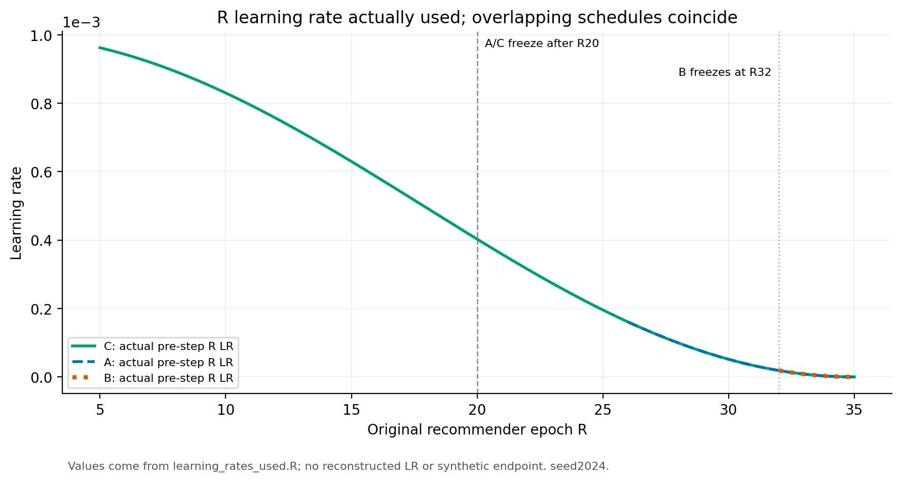

# 第09阶段：三组冻结续训至 R35 的实验结果

2026-10-30。主实验结果与恢复证据汇总草稿；保留历史报告。以下结论基于已经通过的逐样本统计、原用户配对 bootstrap 和恢复审计。最终 Git、后处理交付归档及整个 Goal 的签收由主任务另行完成，本草稿不提前宣告结项。

## 先回答三个实验问题

1. **H1 在 R26 后有继续改善，但没有持续到固定 R35。**完整验证从 R26 的 0.01036453 升到 R32 的 0.01068973，R35 回落到 0.01044555；按原规则 best 为 R32。固定 R35 测试相对 R26 为 −2.19%，用户区间跨零，因此没有固定终点进一步改善的证据；相对旧 H1 R20 则仍提高 12.75%。
2. **统一 R20 冻结、相同 R35/T200 终点下，A 优于 C。**测试 NDCG@5 为 0.00895634 对 0.00825623，差 +0.00070011、相对 +8.48%，95% 用户配对区间 [+0.00025060, +0.00115133]。这是本轮最主要的交互对照结果；它仍是一个 seed、一个此前由 H1 观察启发的冻结方案下的结果，不代表跨 seed 稳定收益。
3. **H0 从自身 best R32 晚期冻结续训到 R35，没有观察到提升，也没有追平 A 的固定 R35。**B 验证下降 3.20%，测试点估计下降 1.74%且区间跨零；A−B 固定 R35 测试差为 +5.91%，区间在零以上。需要保留区别：A 固定 R35 对旧 B R32 的差只有 +4.06%、区间跨零，不能写成已明确胜过旧 H0 best。

## 1. 三组各自回答什么

| 分支 | 起点与实际续训 | 冻结对象/时点 | 本轮新增 R / T updates | 最终 R / T updates | 科学用途 |
|---|---|---|---:|---:|---|
| A：H1-Freeze20-R35 | 已验收 H1 Freeze R26/T200 → R35 | R20 的基础码本、全局 Full Mixer、商品→SID 保持冻结 | 6,237 / 0 | 24,255 / 200 | H1 冻结后是否还能继续改善 |
| B：H0-Freeze32-R35 | 原 H0 best R32/T360 → R35 | R32 冻结基础码本及商品→SID，无 Mixer | 2,079 / 0 | 24,255 / 360 | 从 H0 自身较好状态开始的晚期冻结补充基线 |
| C：H0-Freeze20-R35 | 原 H0 R5/T0 → 重放到 R20/T200 → 冻结至 R35 | R20 冻结基础码本及商品→SID，无 Mixer | 20,790 / 200 | 24,255 / 200 | 与 A 同 R20 冻结、同 R/T 终点的主要对照 |

A/C 比较全局码本交互方案；B 的冻结时点和 T 更新量不同，不把 A−B 直接解释为 Mixer 的因果作用。本轮不混入05阶段噪声试验、07商品内交互或已退役条件编码，也没有新增 seed、Decay、beam 或超 R35 训练。

沿用 KuaiRec 原数据划分、seed 2024、最大历史50件、目标5件、H结构（1层 Encoder+4层 Decoder、hidden256）、原 PSE/损失/优化器。训练 BF16、microbatch256×梯度累积4、有效batch1024；评估 FP32、TF32关闭、beam32、batch32。推荐器保留原35轮/24,255次更新的学习率日程，不重新 warmup，不为续训新建较短日程；B 在 R32 时已处于日程末段。

冻结后不执行 T 优化器更新、不推进 T 噪声时钟；推荐器内部 SID embedding、Encoder、Decoder 继续训练。冻结保留已经学到的编码，不意味着取消该编码机制。

## 2. H1 验证曲线：R32 最好，R35 回落

| R | 验证 NDCG@5 | HR@5 | 聚合 NDCG@50 | NDCG@5 相对 R26 | 相对上一节点 |
|---|---|---|---|---|---|
| 26 | 0.01036453 | 0.04842514 | 0.01532364 | +0.00% | — |
| 29 | 0.01055262 | 0.04864842 | 0.01545730 | +1.81% | +1.81% |
| 32 | 0.01068973 | 0.04898335 | 0.01575312 | +3.14% | +1.30% |
| 35 | 0.01044555 | 0.04737848 | 0.01553180 | +0.78% | -2.28% |

R29/R32 的改善是真实完整验证结果；R35 相对 R32 回落约 2.28%，相对 R26 只剩 +0.78%。R35−R26 验证主指标区间跨零，不能把点估计的小幅正值称为持续改善，也不能由冻结后短期收益推出 Tokenizer 已收敛。

图中只画完整 validation 的单列表 NDCG@5；空心点为历史/起点引用，星号为 A/C 共同节点规则选出的 best。A/C 共同候选为 R20、23、26、29、32、35，按验证 NDCG@5 最大、平局较早轮次选择，最终 A=R32、C=R23。B 只并列父 R32 与固定 R35，不纳入同一种 best 选择。

## 3. 固定 R35：主测试比较

测试集统一为 53,194 条样本、4,153 名用户。主估计是样本均值；bootstrap 按用户成簇，抽中用户时保留其全部样本，2,000 次、seed2024、95%百分位区间。用户等权结果保留在原比较 JSON，不能混作主估计。

| 模型 / 用途 | R / T | 测试 NDCG@5 | HR@5 | Recall@5 | 聚合 NDCG@50 |
|---|---|---|---|---|---|
| A：H1 / R20冻结 | R35 / T200 | 0.00895634 | 0.04171523 | 0.00853856 | 0.01481701 |
| B：H0 / R32冻结 | R35 / T360 | 0.00845692 | 0.03870737 | 0.00801970 | 0.01351617 |
| C：H0 / R20冻结 | R35 / T200 | 0.00825623 | 0.03756063 | 0.00772644 | 0.01338960 |

| 比较（前者 − 后者） | split | NDCG@5 差值 | 相对后者 | 95% 用户配对区间 |
|---|---|---|---|---|
| A R35 − C R35（主比较） | test | +0.00070011 | +8.48% | [+0.00025060, +0.00115133] |
| A R35 − B R35（补充） | test | +0.00049942 | +5.91% | [+0.00005819, +0.00092402] |
| A R35 − C R35 | validation | +0.00217749 | +26.34% | [+0.00178382, +0.00255963] |
| A R35 − B R35 | validation | +0.00181105 | +20.97% | [+0.00141017, +0.00221615] |

固定 R35 的 A−C 不仅 NDCG@5 为正，聚合 NDCG@50 也提高 10.66%，差值 +0.00142741、95%区间 [+0.00094017, +0.00191835]。A−B 聚合 NDCG@50 差 +0.00130083、区间 [+0.00080715, +0.00179663]。完整 HR/Recall/NDCG@10/@20/@50 区间见原配对 JSON，辅助比较未做多重检验校正。

固定终点的聚合指标和实际候选覆盖：

| 分支 | K | 聚合 NDCG | 聚合 HR | 聚合 Recall | 有效候选覆盖 |
|---|---|---|---|---|---|
| A | 10 | 0.01198872 | 0.06769560 | 0.01407678 | 99.66% |
| A | 20 | 0.01420923 | 0.09110050 | 0.01921645 | 89.37% |
| A | 50 | 0.01481701 | 0.09845095 | 0.02088957 | 41.16% |
| B | 10 | 0.01112030 | 0.06166109 | 0.01288491 | 99.88% |
| B | 20 | 0.01305427 | 0.08226492 | 0.01736286 | 87.62% |
| B | 50 | 0.01351617 | 0.08779186 | 0.01862992 | 39.72% |
| C | 10 | 0.01086244 | 0.06015716 | 0.01249013 | 99.90% |
| C | 20 | 0.01288109 | 0.08166335 | 0.01716359 | 87.91% |
| C | 50 | 0.01338960 | 0.08784825 | 0.01855848 | 39.99% |

三组单列表完整率均为100%、重复率与无效率均为0；聚合@50每样本平均有效候选分别为 A 20.58、B 19.86、C 20.00 件。剩余位置是 PAD，不能把@50解释为一次生成了完整50件列表。候选列表分数排序、首次出现去重、碰撞消歧、历史过滤和 PAD 规则保持原样。

## 4. 各自 best 与旧 H0 best：补充结果

| 模型 / 用途 | R / T | 测试 NDCG@5 | HR@5 | Recall@5 | 聚合 NDCG@50 |
|---|---|---|---|---|---|
| A 原共同节点 best | R32 / T200 | 0.00943079 | 0.04398992 | 0.00900477 | 0.01523302 |
| C 原共同节点 best | R23 / T200 | 0.00847090 | 0.03887657 | 0.00794826 | 0.01332600 |
| 旧 H0 best / B父模型 | R32 / T360 | 0.00860706 | 0.03930894 | 0.00810994 | 0.01405766 |

| 比较（前者 − 后者） | split | NDCG@5 差值 | 相对后者 | 95% 用户配对区间 |
|---|---|---|---|---|
| A best R32 − C best R23 | test | +0.00095990 | +11.33% | [+0.00049379, +0.00142174] |
| A best R32 − C best R23 | validation | +0.00179208 | +20.14% | [+0.00138966, +0.00221943] |

测试 best 差为 +11.33%，与固定终点方向一致；但两者 R 更新量是22,176与15,939，相差6,237次，不能称为同训练终点。该补充检查没有替代固定R35主比较。旧B R32单列，未根据A/C的测试结果给B增加轮次或改变冻结点。

## 5. 相对自身起点：改善停在哪里

| 比较（前者 − 后者） | split | NDCG@5 差值 | 相对后者 | 95% 用户配对区间 |
|---|---|---|---|---|
| A R35 − A Freeze R26 | test | -0.00020067 | -2.19% | [-0.00052504, +0.00014152] |
| A R35 − 旧 A R20 | test | +0.00101267 | +12.75% | [+0.00060464, +0.00142931] |
| A R35 − 旧 B R32 | test | +0.00034928 | +4.06% | [-0.00010098, +0.00079313] |
| A R35 − A Freeze R26 | validation | +0.00008101 | +0.78% | [-0.00022092, +0.00038754] |
| B R35 − B父 R32 | test | -0.00015014 | -1.74% | [-0.00035307, +0.00005312] |
| B R35 − B父 R32 | validation | -0.00028531 | -3.20% | [-0.00044408, -0.00012895] |
| C R35 − C重放 R20 | validation | +0.00053992 | +6.99% | [+0.00021351, +0.00084831] |
| C R35 − C原 R5 | validation | +0.00451531 | +120.32% | [+0.00411870, +0.00489115] |

A best R32 的既有补充测试比较也已经完成；下表直接复用先前通过的 CPU 用户配对结果，重新核对来源 SHA，没有新增推理或重新计算这三组区间：

| 比较（前者 − 后者） | split | NDCG@5 差值 | 相对后者 | 95% 用户配对区间 |
|---|---|---|---|---|
| A best R32 − A Freeze R26 | test | +0.00027378 | +2.99% | [-0.00004993, +0.00061020] |
| A best R32 − 旧 A R20 | test | +0.00148712 | +18.72% | [+0.00108660, +0.00189685] |
| A best R32 − 旧 B R32 | test | +0.00082373 | +9.57% | [+0.00039119, +0.00128379] |

A best R32 测试为0.00943079，较Freeze R26提高约2.99%，但其95%区间跨零；相对旧H1 R20与旧H0 best R32则分别提高18.72%和9.57%，对应区间在零以上。该best补充结果与“固定R35对旧H0 best区间跨零”并不矛盾，必须明确引用的是哪一个checkpoint。固定R35相对R26的区间跨零，也不能反向宣称已证明持续恶化。能确定的是：原规则保留了R32这个更好的验证节点，继续到R35并非单调增加收益。复用绑定见 [A best补充比较清单](final_analysis/A/SUPPLEMENTAL_BEST_COMPARISON_BINDING.json)。

B 的晚期冻结没有带来观测到的额外提升；验证下降区间在零以下，测试下降区间跨零。它的新固定R35没有追平A的固定R35，但A固定35对其旧best32仍没有区间排除零的优势，二者必须同时报告。

C 从重放R20到R35的验证提升约6.99%，其最好验证却较早出现在R23；因此不能把H0的冻结后轨迹概括为完全无收益。C起点R5/R20只作验证比较，没有新增未授权起点测试。

## 6. 训练轨迹与 C 重放依据

损失是实际R阶段日志按列表数加权的均值，不混入T目标、不插值缺失节点。不同编码/SID下的损失绝对值不能直接代替商品级推荐质量。较低训练loss与较高验证指标不是同一个判断。

三对分支的重叠区间合计完成10,395次逐点学习率一致性核对（A–C 6,237，B–C 2,079，A–B 2,079）；三组共同覆盖的R更新点为2,079个。图来自各自真实日志，不把短续训改成新的独立日程。具体数值及来源 SHA 见 [曲线来源](final_figures_r1/PLOT_PROVENANCE.json) 和 [训练曲线表](final_figures_r1/TRAINING_CURVES.csv)。

C 确实从原H0 R5/T0完整状态重放五个“40T+3R”周期，没有通过关闭H1 Mixer冒充H0，也没有从H0 R32倒推R20。原方案在启动前固定验证关口：样本身份100%一致、Top5一致率至少99.9%、NDCG@5绝对差不超过1e−6；该容差是工程漂移报警，不是科学等价证明。R8/R11/R14/R17/R20关口均通过；R20的71,657条Top5全部相同、NDCG@5差为0，20个阶段轨迹收据均匹配。

原H0 R20权重已缺失，因此**即使预测/轨迹一致，也不宣称 bitwise 找回旧R20权重**。R20完整状态独立保存并验收后才进入冻结阶段；后续冻结对象和T时钟保持不变。详见 [C R20重放与冻结证据](C_R20_REPLAY_FREEZE_EVIDENCE.json) 与 [冻结后状态抽查](c_frozen_state_spotcheck_20261029/RESULT.json)。

## 7. 冷启动、训练热门与后段收益

授权的独立CPU诊断已补齐五模型，详见 [完整冷启动与热门偏置分析](cold_popularity_audit_20261030/FINAL_REPORT.md) 和 [C补充报告](cold_popularity_audit_20261030/REPORT_C_SUPPLEMENT.md)。它只使用保存的完整验证预测，不改变本节主测试结论。

最关键的结果是：后段未作为训练目标的比例7.71%→12.41%，但相同R32/T200的H1−C前后优势差中，五类目标组成项约只占0.31%，主要变化在训练mid内部。H1后段训练head推荐份额22.42%低于C的27.05%，top10集中度27.74%却高于C的21.96%；“更集中”不能写成“比H0更多推训练热门”。冻结后续训伴随集中度缓解和后段性能恢复，但时间差仍在。这些证据不足以把每用户最后两个session留出作为首要修复或替换原时间划分，本轮未新增此类实验。

## 8. 已通过的保存、恢复与资源证据

- 完整运行包为6,846,443,520字节，SHA256 `9006d8d835ed735bd79bfe382ae362ebc6266ba9c1522bf9a20e6b0dcb399f16`；独立目录解压的3,405份payload逐SHA通过。冻结执行源3,034份文件保持绑定。该包依赖另外已SHA核验的数据、PSE和历史结果，**不是自包含包**，也未捆绑软件环境。
- checkpoint覆盖63个不可覆盖节点+3个last，共66状态，A/B/C分别15/7/44。每个要求R/T边界、起点、验证点、R20边界、最终和best均在清单；[66行覆盖表](final_cpu_restore_r1/CHECKPOINT_COVERAGE.csv) 可逐项核对。
- 原恢复worker对66状态反序列化并检查字段、形状、有限性、计数、SID及RNG；对9个不同文件实际恢复模型、alignment、双优化器、scheduler和CPU随机状态，覆盖10个关键角色。它做了有限的history-only CPU前向及恢复前后状态不变检查；**不是66个模型全部实际重载，也不是CUDA精确续训证明或重新完整评估**。独立复审逐SHA和节点/角色覆盖通过，没有再次反序列化全部状态。CUDA RNG以摘要保留，没有实际恢复CUDA RNG。
- 另有已完成的219秒H100短验收检查真实下一步恢复、冻结隔离和更新连续性；短测与正式起点隔离。最终CPU恢复证据与早期CUDA短验收的范围分开陈述。
- 四个已授权分配（短测+A/B/C）均成功且Pod释放。保守原始调度至同次收尾口径累计 **21.810556 GPU小时**，含短测0.060833小时；低于累计30小时批准值。按记录单价1点/H100小时估算约21.81点，**平台结算尚未核实**。B后续仅控制器的重复终止事件没有新Pod，不扩张GPU时长；剩余预算不是新实验授权。

| 分配 | GPU小时 | 状态 |
|---|---:|---|
| 短验收 | 0.060833 | 已释放 |
| A | 4.925278 | 已释放 |
| B | 1.935556 | 已释放 |
| C | 14.888889 | 已释放 |
| 合计 | 21.810556 | 本轮四项全部释放 |

核验入口：[整包传输](FINAL_TRANSFER_VERIFICATION.json)、[成员/结构核验](FINAL_BACKUP_VERIFICATION.json)、[实际CPU恢复](final_cpu_restore_r1/FULL_MODEL_RESTORE.json)、[独立覆盖复审](final_cpu_restore_r1/INDEPENDENT_REVIEW.json)、[GPU台账](GPU_LEDGER.json)、[资源计时复审](final_lifecycle_r1/ACCOUNTING_REVIEW.md)。

上述归档先于最终分析、恢复收据和本报告生成；这些后处理交付件不能声称已包含在该tar中。最终交付归档/索引、Git提交及Goal验收由主任务随后整合，此草稿不代为确认。

## 9. 证据限制与后续引用

- 本轮支持“在当前单seed和冻结方案下，A在同R35/T200终点优于C”，不支持跨seed稳定或普遍最优的说法。冻结时点R20源于此前H1观察，存在选择局限。
- 用户配对区间衡量当前样本/用户的不确定性，不含训练随机性、选模或冻结点选择不确定性；相同验证集参与选模，补充best不能与固定终点混为一个主协议。
- A−B混合了冻结点和T时钟差异；A best32−C best23混合了R更新量差异。两者有实用参考价值，均不能替代A−C固定35。
- 本轮没有同终点持续更新Tokenizer的反事实；改善不能全归于“冻结”，也不能由SID固定推断表示或Tokenizer已经充分收敛。
- A的旧R23/R26验证summary没有groups，本次保留原字节，复用且重新验证已验收逐样本审计与来源SHA；没有改写历史summary或声称再次执行其全部预测复算。其余新预测与C的13份结果按完整逐样本审计通过。
- H1阶段训练完成、验证节点和测试核验已按原要求提前报告；最终三组比较没有等待C去改变H1或H0的训练和选模。该草稿汇总结果，不覆盖那些历史记录。

原始结果入口：[A独立报告](final_analysis/A/REPORT.md)、[B独立报告](final_analysis/B/REPORT.md)、[C独立报告](final_analysis/C/REPORT.md)、[最终配对比较](final_comparison_r1/analysis_report.json)、[全部主指标/辅助指标CSV](final_comparison_r1/METRICS.csv)、[统计第二实现复核](final_independent_review_r1/INDEPENDENT_REVIEW.json)、[最初Goal范围](GOAL_OBJECTIVE.md)。最终配对报告SHA256为 `ce5f8ecec42a7f73d76d7cf83482cbf8193e2a549e701e06c9097dbca64d8ee2`；第二统计复核已通过，SHA256 `e727cbd3c9030ae1c41798092d496e28cdd8394dd3772d1428fe290a2eaefacc`。
