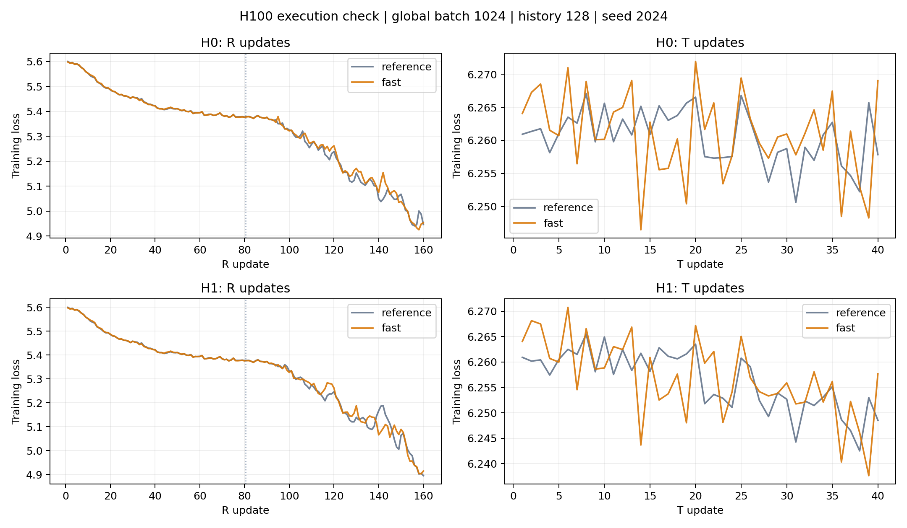

# L5O阶段零：代码、数据与H100短测验收

阶段零已完成：代码和数据检查、H100主短测均通过，GPU作业成功结束，三台本次启用/尝试的临时CPU均已停止。compile候选在240秒内未完成验收，保持关闭。SASRec校准与六卡正式训练均未启动。

## 1. 已完成的修改

- 新建按用户最后五条记录测试、此前五条验证的划分；训练块步长5，history128，保留重复目标记录，不切30分钟会话、不丢600秒跨度块。旧数据不覆盖。
- 统一输出曝光与有效观看Hit/Recall/NDCG，EV主阈值1.0，2.0为敏感性分析；EV指标只平均至少含一个EV目标的用户，IDCG按去重后的相关商品数计算。验证EV-NDCG选点。
- H0/H1的结构、损失、学习率、DIGER-ST、R/T节奏及beam32保持一致；执行端使用GPU常驻静态ID、单个1024 microbatch、每次update统一有限性检查和fused AdamW。
- R单位固定693次优化器更新，R35=24255次R更新，T400；每个R单位保存完整checkpoint并验证，不自动冻结。历史过滤暂沿用False。

新训练预算按更新次数对齐，不是对新数据集遍历35遍；每单位完整batch比旧末批多189个样本，不能声称曝光数逐个相同。

## 2. 数据与本地检查

| 项 | 结果 |
|---|---:|
| 用户 | 7,176 |
| 训练样本 | 2,288,120 |
| 验证 / 测试样本 | 各7,176 |
| 源事件 / 完整核算事件 | 均11,562,802 |
| 无效或歧义事件 | 22 |
| 验证 / 测试含EV用户（阈值1.0） | 5,680 / 5,645 |

本地两次构建的规范化行哈希一致；独立逐记录核对历史、目标、原始事件编号及反馈字段通过。远端源文件39项SHA256通过，远端三个划分的规范化行哈希也与本地一致。

本地两个测试套件分别23项通过、30项通过+1项无CUDA跳过。H100另行完成GPU数值、恢复与解码一致性检查。

## 3. H100训练提速

单张H100 80GB，PyTorch2.6.0+cu118。每组原路径/提速路径各200次更新：80R→40T→80R，共800次主短测更新；每段去掉前5步后统计。原路径microbatch256×4，提速路径1024×1，有效batch均1024。

| 组别 / 阶段 | 原路径 秒/更新 | 提速后 秒/更新 | 提速 | 平均loss相对差 |
|---|---:|---:|---:|---:|
| H0 首次R | 1.099 | 0.389 | 2.82× | 0.0019% |
| H0 T | 1.013 | 0.382 | 2.65× | 0.0006% |
| H0 T之后R | 1.100 | 0.389 | 2.83× | 0.1685% |
| H1 首次R | 1.106 | 0.389 | 2.85× | 0.0019% |
| H1 T | 1.063 | 0.392 | 2.71× | 0.0003% |
| H1 T之后R | 1.113 | 0.388 | 2.87× | 0.0598% |

所有阶段loss均值相对差低于事前5%实用门槛，最大约0.169%。两组都通过保存/加载后下一次GPU更新的模型、优化器及随机状态精确对照。microbatch改变会改变随机数消耗和浮点归约顺序，因此不要求原路径与提速路径逐位一致，也不能用这次短测证明长期训练统计等价。

R阶段平均GPU利用率从约42%–45%提升至95%–96%，T阶段提升至约98%；数据准备从每步约0.27秒降至0.0003秒。提速路径训练峰值allocated显存约34.3GiB，T阶段约24.6GiB。为复用同一输入，参考路径计时期间也保留了未使用的GPU ID缓存；显存数字包括这项共同缓存，不是一个全新原版进程的最小占用。

灰色为原执行方式，橙色为提速路径。R图虚线表示中间经过40次T更新；T图纵轴放大了很小的变化范围，T损失包含辅助约束，不能与R损失的绝对值直接比较。它们是执行短测曲线，不是完整收敛或推荐效果曲线。

## 4. 验证提速与共同设置

同一checkpoint、固定256条验证样本、同beam32，仅改变batch与前沿分数传输方式。

| 组别 | batch4 秒 | batch128 秒 | batch256 秒 | 128/256推荐列表与4一致率 |
|---|---:|---:|---:|---:|
| H0 | 17.667 | 9.528 | 9.727 | 100% / 100% |
| H1 | 17.522 | 9.532 | 9.517 | 100% / 100% |

两组统一采用训练microbatch1024、验证batch128、fused AdamW、GPU静态ID缓存和批量前沿传输；保持确定性算法开启、TF32关闭、compile关闭。128与256速度接近，128共同总耗时略低且验证显存约10.9GiB，256约20.2GiB。

compile日志记录了生成列表时历史长度从128增长至131等形状变化造成的重复编译，并触及Dynamo缓存上限；240秒子测超时退出，未完成性能/恢复验收。这仅说明本次直接编译方式不适合直接采用，不证明其他编译方案无效。所有已报告提速来自非编译配置。

## 5. 耗时与验收边界

本次GPU作业从创建到完成共1,030秒，约17分10秒（包括排队/启动和compile限时尝试），终态SUCCEEDED，实例instance_success。准备CPU最终回读STOPPED，两台备用CPU也已回读STOPPED；失败的HPC申请没有残留作业。共享env-zzl未关闭。最终证据见`FINAL_ACCEPTANCE.json`。

按本次R/T秒数和256条验证吞吐线性外推，单组R35/T400训练约2.66小时，35次全量验证约2.60小时，合计约5.26小时；另留初始化、保存checkpoint、最终测试和机器波动的余量。这不是实跑35轮的承诺时间。H0/H1若各一张卡并行，墙钟时间接近单组，但不包含SASRec、CF或TIGER。

这里验证的是划分实现和执行提速。EV阈值、训练步长等是计划锁定的约定，不是论文公开的全部细节；按用户留五允许其他用户同时期数据进入训练，也与旧全局时间切分不同。SASRec校准尚未执行，不能据此判断已经复现论文或认定历史低分仅由划分造成。

## 6. 版本与证据

- `84b63e9`：数据协议；`10de558`：共同指标；`5fbb1f8`：H0/H1适配和执行优化；`32c9ea5`：有界短测。
- `LOCAL_DATA_AUDIT.json`、`LOCAL_CHECKS.json`、`REMOTE_PREPARED.json`：本地与远端数据/测试证据。
- `SOURCE_MANIFEST.json`、`DEPLOYMENT.json`：源码字节和部署绑定。
- `receipts/COMPLETE.json`、`TIMINGS.csv`、`EXECUTION_ACCEPTANCE.json`：主短测精简收据和派生统计；原始文件哈希与去除预测列表后的哈希均有清单绑定。
- 大数据与短测checkpoint保留远端：`/inspire/hdd/global_user/<inspire-account>/nancy/experiment1_stage09/l5o_stage0_20261117_v1`。
