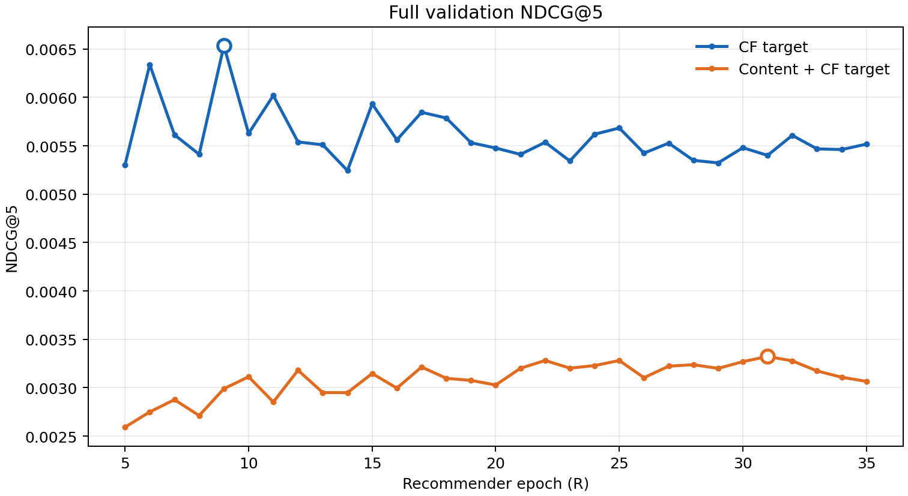
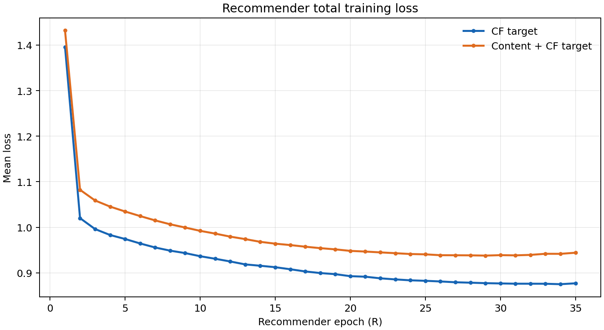
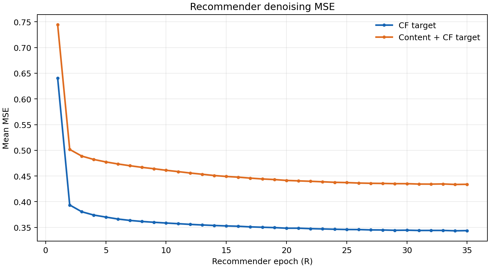
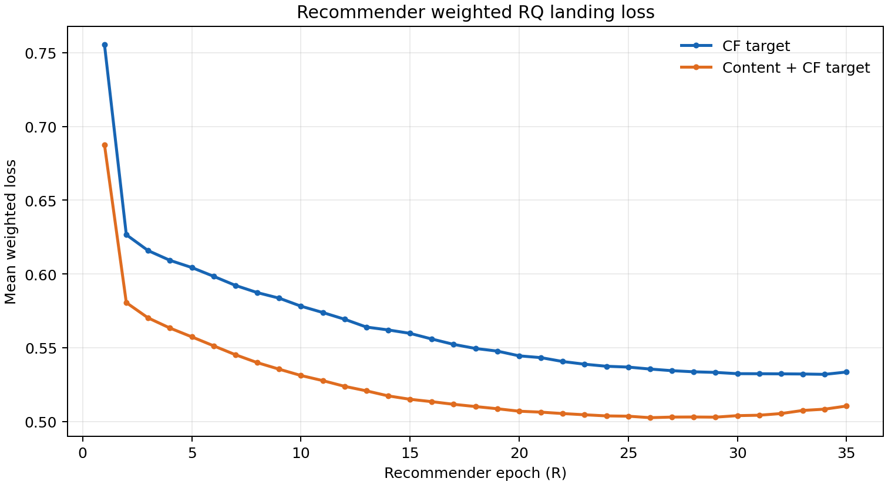
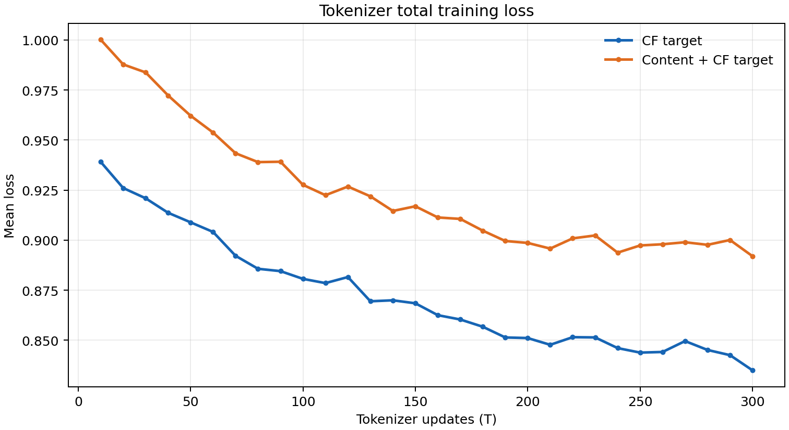
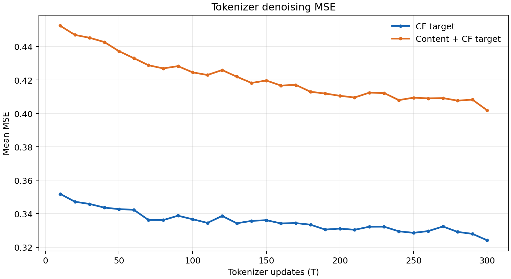
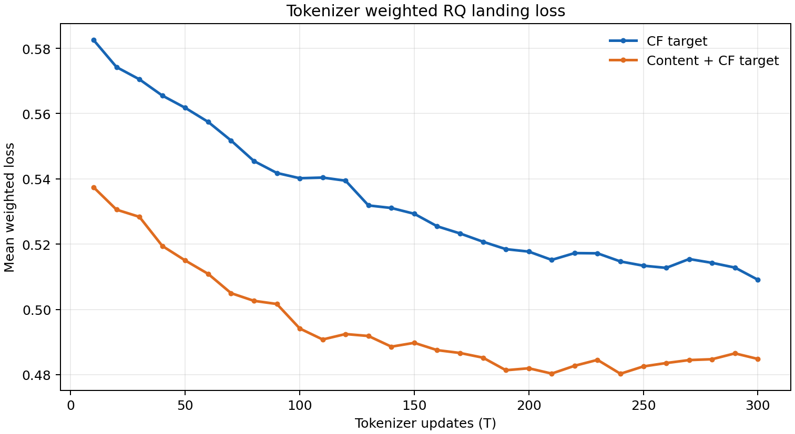
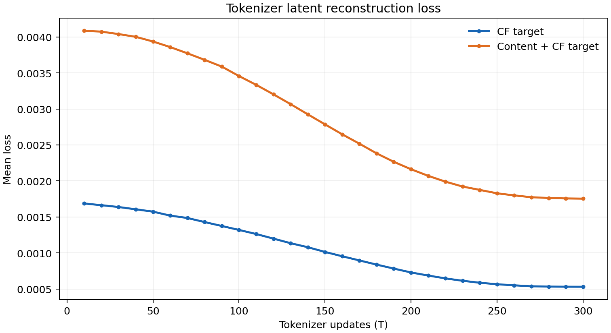
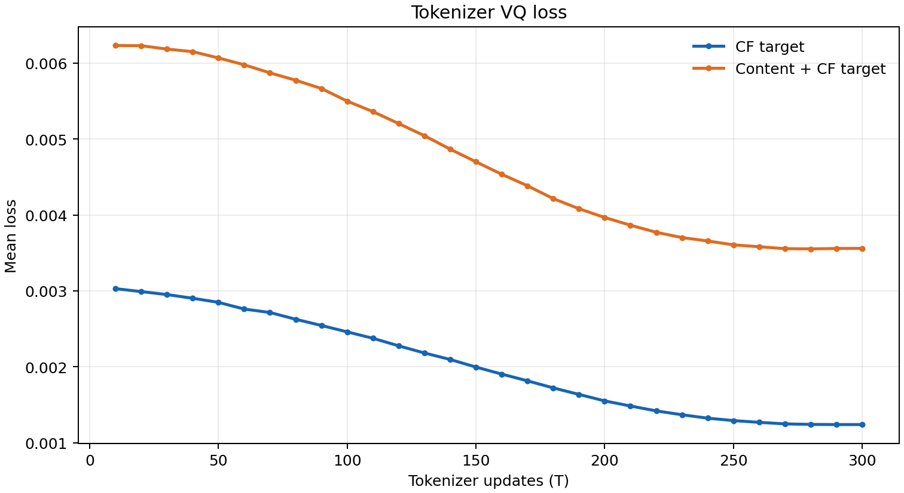
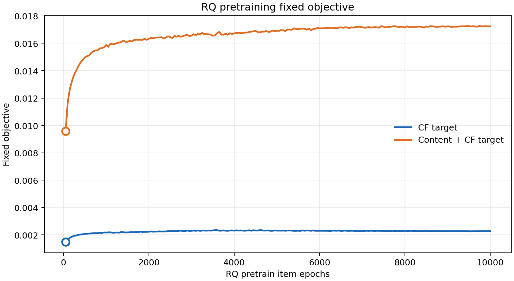

# 两组生成目标实验：训练曲线

数据来自两组已完成作业的 `events.jsonl`；这里只读取日志并作图，没有重新训练或推理。蓝色为纯协同目标（CF），橙色为内容＋协同目标（Hybrid）。联合训练各 35 个 R 轮、300 次 T 更新；图中的实心点是日志节点，空心圈标记所选节点。

## 验证指标

CF 在 R9/T40 达到验证集最高 0.006534，R35/T300 为 0.005518；Hybrid 在 R31/T260 达到最高 0.003323，R35/T300 为 0.003066。CF 全程高于 Hybrid，但其最佳点更早，之后在较低水平波动。两组均没有出现像原 H1 后期那样的持续断崖式下跌。

## 推荐器 R 阶段

训练损失是各 R 轮的均值，横轴为推荐器轮次。两组的去噪 MSE 均持续下降，但验证推荐效果没有同步持续改善；因此不能仅凭训练 loss 判断推荐质量。目标向量定义不同，跨组 loss 绝对值不宜直接解释为某组优化得更好。

## Tokenizer T 阶段

每个点是一个 T block 的平均训练损失，横轴为累计 T 更新次数。两组总损失总体下降；与上面的验证曲线对照，降低训练损失尚未保证指标继续提升。

## RQ 预训练

下图是固定验证目标，不是训练 loss。横轴为预训练日志记录的 item epoch。两组最终都按原验收规则选取 epoch 50；随后固定目标上升，说明不能把“训练越久”当成更好的 RQ 初始化。两组目标定义不同，数值也不直接横比。

作图数据：`CURVE_DATA.json`（只保留上述曲线需要的字段）；生成脚本：`plot_curves.py`。验证 NDCG@5 的 31 个节点逐一与 `FINAL_AUDIT.json` 对齐。
