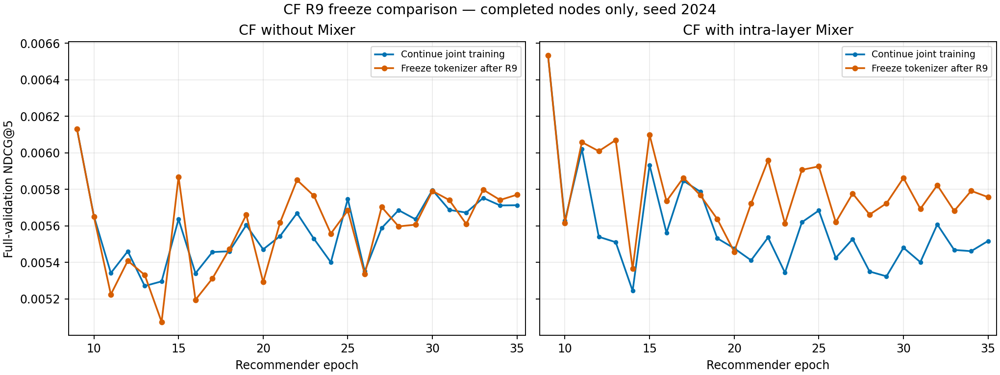

# CF四组最终对照（2026-11-14）

四组均完成训练与best/final全测试。验证71657条，测试53194条，统一报告NDCG@5。单seed；best只由验证集选择。两个冻结分支经用户后续授权，在各自R9/T40完整checkpoint分叉，冻结整个Tokenizer与SID，仅继续推荐器到R35；原组继续交替训练到R35/T300。四组推荐器总更新均24255，冻结分支新增18018次。

## 最佳点与最终点

|组别|best轮次|best验证|best测试|R35验证|R35测试|
|---|---:|---:|---:|---:|---:|
|无Mixer，持续联合|R9|0.006130|0.008246|0.005713|0.006534|
|无Mixer，R9冻结|R9|0.006130|0.008246|0.005771|0.006887|
|有Mixer，持续联合|R9|0.006534|0.008855|0.005518|0.006676|
|有Mixer，R9冻结|R9|0.006534|0.008855|0.005758|0.007739|

## 观察与边界

1. 冻结没有刷新最佳点；四组best均为R9，冻结组best实际继承父checkpoint。
2. 冻结改善末端测试：无Mixer提升5.40%，有Mixer提升15.92%。冻结有Mixer的R35测试高于冻结无Mixer12.36%，但R35验证略低0.23%，不能只凭验证末端判定Mixer无效。
3. 这支持继续区分“最佳成绩”与“后期保留效果”，不证明机制，也不构成跨seed显著性结论。
4. 有/无Mixer各自冻结对照改变了T更新预算，回答的是冻结策略的整体收益，不能拆分为SID稳定与其他Tokenizer参数稳定的独立因果作用。

## 逐轮完整验证

粗体为每行最高值；R5–R8冻结分支尚未建立，R9为共同父节点。

|轮次|原无Mixer|原有Mixer|冻结无Mixer|冻结有Mixer|
|---|---:|---:|---:|---:|
|R5|**0.005332**|0.005305|—|—|
|R6|0.005544|**0.006339**|—|—|
|R7|**0.005724**|0.005614|—|—|
|R8|0.005185|**0.005412**|—|—|
|R9|0.006130|**0.006534**|0.006130|**0.006534**|
|R10|**0.005653**|0.005628|0.005650|0.005615|
|R11|0.005342|0.006020|0.005224|**0.006058**|
|R12|0.005461|0.005540|0.005409|**0.006009**|
|R13|0.005271|0.005511|0.005332|**0.006070**|
|R14|0.005296|0.005244|0.005074|**0.005365**|
|R15|0.005637|0.005933|0.005868|**0.006099**|
|R16|0.005340|0.005562|0.005195|**0.005735**|
|R17|0.005457|0.005847|0.005312|**0.005864**|
|R18|0.005461|**0.005787**|0.005472|0.005767|
|R19|0.005604|0.005532|**0.005660**|0.005637|
|R20|0.005471|**0.005477**|0.005292|0.005459|
|R21|0.005544|0.005411|0.005619|**0.005722**|
|R22|0.005670|0.005537|0.005851|**0.005959**|
|R23|0.005529|0.005344|**0.005765**|0.005613|
|R24|0.005401|0.005620|0.005558|**0.005907**|
|R25|0.005747|0.005684|0.005684|**0.005926**|
|R26|0.005351|0.005425|0.005336|**0.005620**|
|R27|0.005588|0.005528|0.005703|**0.005777**|
|R28|**0.005686**|0.005350|0.005597|0.005662|
|R29|0.005636|0.005324|0.005607|**0.005724**|
|R30|0.005796|0.005480|0.005791|**0.005862**|
|R31|0.005687|0.005401|**0.005741**|0.005693|
|R32|0.005673|0.005608|0.005610|**0.005823**|
|R33|0.005753|0.005468|**0.005798**|0.005682|
|R34|0.005712|0.005461|0.005742|**0.005792**|
|R35|0.005713|0.005518|**0.005771**|0.005758|

## 验收与来源

两个冻结分支各26个新增节点均通过CPU完整状态、SHA、配置/来源绑定、优化器/数据流计数、冻结状态等同性、best选择及测试预测SHA检查；原始R9父节点及GPU恢复证据见STARTUP_RECEIPT.json、START_FREEZE_AUDIT.json。中间节点不是逐个CUDA数值恢复，不能扩大该验收范围。

两项GPU作业均SUCCEEDED且唯一worker为instance_success。大权重与预测文件仍在远端；本地只存小型回执及曲线。CPU通道仍供未完成DIGER作业使用，未关闭。

数据：原组 ../five_arm_20261113_v1/CF_INTERIM_COMPARISON.json、CF_TEST_COMPLETE.json、CF_M1_REFERENCE_SUMMARY.json；冻结组 nodes/、M0_TEST_COMPLETE.json、M1_TEST_COMPLETE.json、M0_FINAL_CPU_AUDIT.json、M1_FINAL_CPU_AUDIT.json、M0_CLOSURE_RECEIPT.json、M1_CLOSURE_RECEIPT.json。

本报告仅完成CF子任务。DIGER未完成，TIGER有Mixer原配置失败后的处置仍待决定；不代表整个五组Goal验收通过。
